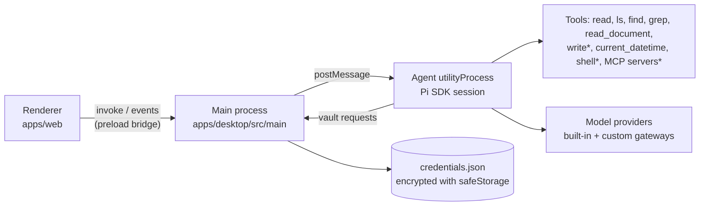

# PP Agent

Desktop chat agent for business teams. Non-technical users chat with it; models, tools, skills, and business systems are managed in the app's Settings.

Full documentation (architecture, codebase, code standards, product requirements) starts at [docs/SUMMARY.md](docs/SUMMARY.md).

## Stack

| Layer                  | Choice                                                                                                                                        |
| ---------------------- | --------------------------------------------------------------------------------------------------------------------------------------------- |
| Monorepo and toolchain | [Vite+](https://viteplus.dev) (`vp`) with pnpm workspaces and catalogs                                                                        |
| Desktop shell          | Electron, packaged with electron-builder                                                                                                      |
| Agent engine           | [Pi SDK](https://github.com/earendil-works/pi) (`@earendil-works/pi-coding-agent`), running in an Electron `utilityProcess`                   |
| UI                     | React 19, shadcn/ui (Base UI, preset `b6u0ULvrE`), [AI Elements](https://ui.shadcn.com/docs/ai-elements) patterns, Streamdown                 |
| Renderer state         | Zustand (agent stream), TanStack Query (settings, model list, commands), [better-modal](https://github.com/buiducnhat/better-modal) (dialogs) |

## Layout

```
apps/
  desktop/   Electron main, preload, and the agent utility process (built with `vp pack`)
  web/       Renderer: React app (built with `vp build`)
packages/
  shared/    IPC contract shared by all three processes
  ui/        shadcn/ui components (@workspace/ui)
```



\* What a tool does is set per tool in **Settings › Tools** (`apps/desktop/src/agent/tools.ts`): `auto` (read-only tools run freely, the rest ask), `ask`, `allow`, or `off`. By default `write`, MCP tools not marked read-only, and any tool without a tier ask before they run; in-place `edit` is off. The shell (bash, or PowerShell on Windows) is off until **Settings › Tools** turns it on, and then every command still asks.

## Features

- **Chat history:** the sidebar lists saved conversations by date; open, rename, or delete them. Each conversation is a Pi session file.
- **Agents:** profiles with their own rules, icon, description, tools, MCP servers, skills, model, starter prompts, and workspace folder, managed in **Settings › Agents** and exported or imported as `.json` files. Pick one in the top bar; you can switch mid-conversation, and each conversation remembers its agent (new chats use the one picked last). Settings › Tools still applies on top of an agent's tool list. The built-in "PP Agent" can be edited but not deleted.
- **Attachments:** attach files from the **+** menu, by dropping them on the chat, or by pasting images. Images go to the model directly; other files are copied into `<workspace>/attachments/` and the agent reads them from there.
- **Documents:** the `read_document` tool turns PDF, DOCX, XLSX, PPTX, ODF, RTF, EPUB, HTML, and CSV into Markdown ([officeparser](https://github.com/harshankur/officeParser)).
- **Models:** sign in to any of Pi's built-in providers (Anthropic, OpenAI, Google, OpenRouter, …) with an API key, or add custom gateways (OpenAI- or Anthropic-compatible endpoints, with a model list fetched from the gateway). Pick the model per conversation under the message box; new chats use the default model from Settings.
- **Thinking:** for models that can reason, the message box offers a thinking level (off, minimal, low, medium, high, …, as the model allows). Each conversation keeps its own level; new chats start with the last one picked. Gateway models need the reasoning toggle in their gateway settings.
- **Message box:** the top bar picks the agent; under the message box sit the **+** menu (attach files, use a skill, run a command), the model, and the thinking level. Typing `/` suggests commands (`/new`, `/compact` to summarize a long chat) and the skills the current agent may use; arrows and Enter or Tab pick one, Escape hides the list.
- **Skills:** import [Agent Skills](https://agentskills.io) from a folder or a `.zip`/`.skill` archive, write or edit them in the app, and turn them on or off. Use one with `/skill:<name>` in the chat; the agent also loads them on its own unless a skill is set to run only when asked.
- **Business systems:** MCP servers become agent tools. **Settings › MCP servers** adds, edits, and removes servers, turns them on or off, shows their status, reconnects them, and signs in to servers that use OAuth. Paste a configuration from Claude Desktop or Cursor in its JSON editor.

## Getting started

Requires the [Vite+ CLI](https://viteplus.dev/guide/) (it manages Node and pnpm).

```bash
vp install
vp run dev      # renderer dev server + Electron
```

On first launch, open **Settings › Models** and either sign in to a built-in provider or add a gateway (URL, API key, models). Every key is encrypted with the OS keychain and only ever handed to the agent process. A single gateway saved by an earlier version (`provider.json`) is moved into the new settings on first start.

The agent works in `~/Documents/PP Agent`. `<user-data>` is `~/Library/Application Support/PP Agent` on macOS and `%APPDATA%\PP Agent` on Windows.

## Configuration

Everything is edited in **Settings**; the files live under `<user-data>`:

| File                           | Contents                                                                                                                                                           |
| ------------------------------ | ------------------------------------------------------------------------------------------------------------------------------------------------------------------ |
| `settings.json`                | Default model, shell on/off, tool policies, disabled skills, gateways (name, API, URL, models), agents, and the agent for new chats. Written by the agent process. |
| `credentials.json`             | API keys of providers and gateways, each encrypted with the OS keychain (Electron `safeStorage`). Only the main process decrypts it.                               |
| `agent/mcp.json`               | MCP servers, in the `mcpServers` format of Claude Desktop and Cursor. Keys the app does not edit (`oauth`, `toolExposure`, …) are kept.                            |
| `agent/mcp-auth.json`          | OAuth tokens of MCP servers you signed in to.                                                                                                                      |
| `agent/skills/<name>/SKILL.md` | Installed skills. Only skills in this folder are used.                                                                                                             |
| `sessions/`                    | Saved conversations (Pi session files, JSONL).                                                                                                                     |

Changes apply to the open conversation without losing it; if the agent is busy, they apply when it finishes.

## Commands

| Command           | What it does                                                                                |
| ----------------- | ------------------------------------------------------------------------------------------- |
| `vp run dev`      | Start the renderer dev server and Electron (restart Electron to pick up main/agent changes) |
| `vp check`        | Format, lint, and type-check the whole workspace                                            |
| `vp run -r build` | Build the renderer and the Electron bundles                                                 |
| `vp run dist`     | Build everything and package installers into `apps/desktop/release`                         |

## Extending

- **Business systems (MCP):** add servers in **Settings › MCP servers**, or deploy `<user-data>/agent/mcp.json` (same format as Claude Desktop / Cursor). A conversation connects only the servers its agent uses; they connect when the chat starts and reconnect when their settings change.

  ```json
  {
    "mcpServers": {
      "crm": {
        "url": "https://crm.example.com/mcp",
        "headers": { "Authorization": "Bearer ${CRM_TOKEN}" },
        "exposure": "direct",
        "description": "Customer records and deals"
      }
    }
  }
  ```

  `exposure: "direct"` declares the tools to the model; the default (`codemode`) lets the model call them from a sandboxed script, which suits large servers. Tools whose server marks them `readOnlyHint` run freely under the `auto` policy; all others ask first. HTTP servers without an `Authorization` header can sign in with OAuth from Settings. See Pi's [MCP docs](https://github.com/earendil-works/pi/blob/main/packages/coding-agent/docs/mcp.md) for `toolExposure` and more.

- **Tools:** add a `defineTool(...)` in `apps/desktop/src/agent/` and register it in `customTools` (`apps/desktop/src/agent/index.ts`); give it a tier in `TIERS` (`apps/desktop/src/agent/tools.ts`), and add it to `MANAGED_TOOLS` and `AGENT_TOOLS` (plus a label in `apps/desktop/src/agent/agents.ts`) so agents can be limited to it. Tools without a tier default to `exec` and ask for approval under the `auto` policy.
- **Skills:** import them in **Settings › Skills**, or drop [Agent Skills](https://agentskills.io) folders into `<user-data>/agent/skills/`. Skill names use lowercase letters, digits, and hyphens.
- **Workspace instructions:** an `AGENTS.md` in the conversation's workspace folder (the agent's folder, or the default `Documents/PP Agent`) is added to the system prompt.
- **UI patterns:** more AI Elements patterns (Plan, Queue, Sources, …) are at https://ui.shadcn.com/docs/ai-elements; add their components with `pnpm dlx shadcn@latest add <name>` from `apps/web`.

## Notes

- Dependencies track the newest releases: versions live in the `pnpm-workspace.yaml` catalog, and `minimumReleaseAge: 0` turns off pnpm's default release-age delay. Delete that line to get the supply-chain delay back.
- The packaged renderer ships with a strict Content-Security-Policy and has no network access; all I/O goes through the preload bridge.
