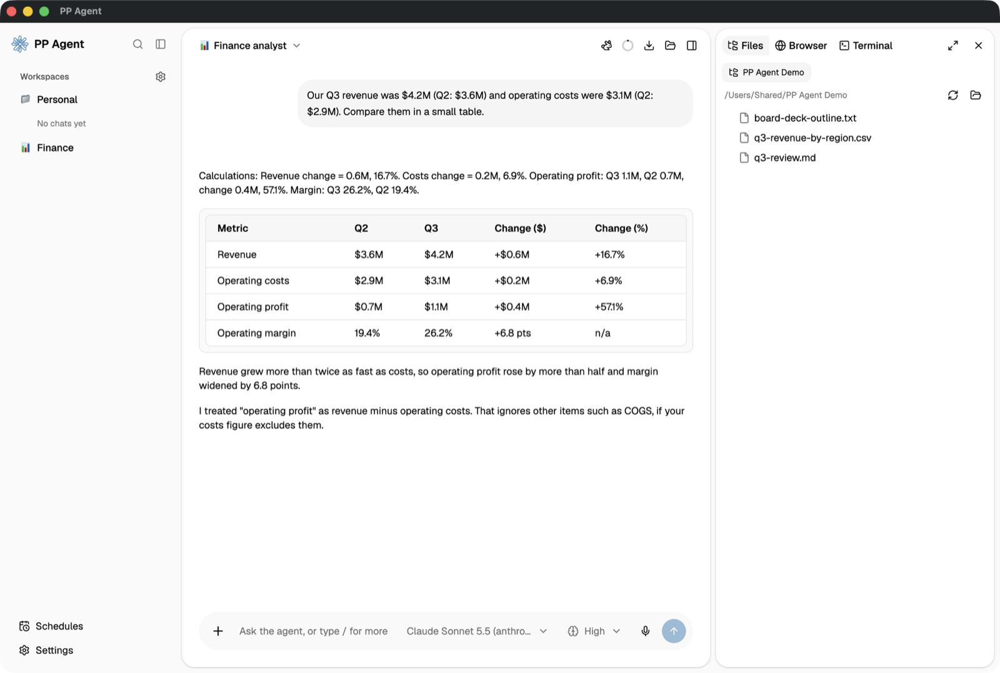
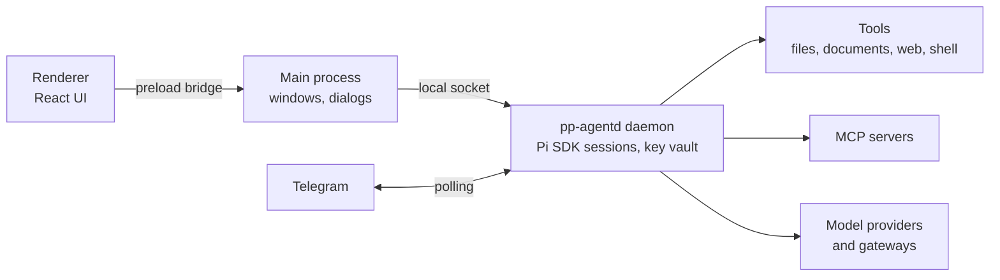

<div align="center">

# PP Agent

**A desktop AI agent for business teams.**
Chat with your documents, work with your business systems through MCP, and switch between agents built for each kind of work, with an approval step before anything changes.

[](https://github.com/pp-techs/pp-agent/actions/workflows/ci.yml)
[](https://github.com/pp-techs/pp-agent/releases/latest)
[](LICENSE)

[Download](#install) · [Features](#features) · [Documentation](docs/SUMMARY.md) · [Contributing](CONTRIBUTING.md)



</div>

## Why PP Agent

Coding agents are powerful but built for developers. PP Agent puts the same engine, the [Pi SDK](https://github.com/earendil-works/pi), behind an interface that people in finance, sales, operations, or HR can use: plain-language settings, no terminal, and nothing that writes a file or calls a business system without asking first. A tech team sets up the models, tools, and connections once, then everyone works through ready-made agents.

## Features

- **Chat with documents.** Attach or drop files and paste images. The agent reads PDF, Word, Excel, PowerPoint, OpenDocument, RTF, EPUB, HTML, and CSV.
- **Side panel.** A panel beside the chat (Cmd+J / Ctrl+J) with a **Terminal** in the workspace folder, a **Files** browser with previews and attach-to-message, and a **Browser** with separate sign-in profiles; import cookies from Chrome, Edge, Brave, Arc, Chromium, or Firefox to stay signed in.
- **Browser and desktop apps.** The agent can fill in forms, check dashboards, and collect information in the side-panel browser, and on macOS and Windows it can use desktop apps (**Settings › Computer use**). Looking runs freely; clicking and typing ask first, and PP Agent itself, terminals, and password settings are always off limits.
- **Long tasks.** `/goal` keeps the agent working turn after turn until the goal is done, with a banner to pause, resume, or clear it. It can also hand up to five read-only research tasks to sub agents that work at the same time. Its checklist stays pinned above the message box.
- **Web search.** The agent can search the web and read pages, PDFs, and Office files from the internet. Pick and order the search services in **Settings › Tools › Web search**: SearXNG (self-hosted), Serper, Tavily, Brave Search, Exa, webclaw, or DuckDuckGo; it falls back to the next one when a service fails. It also works with no setup at all: without a key it uses Exa and DuckDuckGo, after any service you set up. Pages on private networks are never opened.
- **Agents.** Profiles with their own rules, icon, tools, MCP servers, skills, model, starter prompts, and workspace folder. Switch mid-conversation; share them as `.json` files.
- **Any model.** Sign in to Pi's built-in providers (Anthropic, OpenAI, Google, OpenRouter, Mistral, Groq, and more) with an API key, or add your own OpenAI- or Anthropic-compatible gateways. Choose the model and thinking level per conversation.
- **Business systems through MCP.** Add, edit, and monitor [MCP](https://modelcontextprotocol.io) servers in Settings, including OAuth sign-in. Paste configurations from Claude Desktop or Cursor.
- **Approvals you control.** Read-only actions run freely; saving files, shell commands, and actions that change data in your systems ask first. Each tool can be set to automatic, always ask, always allow, or off. Shell commands are off by default and can be set to run without asking, after a confirmation and with a standing warning in Settings. `/yolo` (or **Settings › Tools**) skips the approval step for everything already allowed.
- **Create and edit Office files.** The agent builds and changes Word, Excel, and PowerPoint files in your workspace with the bundled [OfficeCLI](https://github.com/iOfficeAI/OfficeCLI); saving asks first.
- **Chat history.** Search past chats, pin them, export to Markdown or HTML, copy, edit and resend a message, regenerate an answer, branch a chat, and see token use and estimated cost.
- **Memory, checklists, helpers.** The agent keeps notes between chats (view and edit them in **Settings › Memory**), tracks multi-step work in a checklist, and hands research to a read-only helper.
- **Scheduled tasks.** Run a prompt daily, weekly, or at an interval; each run is saved as a chat. Actions that need approval are skipped, since nobody is there to approve them.
- **Voice input.** Dictate into the message box: a whisper model on your own computer, or a speech-to-text service you choose.
- **Background and Telegram.** **Settings › Background** keeps the agent running after you close or quit the app (it starts when you sign in), and **Settings › Channels** lets you chat with it from Telegram or Zalo: pair your account with a one-time code, and approvals are asked in the chat. Scheduled tasks keep running too.
- **Desktop.** Notifications when an answer is ready, an optional tray icon, and a global shortcut.
- **Languages.** English and Tiếng Việt, chosen in **Settings › General** or following your system language. Errors, approvals, and dialogs are translated too.
- **Skills.** Import [Agent Skills](https://agentskills.io), write your own in the app, and invoke them with `/skill:<name>`. Slash commands `/new` and `/compact` keep long chats manageable.
- **Private by design.** API keys (model providers, search services, and the Telegram and Zalo bot tokens) are encrypted with a master key kept in your operating system's keychain; conversations and files stay on your computer except what you send to the providers, search services, and MCP servers you configure. Search queries go to the search service you choose.

## Install

Download the installer for your system from the [latest release](https://github.com/pp-techs/pp-agent/releases/latest):

| System                | File                                                        |
| --------------------- | ----------------------------------------------------------- |
| macOS (Apple silicon) | `pp-agent-<version>-mac-arm64.dmg`                          |
| macOS (Intel)         | `pp-agent-<version>-mac-x64.dmg`                            |
| Windows               | `pp-agent-<version>-win-x64.exe`                            |
| Linux                 | `pp-agent-<version>-linux-x86_64.AppImage` or `…-amd64.deb` |

Each release lists SHA-256 checksums in `SHA256SUMS.txt`.

The app checks for new versions on start and under **Settings → General → Updates**. Windows, Linux (AppImage), and macOS builds signed with a Developer ID install updates from inside the app; with the `.deb` it opens the download page.

> [!NOTE]
> macOS releases are signed with a Developer ID and notarized, and Windows releases are signed, only when the maintainers have configured certificates. Unsigned builds still show warnings:
> On macOS, if the app "is damaged" or "cannot be opened", run `xattr -dr com.apple.quarantine "/Applications/PP Agent.app"` once.
> On Windows, choose **More info → Run anyway** in SmartScreen.

## Getting started

1. Open **Settings › Models** and connect a provider with your API key, or add your team's gateway (URL, key, models).
2. Optionally add business systems in **Settings › MCP servers** and create agents in **Settings › Agents**.
3. Pick an agent in the top bar and start chatting. Type `/` for commands and skills.

The agent works in `~/Documents/PP Agent` unless an agent has its own folder. Settings, encrypted keys, skills, MCP configuration, and conversations live in the app's data folder (`~/Library/Application Support/PP Agent` on macOS, `%APPDATA%\PP Agent` on Windows, `~/.config/PP Agent` on Linux); see [Data storage](docs/architecture/data-storage.md).

## How it works



The agent runs in a separate background process (`pp-agentd`) so a slow tool never freezes the window and the agent can outlive it; every tool call passes an approval gate. Read more in the [architecture docs](docs/SUMMARY.md#architecture).

### Running the daemon without the app

The desktop app starts the daemon itself. To run it on its own (for example on a server), build with `vp pack` in `apps/desktop` and use:

```sh
node apps/desktop/dist/daemon.mjs run         # foreground; PP_AGENT_HOME picks the data folder
node apps/desktop/dist/daemon.mjs install     # start at login (launchd, systemd user unit, Task Scheduler)
node apps/desktop/dist/daemon.mjs status
node apps/desktop/dist/daemon.mjs uninstall
```

Telegram is set up in **Settings › Channels › Telegram**: paste the token from @BotFather, turn it on, press **Pair**, and send `/pair CODE` to the bot. Only the paired account is answered. Set `PP_AGENT_MASTER_KEY` (32 bytes, hex or base64) to keep the vault key out of the keychain, e.g. in Docker.

## Development

Requires the [Vite+ CLI](https://viteplus.dev/guide/) (`vp`), which manages Node.js and pnpm.

```bash
git clone https://github.com/pp-techs/pp-agent.git
cd pp-agent
vp install
vp run dev
```

| Command            | What it does                                                                 |
| ------------------ | ---------------------------------------------------------------------------- |
| `vp run dev`       | Renderer dev server and Electron (restart Electron after main/agent changes) |
| `vp check`         | Format, lint, and type-check the workspace                                   |
| `vp run -r build`  | Build the renderer and the Electron bundles                                  |
| `vp run dist`      | Package installers for the current system into `apps/desktop/release`        |
| `vp run changeset` | Describe a change for the next release                                       |

The repository is a pnpm monorepo: `apps/desktop` (Electron main, preload, and agent process), `apps/web` (React renderer), `packages/shared` (the cross-process contract), and `packages/ui` (shadcn/ui components). Start with [docs/SUMMARY.md](docs/SUMMARY.md) for architecture, codebase, and coding standards.

## Releases

Versions follow [Semantic Versioning](https://semver.org). Changes are recorded with [Changesets](https://github.com/changesets/changesets); merging the release pull request on `main` builds installers for every platform and publishes a GitHub Release. See [CHANGELOG.md](CHANGELOG.md) and the [release process](docs/code-standard/release-process.md).

## Contributing

Contributions are welcome. Read [CONTRIBUTING.md](CONTRIBUTING.md) before opening a pull request, and report vulnerabilities privately as described in [SECURITY.md](SECURITY.md).

## License

Copyright 2026 PP Techs. Licensed under the [Apache License 2.0](LICENSE); see [NOTICE](NOTICE).
