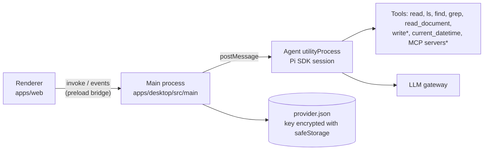

# PP Agent

Desktop chat agent for business teams. Non-technical users chat with it; the tech team controls the model gateway, tools, and skills.

## Stack

| Layer                  | Choice                                                                                                                                        |
| ---------------------- | --------------------------------------------------------------------------------------------------------------------------------------------- |
| Monorepo and toolchain | [Vite+](https://viteplus.dev) (`vp`) with pnpm workspaces and catalogs                                                                        |
| Desktop shell          | Electron, packaged with electron-builder                                                                                                      |
| Agent engine           | [Pi SDK](https://github.com/earendil-works/pi) (`@earendil-works/pi-coding-agent`), running in an Electron `utilityProcess`                   |
| UI                     | React 19, shadcn/ui (Base UI, preset `b6u0ULvrE`), [AI Elements](https://ui.shadcn.com/docs/ai-elements) patterns, Streamdown                 |
| Renderer state         | Zustand (agent stream), TanStack Query (settings, model list, commands), [better-modal](https://github.com/buiducnhat/better-modal) (dialogs) |

## Layout

```
apps/
  desktop/   Electron main, preload, and the agent utility process (built with `vp pack`)
  web/       Renderer: React app (built with `vp build`)
packages/
  shared/    IPC contract shared by all three processes
  ui/        shadcn/ui components (@workspace/ui)
```



\* `write`, MCP tools not marked read-only, and any tool without a tier ask the user before they run (omp-style read/write/exec tiers, `apps/desktop/src/agent/tools.ts`). The shell and in-place edit tools are blocked outright.

## Features

- **Chat history:** the sidebar lists saved conversations by date; open, rename, or delete them. Each conversation is a Pi session file.
- **Attachments:** attach files with the paperclip, by dropping them on the chat, or by pasting images. Images go to the model directly; other files are copied into `<workspace>/attachments/` and the agent reads them from there.
- **Documents:** the `read_document` tool turns PDF, DOCX, XLSX, PPTX, ODF, RTF, EPUB, HTML, and CSV into Markdown ([officeparser](https://github.com/harshankur/officeParser)).
- **Business systems:** MCP servers listed in `<user-data>/agent/mcp.json` become agent tools (see below). **Tools and connections** in the sidebar shows what is connected.

## Getting started

Requires the [Vite+ CLI](https://viteplus.dev/guide/) (it manages Node and pnpm).

```bash
vp install
vp run dev      # renderer dev server + Electron
```

On first launch, open **Settings** and enter the gateway URL (any OpenAI-compatible or Anthropic endpoint), the API key, and a model. The key is encrypted with the OS keychain and only ever handed to the agent process.

The agent works in `~/Documents/PP Agent`. Sessions are saved as JSONL under the app's user-data folder (`sessions/`). `<user-data>` is `~/Library/Application Support/PP Agent` on macOS and `%APPDATA%\PP Agent` on Windows.

## Commands

| Command           | What it does                                                                                |
| ----------------- | ------------------------------------------------------------------------------------------- |
| `vp run dev`      | Start the renderer dev server and Electron (restart Electron to pick up main/agent changes) |
| `vp check`        | Format, lint, and type-check the whole workspace                                            |
| `vp run -r build` | Build the renderer and the Electron bundles                                                 |
| `vp run dist`     | Build everything and package installers into `apps/desktop/release`                         |

## Extending

- **Business systems (MCP):** the tech team deploys `<user-data>/agent/mcp.json` (same format as Claude Desktop / Cursor). Servers connect when a chat starts.

  ```json
  {
    "mcpServers": {
      "crm": {
        "url": "https://crm.example.com/mcp",
        "headers": { "Authorization": "Bearer ${CRM_TOKEN}" },
        "exposure": "direct",
        "description": "Customer records and deals"
      }
    }
  }
  ```

  `exposure: "direct"` declares the tools to the model; the default (`codemode`) lets the model call them from a sandboxed script, which suits large servers. Tools whose server marks them `readOnlyHint` run freely; all others ask first. See Pi's [MCP docs](https://github.com/earendil-works/pi/blob/main/packages/coding-agent/docs/mcp.md) for OAuth, `toolExposure`, and more.

- **Tools:** add a `defineTool(...)` in `apps/desktop/src/agent/` and register it in `customTools` (`apps/desktop/src/agent/index.ts`); give it a tier in `TIERS`. Tools without a tier default to `exec` and always ask for approval.
- **Skills:** drop [Agent Skills](https://agentskills.io) folders into `<user-data>/agent/skills/`; Pi lists them in the system prompt.
- **Workspace instructions:** an `AGENTS.md` in the workspace folder is added to the system prompt.
- **UI patterns:** more AI Elements patterns (Plan, Queue, Sources, …) are at https://ui.shadcn.com/docs/ai-elements; add their components with `pnpm dlx shadcn@latest add <name>` from `apps/web`.

## Notes

- Dependencies track the newest releases: versions live in the `pnpm-workspace.yaml` catalog, and `minimumReleaseAge: 0` turns off pnpm's default release-age delay. Delete that line to get the supply-chain delay back.
- The packaged renderer ships with a strict Content-Security-Policy and has no network access; all I/O goes through the preload bridge.
