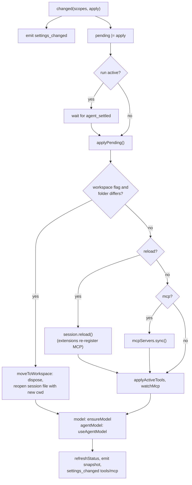
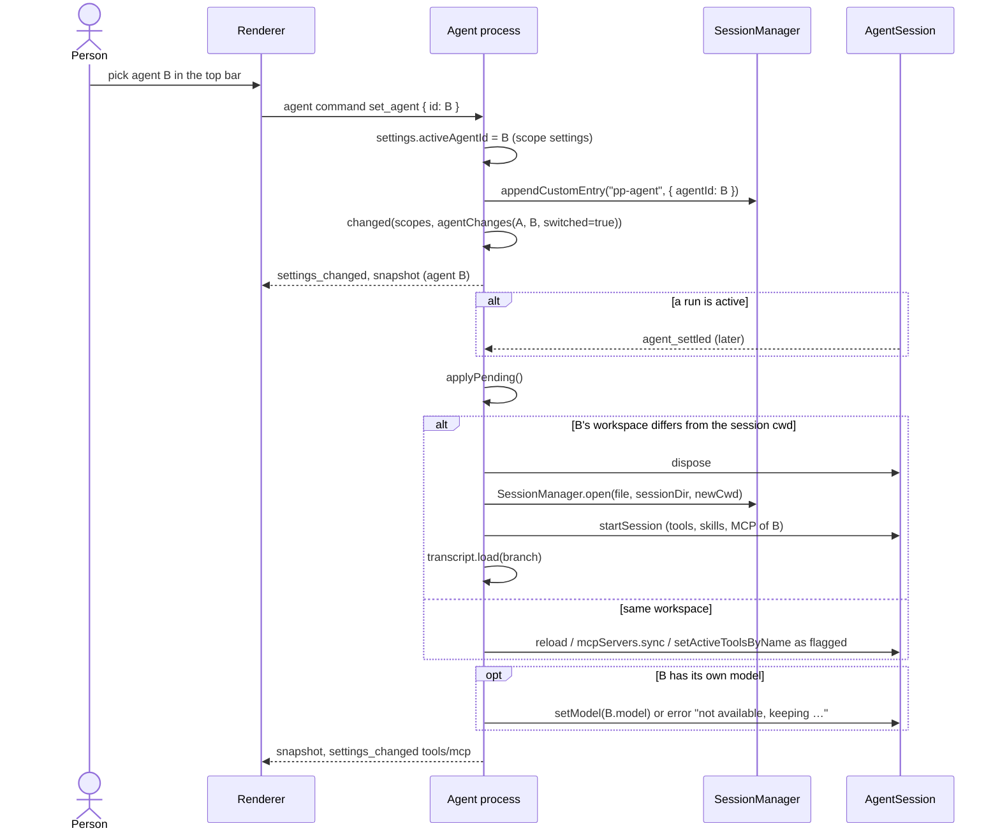

# Agents and live settings

Settings changes and agent switches apply to the open conversation without closing it. Changes that touch the session are collected as pending changes and applied only when no run is active. Code: `AgentHost.changed`, `applyPending`, `switchAgent`, `moveToWorkspace` in `apps/desktop/src/agent/index.ts`.

In the diagrams below, arrows between the renderer and the agent process are relayed by the preload bridge and the main process (see [IPC and message flow](ipc-and-messages.md)).

## Pending changes

```ts
interface PendingChanges {
  reload: boolean; // skills or the agent's skill list: session.reload()
  tools: boolean; // tool policies, shell, the agent's tool list: recompute active tools
  model: boolean; // providers or gateways changed: keep a usable model
  mcp: boolean; // mcp.json or the agent's servers: register/unregister MCP servers
  workspace: boolean; // agent or its folder changed: move to the agent's workspace
  agentModel: boolean; // switched to an agent with its own model: use it
}
```

Every mutating command ends in `changed(scopes, apply)`:

1. Emits `settings_changed { scopes }` so the renderer refetches the affected queries.
2. ORs `apply` into the pending flags.
3. If no run is active, calls `applyPending()`; otherwise Pi's `agent_settled` event calls it when the run ends.

`applyPending()` is chained on a single promise (`applying`), so batches never overlap, and it re-checks `running` before touching the session.

| Command                                                                     | Scopes emitted                           | Pending flags       |
| --------------------------------------------------------------------------- | ---------------------------------------- | ------------------- |
| `update_settings` (shell toggled)                                           | settings, tools                          | tools               |
| `update_settings` (default model)                                           | settings                                 | —                   |
| `set_tool_policy`                                                           | tools                                    | tools               |
| `save_skill`, `delete_skill`, `set_skill_enabled`, `import_skill`           | skills (+ agents on rename)              | reload              |
| `save_mcp_server`, `delete_mcp_server`, `save_mcp_json`                     | mcp (+ agents on rename)                 | mcp                 |
| `connect_provider`, `disconnect_provider`, `save_gateway`, `delete_gateway` | providers, models (+ settings on delete) | model               |
| `save_agent` of the conversation's agent                                    | agents                                   | from `agentChanges` |
| `set_agent`, `delete_agent` of the conversation's agent                     | agents and/or settings                   | from `agentChanges` |
| `set_thinking_level`                                                        | settings (when the default changed)      | —                   |

Renames are propagated: renaming a skill rewrites `disabledSkills` and every agent's skill list; renaming an MCP server rewrites every agent's server list.



Notes:

- Active tools are only replaced when the set actually changes, because replacing the loadout drops MCP tools that are still connecting.
- The agent's rules are not a pending change: the agent extension adds an `agent` section to the system prompt on every `before_agent_start`, so instruction edits apply from the next message.
- A new `AgentSession` already reflects every setting, so starting one clears the pending flags.
- Failures while applying become an `error` event ("Settings could not be applied: …").

## Agent switch mid-conversation

An agent is a profile in `settings.json` (`AgentProfile`): rules, icon, description, app tools, MCP servers, skills, model, starter prompts, workspace. `set_agent` records the agent on the open conversation and makes it the agent for new conversations (`activeAgentId`). The renderer disables the agent picker while running; the agent process still defers the session changes if a run is active.



`agentChanges(before, after, switched)` sets `workspace` on every switch (compared with the session's actual folder when applied), and `mcp`, `tools`, `reload` only when the respective lists differ. `agentModel` is set when the new agent has a model and either it is a switch or the model changed.

`moveToWorkspace` keeps the transcript and the model. A conversation with no reply yet has no session file, so it starts over in the new folder with a fresh `pp-agent` entry.

Editing the conversation's own agent (`save_agent`) uses the same mechanism with `switched = false`. Deleting it switches the open conversation to the default agent; other conversations that used it fall back to the default agent when opened. The default agent (`id: "default"`) cannot be deleted.

## Settings that apply without a pending change

- **Default model** (`update_settings`): a conversation with no messages, whose agent has no usable model of its own, switches to the new default immediately and a snapshot is sent.
- **Thinking level** and **model** of the open conversation: applied directly with `session.setThinkingLevel` / `session.setModel` (see [Model and thinking selection](model-and-thinking-selection.md)).
