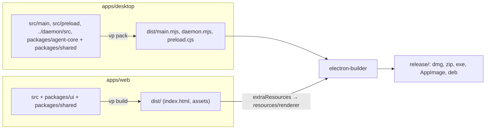
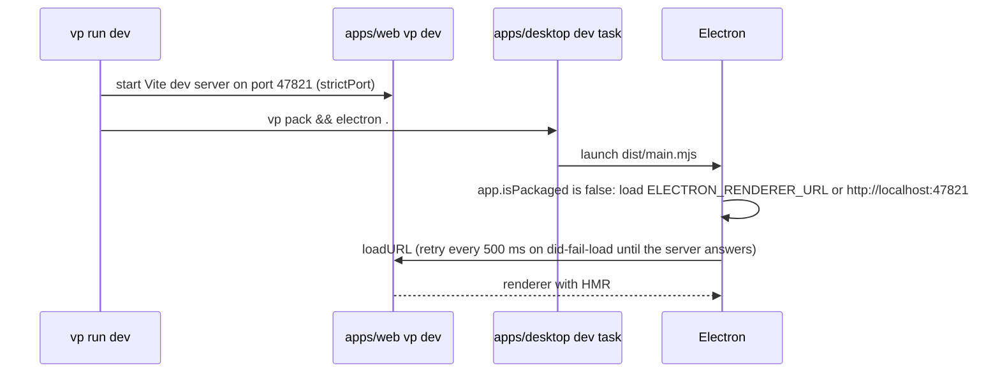

# Build and packaging

The monorepo is driven by Vite+ (`vp`) with pnpm workspaces and a version catalog (`pnpm-workspace.yaml`). Three packages produce build output: `apps/web` (renderer, `vp build`), `apps/desktop` (Electron bundles, `vp pack`, then electron-builder) and `apps/daemon` (`vp pack` to its own `dist/daemon.mjs`; the app ships the copy bundled by `apps/desktop`). `packages/shared`, `packages/agent-core` and `packages/ui` are consumed from source and bundled into those outputs.

## Scripts

| Root script (`vp run <name>`) | Runs                                                                 |
| ----------------------------- | -------------------------------------------------------------------- |
| `dev`                         | `@workspace/web#dev` and `@workspace/desktop#dev` in parallel        |
| `build`                       | `build` in every package (`vp build` for web, `vp pack` for desktop) |
| `dist`                        | `@workspace/web#build`, then `@workspace/desktop#dist`               |
| `ready`                       | `vp check`, then every `build`                                       |

`apps/desktop/package.json` also has `dist:dir` (unpacked app, no installer) and `start` (`electron .` on existing bundles).

## Desktop bundles (`vp pack`)

`apps/desktop/vite.config.ts` defines two pack configs, both `platform: "node"`, `target: "node24"`, output `dist/`, with source maps and `electron` and `@napi-rs/keyring` (a native addon) never bundled:

| Output             | Source                   | Format | Why                                                                                                                  |
| ------------------ | ------------------------ | ------ | -------------------------------------------------------------------------------------------------------------------- |
| `dist/main.mjs`    | `src/main/index.ts`      | ESM    | Main process; `package.json` `main` points here.                                                                     |
| `dist/daemon.mjs`  | `../daemon/src/index.ts` | ESM    | `pp-agentd`. Main spawns it (`node` mode via `ELECTRON_RUN_AS_NODE`), a service manager runs it, or a terminal does. |
| `dist/preload.cjs` | `src/preload/index.ts`   | CJS    | Sandboxed preload scripts must be CommonJS.                                                                          |

The preload entry uses `clean: false` so it does not wipe the ESM outputs. The Pi SDK is kept out of the bundle and loaded from `node_modules` at runtime because it loads assets and wasm itself.

The other runtime `dependencies` of `apps/desktop` (`fflate`, `officeparser`, `typebox`, `yaml`, `@napi-rs/keyring`) are left external too (`dist/daemon.mjs` imports them), while `@workspace/shared`, `@workspace/agent-core` and `@workspace/daemon` (devDependencies) are inlined.

## Renderer bundle (`vp build`)

`apps/web/vite.config.ts`:

- `base: "./"` so the built `index.html` loads its assets over `file://`.
- React and Tailwind plugins, plus `pp-agent:csp`, which injects the Content-Security-Policy meta tag in builds only.
- `@` aliases `apps/web/src`; `chunkSizeWarningLimit` is raised because the bundle is loaded from disk.

## Packaging (electron-builder)

`apps/desktop/electron-builder.yml`:

- App id `com.pptechs.agent`, product name "PP Agent", output `apps/desktop/release`, asset names `pp-agent-<version>-<os>-<arch>.<ext>`.
- Ships `dist/**` and `package.json` inside an asar archive; production `dependencies` (including the Pi SDK) come along from `node_modules`.
- `extraResources` copies `../web/dist` to `resources/renderer`. In a packaged app main loads `process.resourcesPath/renderer/index.html`, which is why `dist` builds the web app first.
- Targets: macOS `dmg` + `zip` (category productivity), Windows `nsis` (assisted installer, install folder selectable), Linux `AppImage` + `deb`. `publish: null`: the release workflow uploads installers itself (see [Release process](../code-standard/release-process.md)).
- `asarUnpack: node_modules/@napi-rs/**` and `node_modules/node-pty/**`: native addons cannot load from inside the asar archive (the daemon's OS keyring binding, the side panel terminal). `afterPack: scripts/after-pack.cjs` restores the execute bit of node-pty's macOS `spawn-helper` before signing. `node-pty` is also in the pack configs' `neverBundle`.

## Development flow

- The renderer hot-reloads; main, preload and daemon changes need Electron restarted (the dev task packs once and launches). The daemon the app spawned stops when the app quits. A daemon that is already running with the same protocol and app version (a login service, or one started from a terminal) is reused, not replaced, so stop it before testing daemon changes.
- The desktop `dev` task is declared with `cache: false`: Vite Task's cache tracking injects a file-access hook into child processes, which crashes Electron's sandboxed renderer (blank window).
- Port 47821 is fixed on both sides: `strictPort` in `apps/web/vite.config.ts` and the fallback `RENDERER_URL` in `apps/desktop/src/main/index.ts`. Set `ELECTRON_RENDERER_URL` to point Electron elsewhere.
- In dev the renderer has no CSP meta tag (the dev server needs inline scripts); the sandbox and navigation rules still apply.
- `window.ppAgent` is typed as optional: `apps/web/src/lib/bridge.ts` exports `null` when the preload bridge is absent (the renderer opened in a plain browser), so the UI can detect that it is not running inside the desktop shell.

## Checks

`vp check` formats (oxfmt, print width 100), lints (oxlint with type-aware rules and type checking, React rules for `apps/web` and `packages/ui`, Node env for `apps/desktop`) and type-checks the workspace; `dist/` and `release/` are ignored. The pre-commit hook (`.vite-hooks/pre-commit`, installed by the root `prepare` script `vp config`) runs `vp staged`, which applies `vp check --fix` to staged files (`staged` in the root `vite.config.ts`).
