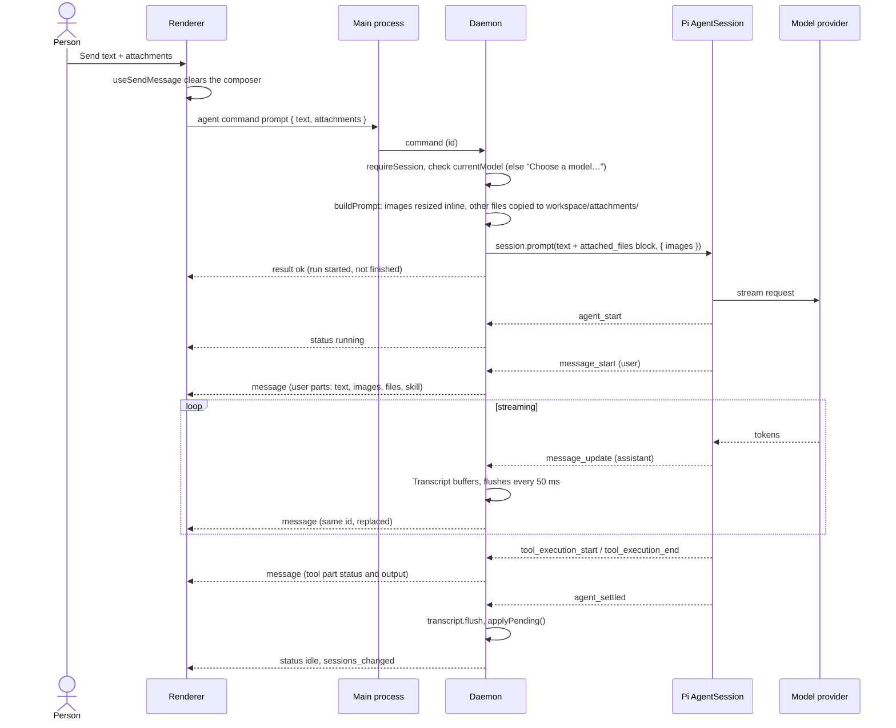
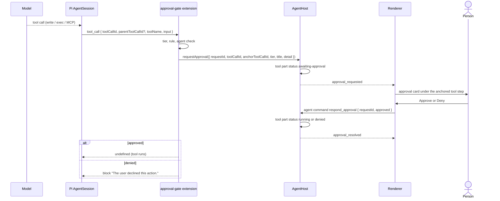
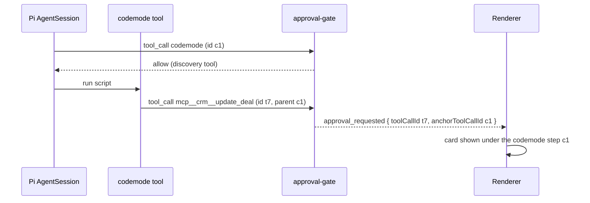
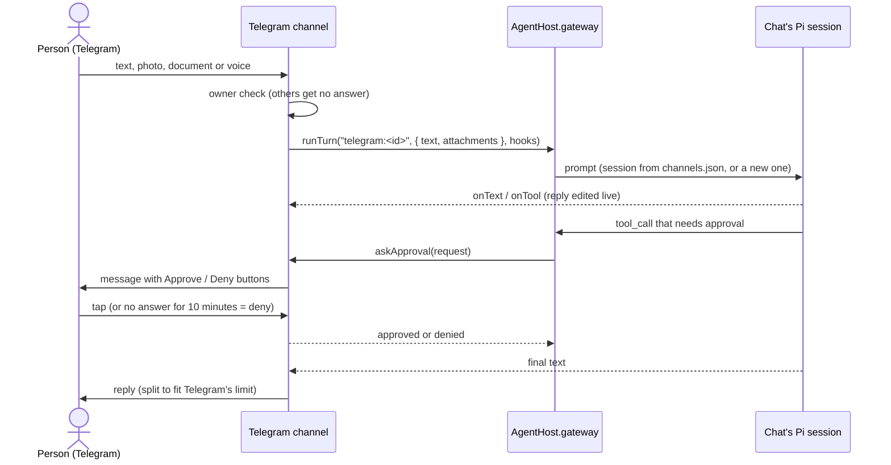

# Conversation flows

How a prompt becomes a streamed reply, and how tool calls are gated. Code: `AgentHost` in `packages/agent-core/src/index.ts`, `packages/agent-core/src/attachments.ts`, `packages/agent-core/src/transcript.ts`, `packages/agent-core/src/tools.ts`.

## Sending a prompt with attachments

Attachments reach the daemon as `Attachment` objects with either a `path` (picked with `files.pick()` or dropped, resolved by `files.pathFor`) or base64 `data` (pasted images).

Details:

- **Attachment handling.** PNG, JPEG, GIF and WebP go to the model as image content, downscaled with Pi's `resizeImage`. Any other file must have a path; it is copied into `<workspace>/attachments/<timestamp>-<name>` and listed in an `<attached_files>` block appended to the text so the agent can open it (for office files and PDFs with `read_document`). Preparing attachments happens before the command resolves, so a bad attachment fails the send and the renderer restores the draft and attachments.
- **Empty text.** If only attachments are sent, the text becomes "Please take a look at the attached files."
- **While a run is active.** A prompt sent while Pi is streaming is queued with `streamingBehavior: "followUp"`.
- **Run errors.** `session.prompt()` resolves only when the run ends; its rejection becomes an `error` event, not a command failure.
- **Transcript projection.** `Transcript` turns Pi's `AgentMessage`s into `ChatMessage`s. Assistant messages own their tool-call parts; tool status and output are folded into those parts. Upserts are coalesced (50 ms) so a long reply does not send one IPC message per token; tool output shown in the UI is capped at 8,000 characters (the model still receives the full result). User messages are split back into text, attached files (from the `<attached_files>` block) and an invoked skill (`/skill:<name>` via Pi's `parseSkillBlock`).
- **Opening a saved conversation** rebuilds the transcript without per-message events and sends one `snapshot`.

Other conversation commands: `abort` (denies pending approvals first, then `session.abort()`), `new_chat` and `open_session` (abort, dispose, start a new `AgentSession`), `compact` (refused while running; Pi summarises older messages), `rename_session`, `delete_session` (also clears the pin), `list_sessions` (non-empty sessions across all workspaces, newest first, titled by name or first message; each carries `pinned`), `pin_session`, `search_sessions` (see `agent/history.ts`), `export_session` (see `agent/export.ts`) and `get_usage`.

Message actions (`regenerate`, `edit_message`, `branch_session`) throw "Wait for the answer to finish." while a run or compaction is active. Every user and assistant `ChatMessage` carries `entryId`, the id of its Pi session entry (`Transcript.load` tags saved messages; `setEntryIds` tags new ones when the run settles). `regenerate` and `edit_message` move the leaf to the entry before the user message (`session.navigateTree`, or `branch`/`resetLeaf` when that message is the leaf) and send the message again; the dropped messages stay in the file as another branch of the tree. `branch_session` opens the file in a second `SessionManager`, calls `createBranchedSession` up to the end of the chosen turn (an assistant message keeps its tool results), names the copy "<title> (branch)" and opens it.

## Approval gate

Renderer ↔ daemon arrows in the diagrams below are relayed by the preload bridge and the main process.

Every tool call passes through the `approval-gate` extension registered first in `startSession`. It listens to Pi's `tool_call` event and either lets the call run, blocks it with a reason the model sees, or waits for the person.

### Deciding

1. **Tier** (`toolTier`): built-in tools have a fixed tier (`read`, `ls`, `find`, `grep`, `read_document`, `current_datetime`, `web_search`, `web_fetch` → read; `write`, `edit` → write; `bash`, `powershell` → exec; discovery tools `codemode`, `tool_search`, `list_mcp_resources`, `list_mcp_resource_templates`, `read_mcp_resource` → read). MCP tools (`mcp__<server>__<tool>`) are read only when the server annotates them `readOnlyHint`, otherwise write. Any unknown tool is exec.
2. **Rule** (`toolRule`): the shell tool of this platform is `off` (locked) unless shell is enabled in Settings, then `ask`, or `allow` when its own policy is `allow` (the rule then carries a `warning`); the other platform's shell is always `off`; discovery tools are always `allow` (locked). Others use the tool policy from `settings.json`, defaulting to `auto` (`edit` defaults to `off`). `auto` means `allow` for the read tier and `ask` otherwise.
3. `off` → blocked ("turned off in Settings"). Tools that are off stay registered because codemode can reach any registered tool, so the gate is the enforcement point.
4. The current agent's tool list (`agentAllowsTool`) → blocked when the agent may not use an app tool. MCP tools follow the agent's MCP servers instead; discovery tools stay available.
5. `allow` → runs. `ask` → approval request.

### Asking

`describeToolCall` builds the title and detail the person sees: "Save `<path>`" with the content for `write`, "Edit `<path>`" with the edits, "Run a command" with the command for the shell, "Use “tool” in server" with the arguments for MCP tools; previews are cut at 600 characters.

### Codemode and nested calls

With MCP exposure `codemode` (the default), the model writes a script that calls tools itself. `codemode` is a discovery tool, so the script starts without asking; each tool the script calls raises its own `tool_call` event with `parentToolCallId` set to the codemode call. The gate sets `anchorToolCallId = parentToolCallId ?? toolCallId`; the renderer shows the approval on the tool step whose `toolCallId` equals the anchor (`apps/web/src/components/chat/chat-message.tsx`), because the nested call has no step of its own in the transcript.

### Abort and pending approvals

A pending approval blocks the run, so `abort`, `new_chat`, `open_session` and `delete_session` of the open conversation first deny every pending approval (`denyAllApprovals`) and then abort the session. Pending approvals are part of the snapshot, so a renderer reload shows them again.

## Chat channel turns (Telegram)

A message from the paired person on Telegram becomes a turn without the window. The channel (`packages/agent-core/src/channels/telegram/`) long-polls the Bot API and talks to the agent only through `AgentHost.gateway` (`ChannelGateway`: `runTurn`, `newConversation`, `abort`, `transcribe`). Each chat key (`telegram:<chatId>`) has its own Pi session, separate from the conversation open in the window, built with the agent and workspace chosen in Settings › Channels › Telegram. Either can also be selected in chat with `/agent` and `/workspace`. Turns of one chat run one at a time; up to 5 more messages wait, and the rest get a "busy" reply.

- **Who.** Only the paired owner is answered; strangers are ignored. A tap on Approve or Deny counts only from the owner. `/pair CODE` works while a pairing window (10 minutes, one use, 5 wrong tries lock it for 15 minutes) is open.
- **Same gate as the window.** The chat session uses the agent's tool list and the same `approval-gate`. Requests are asked in the chat instead of the window; an unanswered one is denied after 10 minutes, and `/stop` or `/new` denies all pending ones.
- **Input.** Text, photos (sent as images), documents (copied to the workspace's `attachments/`, up to 20 MiB), and voice or audio (transcribed with the voice input provider set up in Settings; without one the reply says why it failed). Other message kinds get an "unsupported" reply.
- **Commands.** `/new` starts a fresh conversation for the chat (drops its entry in `channels.json`), `/stop` aborts the turn and clears the queue, `/help`, `/start`. `/model` and `/thinking` call `gateway.pickOptions` / `gateway.pick`, which open the chat's own session and call `session.setModel` / `setThinkingLevel` (Pi saves them with the conversation). `/agent` and `/workspace` call `gateway.options` / `gateway.choose`: the pick is stored per chat in `channels.json` (`choices`), the session is closed and reopened on the next turn; a workspace change also drops the chat's conversation, an agent change appends an agent entry to it.
- **History.** Each chat conversation is a saved session titled `💬 Telegram – <date>`, so it also shows in the window's history. After a restart the daemon reopens the session named in `channels.json`; a chat session idle for 30 minutes is released from memory (not deleted).
