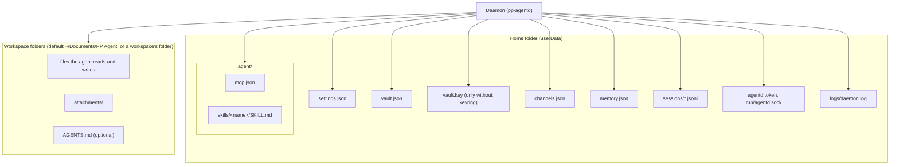

# Data storage

All persistent state lives in two places: the daemon's home folder, which is Electron's `userData` folder (`~/Library/Application Support/PP Agent` on macOS, `%APPDATA%\PP Agent` on Windows, `~/.config/PP Agent` on Linux) unless `PP_AGENT_HOME` says otherwise, and the workspace folders the agent works in. The daemon computes the paths itself (`apps/daemon/src/paths.ts`, `AgentPaths`); the app starts it with `PP_AGENT_HOME` set to `userData`, so both see the same files. `PP_AGENT_WORKSPACE` overrides the built-in workspace folder (`~/Documents/PP Agent`; the app passes Electron's resolved Documents folder).

## Files and owners

| Path                           | Owner (only writer)                                    | Contents and rules                                                                                                                                                                                                                                                                                                                                                                                                                                                                                                                                                                                                                                                                                                                                                                                                                                                                                                                                                                                                                                                                 |
| ------------------------------ | ------------------------------------------------------ | ---------------------------------------------------------------------------------------------------------------------------------------------------------------------------------------------------------------------------------------------------------------------------------------------------------------------------------------------------------------------------------------------------------------------------------------------------------------------------------------------------------------------------------------------------------------------------------------------------------------------------------------------------------------------------------------------------------------------------------------------------------------------------------------------------------------------------------------------------------------------------------------------------------------------------------------------------------------------------------------------------------------------------------------------------------------------------------- |
| `settings.json`                | Daemon (`SettingsStore`)                               | `SettingsFile`: default model, shell on/off, tool policies, disabled skills, gateways, agents, active agent id, thinking level, `pinnedSessions` (file names of pinned conversations, e.g. `<id>.jsonl`; a pin is dropped when its conversation is deleted). Each gateway carries `requiresApiKey` (missing in files from before keyless gateways = `true`; `false` registers the gateway with a placeholder key so local endpoints without a key work, and a key stored in the vault still wins). Parsed field by field, so one malformed value falls back to its default without losing the rest. The default agent is always present. `scheduledTasks`: the scheduled tasks (name, prompt, agent and workspace ids, schedule, enabled, `armedAt`, and `lastRun` with time, duration, status, error, skipped-approval count and the run's session path; missing = none; entries that do not fit are dropped one by one, at most 50). `voice`: `providerId` (null = not set up), `model` (default `whisper-1`), `language` (`app`, `auto` or a code); the key stays in the vault. |
| `memory.json`                  | Daemon (`MemoryStore`)                                 | `{ enabled, entries[] }`: the long-term notes (`id`, `text`, `tag`, `createdAt`, `updatedAt`) and the global memory switch. Written atomically (temp file, rename) with mode 0600; read field by field, so a bad entry is dropped without losing the rest. Caps in `MEMORY_LIMITS`.                                                                                                                                                                                                                                                                                                                                                                                                                                                                                                                                                                                                                                                                                                                                                                                                |
| `vault.json`                   | Daemon (`apps/daemon/src/vault/index.ts`)              | The vault stores a key HMAC check and rejects a changed or missing key before allowing access. Legacy entries are authenticated before adding the check. The vault: `{ version: 1, keyCheck, entries: { [id]: base64(iv ‖ tag ‖ ciphertext) } }`, each entry the JSON `StoredCredential` encrypted with AES-256-GCM under one master key, with the entry id as authenticated data (an entry copied under another id fails to decrypt). Ids: provider and gateway ids, `websearch:<provider>` (search keys), `mcp-auth:state` (MCP OAuth state) and `channel:telegram` (the bot token); the last three are hidden from the provider list. A file that is not valid is left untouched and reported, never overwritten. Mode 0600.                                                                                                                                                                                                                                                                                                                                                    |
| `vault.key`                    | Daemon                                                 | The master key (32 bytes as hex, mode 0600), An existing key file is preferred over the OS keyring; `PP_AGENT_MASTER_KEY` remains an explicit override, checked against the vault. New keys are generated only for empty vaults without a stored key check. It sits next to the vault, so it protects against casual reading, not against someone who can read the folder.                                                                                                                                                                                                                                                                                                                                                                                                                                                                                                                                                                                                                                                                                                         |
| OS keyring entry               | Daemon (`@napi-rs/keyring`)                            | Service `PP Agent`, account `vault-master-key`: the master key, created on first use and read back to check the keyring kept it. Where the keyring is unusable (for example a headless Linux box), the daemon logs a warning and uses `vault.key`. `PP_AGENT_MASTER_KEY` (32 bytes as hex or base64) wins over both.                                                                                                                                                                                                                                                                                                                                                                                                                                                                                                                                                                                                                                                                                                                                                               |
| `channels.json`                | Daemon (`ChatSessionMap`)                              | `{ chats: { "telegram:<chatId>": "<session file>" } }`: which saved conversation each chat continues, so a restarted daemon picks up where it stopped. `/new` in the chat drops its entry. Atomic write, mode 0600.                                                                                                                                                                                                                                                                                                                                                                                                                                                                                                                                                                                                                                                                                                                                                                                                                                                                |
| `agentd.sock`, `agentd.token`  | Daemon                                                 | The local socket (under `run/` on Unix; a named pipe on Windows; `/tmp/pp-agent-<uid>/agentd.sock` when the home path is too long for a socket) and the token clients send in `hello` (64 hex characters, mode 0600). Clients only read the token.                                                                                                                                                                                                                                                                                                                                                                                                                                                                                                                                                                                                                                                                                                                                                                                                                                 |
| `logs/daemon.log`              | Daemon output, appended                                | The daemon's log, whether the app, a service manager or a terminal started it. Never holds decrypted vault values.                                                                                                                                                                                                                                                                                                                                                                                                                                                                                                                                                                                                                                                                                                                                                                                                                                                                                                                                                                 |
| `pp-agentd-launch.ps1`         | Daemon (`install`)                                     | Windows only, next to the log: the launcher script that the scheduled task runs.                                                                                                                                                                                                                                                                                                                                                                                                                                                                                                                                                                                                                                                                                                                                                                                                                                                                                                                                                                                                   |
| `agent/mcp.json`               | Daemon (`McpConfigFile`)                               | MCP servers in the `mcpServers` shape of Claude Desktop and Cursor. Settings edits write only the fields they manage; unknown keys (`oauth`, `toolExposure`, …) are preserved.                                                                                                                                                                                                                                                                                                                                                                                                                                                                                                                                                                                                                                                                                                                                                                                                                                                                                                     |
| `agent/mcp-auth.json` (legacy) | Daemon (`mcp-auth.ts`)                                 | Plain-text OAuth file of earlier versions. At start its contents move into the vault (`mcp-auth:state`) and the file is deleted; it stays only if the vault cannot be read or written, and Pi then keeps using it.                                                                                                                                                                                                                                                                                                                                                                                                                                                                                                                                                                                                                                                                                                                                                                                                                                                                 |
| `agent/skills/<name>/`         | Daemon (`SkillLibrary`)                                | One folder per skill with a `SKILL.md`. Only skills inside this folder are loaded (`skills.owns(baseDir)`). Imports copy a folder or extract a `.zip`/`.skill` archive (rejected beyond 100 MiB expanded or on path traversal).                                                                                                                                                                                                                                                                                                                                                                                                                                                                                                                                                                                                                                                                                                                                                                                                                                                    |
| `sessions/*.jsonl`             | Daemon (Pi `SessionManager`)                           | One file per conversation: messages, model and thinking changes, compactions, the session name, and `pp-agent` custom entries recording the conversation's agent (`{ agentId }`). Conversations of all agents and workspaces share this folder; the workspace is found from the session's `cwd`.                                                                                                                                                                                                                                                                                                                                                                                                                                                                                                                                                                                                                                                                                                                                                                                   |
| `<workspace>/`                 | Daemon (tools)                                         | The conversation's working directory (`cwd`). The default is `~/Documents/PP Agent`; any other workspace has its own absolute folder (`WorkspaceProfile.dir`). Created on demand; if it cannot be created, the default folder is used and an `error` event explains why.                                                                                                                                                                                                                                                                                                                                                                                                                                                                                                                                                                                                                                                                                                                                                                                                           |
| `<workspace>/attachments/`     | Daemon (`buildPrompt`)                                 | Copies of non-image attachments, named `<yyyymmdd-hhmmss-mmm>-<original name>`.                                                                                                                                                                                                                                                                                                                                                                                                                                                                                                                                                                                                                                                                                                                                                                                                                                                                                                                                                                                                    |
| `<workspace>/AGENTS.md`        | The person                                             | Optional workspace instructions; Pi adds it to the system prompt.                                                                                                                                                                                                                                                                                                                                                                                                                                                                                                                                                                                                                                                                                                                                                                                                                                                                                                                                                                                                                  |
| `credentials.json` (legacy)    | Main process (`apps/desktop/src/main/legacy-vault.ts`) | The old desktop vault: `{ [providerId]: base64(safeStorage.encrypt(JSON StoredCredential)) }`. Read once after a connection to the daemon, handed over with `vault_import`, then deleted (see [Legacy files](#legacy-files)).                                                                                                                                                                                                                                                                                                                                                                                                                                                                                                                                                                                                                                                                                                                                                                                                                                                      |
| `provider.json` (legacy)       | Main process (`apps/desktop/src/main/legacy.ts`)       | Single-gateway file from earlier versions. On start, before the daemon is spawned, it becomes a `gw-gateway` gateway in `settings.json` (only when `settings.json` does not exist yet) plus a vault entry, then it is deleted.                                                                                                                                                                                                                                                                                                                                                                                                                                                                                                                                                                                                                                                                                                                                                                                                                                                     |
| `<tmp>/pp-agent-telegram/`     | Daemon (Telegram channel)                              | Documents received from Telegram, under unique names (file mode 0600, folder 0700), removed after the turn. Photos are passed as base64 and not written.                                                                                                                                                                                                                                                                                                                                                                                                                                                                                                                                                                                                                                                                                                                                                                                                                                                                                                                           |

`settings.json` also holds `channels.telegram`: `enabled`, `agentId`, `workspaceId` (the agent and workspace that Telegram conversations use), and the paired person (`ownerId`, `ownerName`). The bot token is never in settings; it is the vault entry `channel:telegram`. It is read field by field like the rest of the file.

MCP OAuth state (client registration, tokens, PKCE verifiers) lives in the vault through `VaultMcpAuthStore`, which Pi's MCP extension uses via `createMcpExtension({ credentials })`. Only when the vault cannot be read does Pi fall back to `agent/mcp-auth.json`.

### Legacy files

- **`credentials.json` (safeStorage vault).** Earlier versions kept credentials in `userData/credentials.json`, encrypted with Electron `safeStorage`; only the main process could decrypt it. After each connection to the daemon, main checks for the file, decrypts its entries and sends them in one `vault_import` frame. The daemon stores the entries it does not have yet (nothing already saved is overwritten) and main then deletes the file. Entries that cannot be decrypted are skipped; if nothing in a non-empty file can be decrypted, the file stays so a later run (with the keychain unlocked) can still recover it. `safeStorage` is used for nothing else any more.
- **`provider.json`.** See the table above.

## Write discipline

- `settings.json`, `vault.json`, `channels.json` and `agent/mcp.json` are written to a sibling `.tmp` file and renamed into place, with mode `0600`, so a crash never leaves a truncated file.
- `SettingsStore.update` is synchronous (clone, mutate, write, swap), so two updates in the daemon never interleave.
- Vault operations run strictly one after another (a promise queue in the vault); `VaultCredentialStore` also chains operations per id and caches what it has read. Because only the daemon writes, the cache stays accurate.
- Renderer-supplied session paths are accepted only inside `sessions/` with a `.jsonl` extension.

## What a conversation records

A conversation is a Pi session file. Beyond Pi's own entries, the app relies on:

- **Agent**: the latest `pp-agent` custom entry on the branch decides which agent opens with the conversation. A new conversation gets its entry in memory immediately; Pi writes the file with the first reply. A deleted agent falls back to the default agent when the conversation is opened.
- **Model and thinking level**: stored by Pi; a saved conversation reopens with them when they are still available (see [Model and thinking selection](model-and-thinking-selection.md)).
- **Workspace**: the session's `cwd`. A conversation belongs to the workspace whose folder equals its `cwd` (`workspaceForCwd`); one that matches none (its workspace was deleted) is listed under, and reopened in, the built-in workspace, reopening the session file with that folder as `cwd`.
- **Full history**: the chat shows every message on the branch, including messages a compaction summarised away (`branchMessages`), with a divider where each compaction happened (a `compaction` chat message with no parts). The model sees only what Pi keeps. Before each model call the `context` hook in `packages/agent-core/src/context.ts` also replaces old tool output with `[Output truncated - N tokens]` in that request's copy of the messages (newest 40,000 tokens kept, only when it frees at least 20,000, skill instructions never); the saved conversation and the chat are unchanged.
