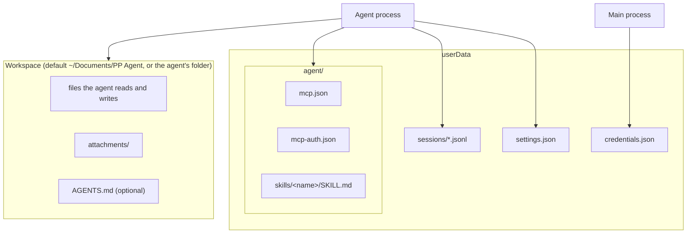

# Data storage

All persistent state lives in two places: Electron's `userData` folder (`~/Library/Application Support/PP Agent` on macOS, `%APPDATA%\PP Agent` on Windows) and the workspace folders the agent works in. Main computes the paths and passes them to the agent process in the `init` message (`AgentPaths`).

## Files and owners

| Path                       | Owner (only writer)                              | Contents and rules                                                                                                                                                                                                                                                    |
| -------------------------- | ------------------------------------------------ | --------------------------------------------------------------------------------------------------------------------------------------------------------------------------------------------------------------------------------------------------------------------- |
| `settings.json`            | Agent process (`SettingsStore`)                  | `SettingsFile`: default model, shell on/off, tool policies, disabled skills, gateways, agents, active agent id, thinking level. Parsed field by field, so one malformed value falls back to its default without losing the rest. The default agent is always present. |
| `credentials.json`         | Main process (`apps/desktop/src/main/vault.ts`)  | The vault: `{ [providerId]: base64(safeStorage.encrypt(JSON StoredCredential)) }` for built-in providers and gateways. The agent process reaches it only through vault requests.                                                                                      |
| `agent/mcp.json`           | Agent process (`McpConfigFile`)                  | MCP servers in the `mcpServers` shape of Claude Desktop and Cursor. Settings edits write only the fields they manage; unknown keys (`oauth`, `toolExposure`, …) are preserved.                                                                                        |
| `agent/mcp-auth.json`      | Agent process (Pi's MCP extension)               | OAuth tokens of MCP servers the person signed in to. Pi resolves the location from `PI_CODING_AGENT_DIR`, which the agent process sets to `agent/` at `init`.                                                                                                         |
| `agent/skills/<name>/`     | Agent process (`SkillLibrary`)                   | One folder per skill with a `SKILL.md`. Only skills inside this folder are loaded (`skills.owns(baseDir)`). Imports copy a folder or extract a `.zip`/`.skill` archive (rejected beyond 100 MiB expanded or on path traversal).                                       |
| `sessions/*.jsonl`         | Agent process (Pi `SessionManager`)              | One file per conversation: messages, model and thinking changes, compactions, the session name, and `pp-agent` custom entries recording the conversation's agent (`{ agentId }`). Conversations of all agents share this folder regardless of workspace.              |
| `<workspace>/`             | Agent process (tools)                            | The conversation's working directory (`cwd`). The default is `~/Documents/PP Agent`; an agent may set its own absolute folder. Created on demand; if it cannot be created, the default folder is used and an `error` event explains why.                              |
| `<workspace>/attachments/` | Agent process (`buildPrompt`)                    | Copies of non-image attachments, named `<yyyymmdd-hhmmss-mmm>-<original name>`.                                                                                                                                                                                       |
| `<workspace>/AGENTS.md`    | The person                                       | Optional workspace instructions; Pi adds it to the system prompt.                                                                                                                                                                                                     |
| `provider.json` (legacy)   | Main process (`apps/desktop/src/main/legacy.ts`) | Single-gateway file from earlier versions. On start, before the agent process is forked, it becomes a `gw-gateway` gateway in `settings.json` (only when `settings.json` does not exist yet) plus a vault entry, then it is deleted.                                  |

`agent/mcp-auth.json` is written by Pi's MCP extension (its default credential store in the agent directory, see Pi `docs/mcp.md`); this app never opens it directly.

## Write discipline

- `settings.json`, `credentials.json` and `agent/mcp.json` are written to a sibling `.tmp` file and renamed into place, with mode `0600`, so a crash never leaves a truncated file.
- `SettingsStore.update` is synchronous (clone, mutate, write, swap), so two updates in the agent process never interleave.
- Vault operations in main run strictly one after another; the agent-side `VaultCredentialStore` also chains operations per provider and caches what it has read. Because only the agent process issues writes, the cache stays accurate.
- Renderer-supplied session paths are accepted only inside `sessions/` with a `.jsonl` extension.

## What a conversation records

A conversation is a Pi session file. Beyond Pi's own entries, the app relies on:

- **Agent**: the latest `pp-agent` custom entry on the branch decides which agent opens with the conversation. A new conversation gets its entry in memory immediately; Pi writes the file with the first reply. A deleted agent falls back to the default agent when the conversation is opened.
- **Model and thinking level**: stored by Pi; a saved conversation reopens with them when they are still available (see [Model and thinking selection](model-and-thinking-selection.md)).
- **Workspace**: the session's `cwd`. When a conversation is opened, the agent process uses the agent's _current_ workspace, reopening the session file with a new `cwd` if it changed.
- **Full history**: the chat shows every message on the branch, including messages a compaction summarised away (`branchMessages`); the model sees only what Pi keeps.
