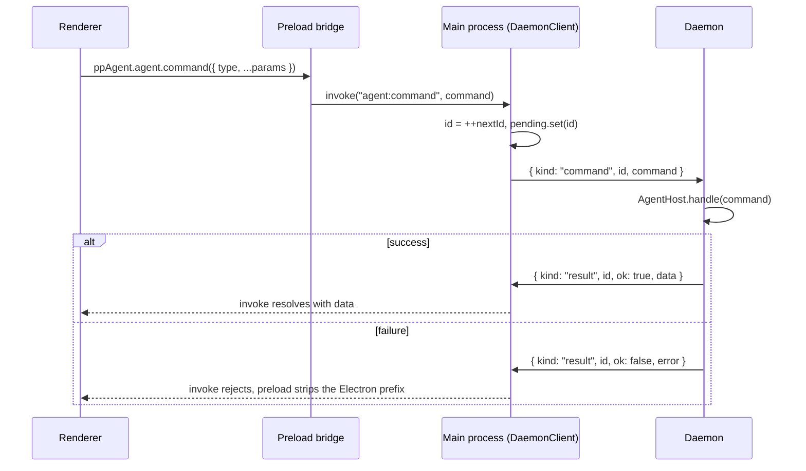

# IPC and message flow

Two hops carry all traffic: renderer ↔ main over Electron IPC (through the preload bridge), and main ↔ daemon over a local socket carrying newline-delimited JSON frames. Main is a relay for agent traffic; it only acts on its own for files, links, and starting or replacing the daemon.

## Renderer ↔ main channels

Channel names are the `IPC` constant in `packages/shared/src/index.ts`. All are `ipcMain.handle` / `ipcRenderer.invoke` pairs, except `agent:event`, which main pushes with `webContents.send`.

| Channel                | Bridge method                             | Handled by                                                                           |
| ---------------------- | ----------------------------------------- | ------------------------------------------------------------------------------------ |
| `agent:command`        | `agent.command(command)`                  | Forwarded to the daemon (below)                                                      |
| `agent:event`          | `agent.onEvent(listener)`                 | Pushed by main for every agent event                                                 |
| `files:pick`           | `files.pick()`                            | Open dialog, returns `Attachment[]` with path and guessed MIME type                  |
| `files:pick-skill`     | `files.pickSkill()`                       | Folder or `.zip`/`.skill` picker                                                     |
| `files:pick-folder`    | `files.pickFolder()`                      | Folder picker (a new workspace's folder)                                             |
| `files:open-workspace` | `files.openWorkspace(dir)`                | Opens an absolute folder in Finder / Explorer                                        |
| `files:reveal`         | `files.reveal(path)`                      | Shows a path inside userData or the default workspace                                |
| `files:open-agent`     | `files.openAgentFile()`                   | Reads an exported agent file                                                         |
| `files:save-agent`     | `files.saveAgentFile(name, json)`         | Writes an exported agent file                                                        |
| `files:save-export`    | `files.saveExport(name, format, content)` | Save dialog, then writes an exported conversation (`md` or `html`; capped at 50 MiB) |
| `shell:open-external`  | `openExternal(url)`                       | http(s) URL in the default browser                                                   |
| `updates:state`        | `updates.state()`                         | Current `UpdateState`                                                                |
| `updates:check`        | `updates.check()`                         | Looks for a newer release (a person asked)                                           |
| `updates:download`     | `updates.download()`                      | Downloads in the app, or opens the release page for `.deb`                           |
| `updates:install`      | `updates.install()`                       | Quits and installs a downloaded update                                               |
| `updates:event`        | `updates.onState(listener)`               | Pushed by main whenever the `UpdateState` changes                                    |

`files.pathFor(file)` is answered in the preload itself (`webUtils.getPathForFile`) without IPC.

The side panel adds `terminal:*`, `workspace:*` and `browser:*` channels plus `shell:toggle-panel`; output, file changes and tab state are pushed by main (`terminal:data`, `terminal:changed`, `workspace:changed`, `browser:changed`), and `terminal:write`, `terminal:resize` and `browser:set-bounds` are one-way `send`s. See [Side panel](side-panel.md).

## Main ↔ daemon frames

One JSON value per line (`encodeFrame` / `FrameDecoder` in `apps/daemon/src/framing.ts`; a line longer than 64 MiB or not valid JSON closes the connection). The transport is a Unix socket, or a named pipe on Windows; see [Process model](process-model.md#the-daemon-socket) for the endpoint and token. Abridged from `packages/shared/src/index.ts`:

```ts
const DAEMON_PROTOCOL = 3;

type ClientFrame =
  | { kind: "hello"; protocol: number; nonce: string; proof: string; appVersion: string }
  | { kind: "command"; id: number; command: AgentCommand }
  | { kind: "vault_import"; id: number; entries: Record<string, StoredCredential> }
  | { kind: "shutdown" }
  | { kind: "browser_available"; available: boolean }
  | { kind: "browser_response"; id: number; ok: true; result: BrowserResult }
  | { kind: "browser_response"; id: number; ok: false; error: string };

type DaemonFrame =
  | { kind: "challenge"; nonce: string }
  | { kind: "hello_ok"; protocol: number; appVersion: string; pid: number; proof: string }
  | { kind: "hello_error"; error: string }
  | { kind: "event"; event: AgentEvent }
  | { kind: "result"; id: number; ok: true; data: unknown }
  | { kind: "result"; id: number; ok: false; error: string }
  | { kind: "open_url"; url: string }
  | { kind: "browser_request"; id: number; request: BrowserRequest };
```

| Frame               | Direction       | What happens                                                                                                                                                                                                                                                                       |
| ------------------- | --------------- | ---------------------------------------------------------------------------------------------------------------------------------------------------------------------------------------------------------------------------------------------------------------------------------- |
| `challenge`         | daemon → client | Fresh nonce issued for this connection before the client sends its proof.                                                                                                                                                                                                          |
| `hello`             | client → daemon | Must be the first frame. The daemon checks a challenge-bound HMAC proof, then answers `hello_ok` with its own proof. A wrong proof gets `hello_error` and the connection is closed.                                                                                                |
| `hello_ok`          | daemon → client | Carries the daemon's protocol, app version and pid. A different protocol or version still gets `hello_ok`, so a newer app can see it and send `shutdown`.                                                                                                                          |
| `command`           | client → daemon | Carries an agent command with a client-assigned id; answered by a `result` with the same id. Runs `AgentHost.handle`, which waits for `init` to finish except for `get_snapshot`.                                                                                                  |
| `result`            | daemon → client | Resolves or rejects the pending `invoke` with that id (`error` is the message the renderer shows).                                                                                                                                                                                 |
| `event`             | daemon → client | Broadcast to every authenticated client; main forwards it unchanged to the renderer on `agent:event`.                                                                                                                                                                              |
| `open_url`          | daemon → client | Broadcast like events; main opens an http(s) URL in the browser (provider or MCP OAuth sign-in); other schemes are refused.                                                                                                                                                        |
| `vault_import`      | client → daemon | One-time import of the legacy `credentials.json` entries (below); answered by a `result`. Entries the vault already has are not overwritten.                                                                                                                                       |
| `shutdown`          | client → daemon | Asks the daemon to exit: sent when an update or version change replaced the app, and on quit when this app started the daemon.                                                                                                                                                     |
| `browser_available` | client → daemon | Whether this client has a window whose side panel browser can run the agent's `browser` tool; sent after every connection and when the window opens or closes.                                                                                                                     |
| `browser_request`   | daemon → client | One `browser` tool call, sent only to the newest client that offered its browser; answered by `browser_response` with the same id (90 s timeout, aborted with the tool call, failed when that client leaves). See [Side panel](side-panel.md#browser-use-the-agents-browser-tool). |
| `hello_error`       | daemon → client | Answers a bad proof, a malformed frame or a first frame that is not `hello` (the connection is then closed), and a repeated `hello` (the connection stays open).                                                                                                                   |

### Command correlation



- Ids are a per-main-process counter; the daemon echoes them back. When the connection drops, every pending id is rejected with "The agent stopped unexpectedly." Commands issued while there is no connection wait up to 20 s for one.
- `AgentCommand` is a discriminated union generated from `AgentCommandMap`, so `bridge.agent.command({ type: "set_model", ... })` is typed with its own result (`AgentCommandResult<K>`). `AgentHost.handle` switches over the same union and ends with a `never` check. Commands for the background service and Telegram (`get_service_status`, `set_service_installed`, `get_telegram_status`, `save_telegram`, `start_telegram_pairing`, `forget_telegram`) travel the same way.
- A command result means "accepted", not "finished". `prompt` resolves once attachments are prepared and the run has started; the reply streams as events.

### Credentials

The daemon never sends a stored secret to a client: views such as `GatewayView` omit keys. Keys go the other way only when a person saves one (for example `save_gateway`, `save_telegram`). The daemon's `AgentHost` keeps Pi's `CredentialStore` in `VaultCredentialStore` (`packages/agent-core/src/credentials.ts`) on top of a `VaultBackend` (`read`, `list`, `write`, `delete`, `available`) that the daemon supplies (`apps/daemon/src/vault/index.ts`). The store caches entries per id and serialises writes per id. The only credential traffic from main is `vault_import`, once, for a leftover legacy `credentials.json` (see [Data storage](data-storage.md#legacy-files)).

## Agent events

`AgentEvent` (shared contract) and how the renderer uses each (`apps/web/src/hooks/use-agent-connection.ts`, `apps/web/src/stores/chat-store.ts`):

| Event                                      | Renderer effect                                                                            |
| ------------------------------------------ | ------------------------------------------------------------------------------------------ |
| `status`                                   | Sets the chat store status.                                                                |
| `message`                                  | Upserts a `ChatMessage` by id (streaming replaces the same id repeatedly).                 |
| `snapshot`                                 | Replaces the whole chat store; refetches sessions and tools.                               |
| `approval_requested` / `approval_resolved` | Adds / removes a pending approval in the chat store.                                       |
| `question_requested` / `question_resolved` | Adds / removes a pending `ask_user` question in the chat store.                            |
| `sessions_changed`                         | Refetches the conversation list.                                                           |
| `context { context }`                      | Updates the context window gauge in the chat store (after each reply and after `compact`). |
| `settings_changed { scopes }`              | Invalidates the TanStack queries mapped from each `SettingsScope`.                         |
| `auth_prompt` / `auth_prompt_closed`       | Pushes / removes a sign-in prompt in the auth prompt modal store.                          |
| `auth_info`                                | Toast with the flow title, message and an "Open" action for the URL.                       |
| `error`                                    | Error toast.                                                                               |

Scope → query mapping (`SCOPE_KEYS`):

| Scope        | Queries refetched               |
| ------------ | ------------------------------- |
| `settings`   | settings                        |
| `providers`  | providers, gateways             |
| `models`     | models                          |
| `tools`      | tools, agent tool options       |
| `skills`     | skills, every `["skill", name]` |
| `mcp`        | MCP overview, raw mcp.json      |
| `agents`     | agents, agent tool options      |
| `background` | service status, Telegram status |

## Renderer state split

- **Zustand chat store** holds the live conversation: status, messages, approvals, questions, model, agent, thinking, workspace, session path. It is fed only by agent events and the initial `get_snapshot`.
- **TanStack Query** holds everything requested on demand (settings, providers, models, tools, skills, MCP, agents, sessions, memory, scheduled tasks, voice input, background service and Telegram status) and runs commands as mutations (`useAgentCommands` in `apps/web/src/lib/queries.ts`). The daemon tells it what is stale through `settings_changed` and `sessions_changed`; the renderer does not guess.
- **Composer store** (`apps/web/src/stores/composer-store.ts`) holds the draft and attachments; a failed `prompt` restores both.
