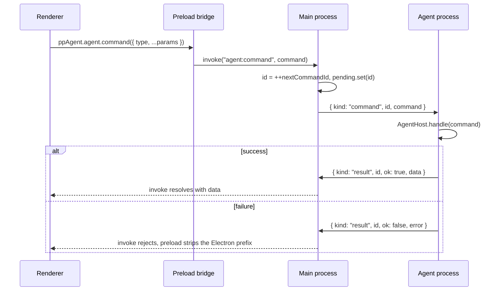
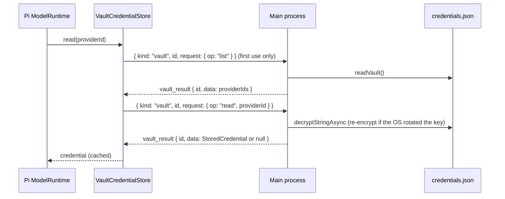

# IPC and message flow

Two hops carry all traffic: renderer ↔ main over Electron IPC (through the preload bridge), and main ↔ agent process over the utility process message port. Main is a relay for agent traffic; it only acts on its own for files, links and the vault.

## Renderer ↔ main channels

Channel names are the `IPC` constant in `packages/shared/src/index.ts`. All are `ipcMain.handle` / `ipcRenderer.invoke` pairs, except `agent:event`, which main pushes with `webContents.send`.

| Channel                | Bridge method                             | Handled by                                                                           |
| ---------------------- | ----------------------------------------- | ------------------------------------------------------------------------------------ |
| `agent:command`        | `agent.command(command)`                  | Forwarded to the agent process (below)                                               |
| `agent:event`          | `agent.onEvent(listener)`                 | Pushed by main for every agent event                                                 |
| `files:pick`           | `files.pick()`                            | Open dialog, returns `Attachment[]` with path and guessed MIME type                  |
| `files:pick-skill`     | `files.pickSkill()`                       | Folder or `.zip`/`.skill` picker                                                     |
| `files:pick-folder`    | `files.pickFolder()`                      | Folder picker (a new workspace's folder)                                             |
| `files:open-workspace` | `files.openWorkspace(dir)`                | Opens an absolute folder in Finder / Explorer                                        |
| `files:reveal`         | `files.reveal(path)`                      | Shows a path inside userData or the default workspace                                |
| `files:open-agent`     | `files.openAgentFile()`                   | Reads an exported agent file                                                         |
| `files:save-agent`     | `files.saveAgentFile(name, json)`         | Writes an exported agent file                                                        |
| `files:save-export`    | `files.saveExport(name, format, content)` | Save dialog, then writes an exported conversation (`md` or `html`; capped at 50 MiB) |
| `shell:open-external`  | `openExternal(url)`                       | http(s) URL in the default browser                                                   |
| `updates:state`        | `updates.state()`                         | Current `UpdateState`                                                                |
| `updates:check`        | `updates.check()`                         | Looks for a newer release (a person asked)                                           |
| `updates:download`     | `updates.download()`                      | Downloads in the app, or opens the release page for `.deb`                           |
| `updates:install`      | `updates.install()`                       | Quits and installs a downloaded update                                               |
| `updates:event`        | `updates.onState(listener)`               | Pushed by main whenever the `UpdateState` changes                                    |

`files.pathFor(file)` is answered in the preload itself (`webUtils.getPathForFile`) without IPC.

## Main ↔ agent process messages

Abridged from `packages/shared/src/index.ts`:

```ts
type MainToAgentMessage =
  | { kind: "init"; paths: AgentPaths }
  | { kind: "command"; id: number; command: AgentCommand }
  | { kind: "vault_result"; id: number; ok: true; data: unknown }
  | { kind: "vault_result"; id: number; ok: false; error: string };

type AgentToMainMessage =
  | { kind: "event"; event: AgentEvent }
  | { kind: "result"; id: number; ok: true; data: unknown }
  | { kind: "result"; id: number; ok: false; error: string }
  | { kind: "vault"; id: number; request: VaultRequest }
  | { kind: "open_url"; url: string };
```

| Message        | Direction    | What main does                                                                                  |
| -------------- | ------------ | ----------------------------------------------------------------------------------------------- |
| `init`         | main → agent | Sent once after fork with the userData-derived paths.                                           |
| `command`      | main → agent | Carries a renderer agent command with a main-assigned id.                                       |
| `result`       | agent → main | Resolves or rejects the pending `invoke` with that id.                                          |
| `event`        | agent → main | Forwarded unchanged to the renderer on `agent:event`.                                           |
| `vault`        | agent → main | Runs the vault operation and replies with `vault_result` carrying the same id.                  |
| `vault_result` | main → agent | Fed to `VaultCredentialStore.resolve` in the agent process.                                     |
| `open_url`     | agent → main | Opens an http(s) URL in the browser (provider or MCP OAuth sign-in); other schemes are refused. |

### Command correlation



- Ids are a per-main-process counter; the agent process echoes them back. When the agent process exits, every pending id is rejected.
- `AgentCommand` is a discriminated union generated from `AgentCommandMap`, so `bridge.agent.command({ type: "set_model", ... })` is typed with its own result (`AgentCommandResult<K>`). `AgentHost.handle` switches over the same union and ends with a `never` check.
- A command result means "accepted", not "finished". `prompt` resolves once attachments are prepared and the run has started; the reply streams as events.

### Vault requests

The agent process keeps Pi's `CredentialStore` in `VaultCredentialStore` (`apps/desktop/src/agent/credentials.ts`). It caches entries per provider and serialises writes per provider; each miss becomes a `vault` message with its own id space, independent of command ids:



Ops are `read`, `list`, `write`, `delete`. Main runs them one at a time through a promise queue (`serialize` in `apps/desktop/src/main/vault.ts`). An entry that can no longer be decrypted counts as missing; signing in again replaces it.

## Agent events

`AgentEvent` (shared contract) and how the renderer uses each (`apps/web/src/hooks/use-agent-connection.ts`, `apps/web/src/stores/chat-store.ts`):

| Event                                      | Renderer effect                                                                            |
| ------------------------------------------ | ------------------------------------------------------------------------------------------ |
| `status`                                   | Sets the chat store status.                                                                |
| `message`                                  | Upserts a `ChatMessage` by id (streaming replaces the same id repeatedly).                 |
| `snapshot`                                 | Replaces the whole chat store; refetches sessions and tools.                               |
| `approval_requested` / `approval_resolved` | Adds / removes a pending approval in the chat store.                                       |
| `sessions_changed`                         | Refetches the conversation list.                                                           |
| `context { context }`                      | Updates the context window gauge in the chat store (after each reply and after `compact`). |
| `settings_changed { scopes }`              | Invalidates the TanStack queries mapped from each `SettingsScope`.                         |
| `auth_prompt` / `auth_prompt_closed`       | Pushes / removes a sign-in prompt in the auth prompt modal store.                          |
| `auth_info`                                | Toast with the flow title, message and an "Open" action for the URL.                       |
| `error`                                    | Error toast.                                                                               |

Scope → query mapping (`SCOPE_KEYS`):

| Scope       | Queries refetched               |
| ----------- | ------------------------------- |
| `settings`  | settings                        |
| `providers` | providers, gateways             |
| `models`    | models                          |
| `tools`     | tools, agent tool options       |
| `skills`    | skills, every `["skill", name]` |
| `mcp`       | MCP overview, raw mcp.json      |
| `agents`    | agents, agent tool options      |

## Renderer state split

- **Zustand chat store** holds the live conversation: status, messages, approvals, model, agent, thinking, workspace, session path. It is fed only by agent events and the initial `get_snapshot`.
- **TanStack Query** holds everything requested on demand (settings, providers, models, tools, skills, MCP, agents, sessions, memory, scheduled tasks, voice input) and runs commands as mutations (`useAgentCommands` in `apps/web/src/lib/queries.ts`). The agent process tells it what is stale through `settings_changed` and `sessions_changed`; the renderer does not guess.
- **Composer store** (`apps/web/src/stores/composer-store.ts`) holds the draft and attachments; a failed `prompt` restores both.
