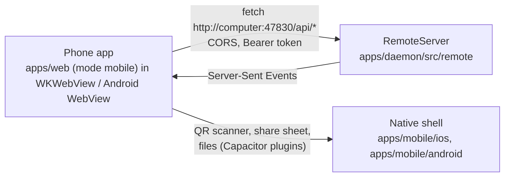

# Phone app (iOS and Android)

`apps/mobile` is PP Agent for phones: the web app (`apps/web`) bundled into a [Capacitor](https://capacitorjs.com) shell. It talks to the computer's [Phone access](phone-access.md) server exactly like the web app in a phone's browser, with the same pairing, device token, API and refused commands. What differs is where the page comes from: the app carries its own copy, so the person tells it which computer to use.



## Pieces

| Piece                 | Where                                                               | Role                                                                                                                                                                                                                               |
| --------------------- | ------------------------------------------------------------------- | ---------------------------------------------------------------------------------------------------------------------------------------------------------------------------------------------------------------------------------- |
| Capacitor project     | `apps/mobile/capacitor.config.ts`, `ios/`, `android/`               | App id `com.pptechs.agent`, web assets from `apps/mobile/www`. iOS uses Swift Package Manager (no CocoaPods); Android min SDK 26 (the barcode scanner's floor).                                                                    |
| Mobile build          | `vp run @workspace/web#build:mobile`                                | `vp build --mode mobile` into `apps/mobile/www`. The only difference from the desktop build is the CSP: `connect-src 'self' http: https:`, since the computer's address is known only at run time.                                 |
| `isNativeApp`         | `apps/web/src/lib/native.ts`                                        | `Capacitor.isNativePlatform()`. With it, `bridge.ts` picks the web bridge even though the page is not served over http(s). Also holds `scanQrCode` and `shareTextFile`, which load their plugins on first use.                     |
| Web bridge in the app | `apps/web/src/lib/web-bridge.ts`                                    | Same bridge; requests go to the stored computer (`pp-agent.server` in `localStorage`) instead of the page's origin. `connectToServer` checks `/api/session` before saving an address; a new computer drops the old token.          |
| Connect screen        | `apps/web/src/components/remote/remote-gate.tsx`                    | Phase `noComputer`: scan the QR code (connects, and pairs in the same step when pairing is open on the computer) or type an address. The pairing and unreachable screens show the computer's address and **Use another computer**. |
| Address parsing       | `apps/web/src/lib/server-address.ts`                                | Reads the QR link (`http://ip:port/#pair=CODE`), a bare `ip:port`, a host name, or an `https://` address (e.g. `tailscale serve`); plain HTTP without a port gets 47830.                                                           |
| CORS on the computer  | `appOrigin`, `applyCorsHeaders` in `apps/daemon/src/remote/http.ts` | The app's pages are `capacitor://localhost` (iOS) and `http://localhost` (Android). Requests from exactly these origins get CORS headers and preflights a 204; every other foreign origin is still refused with 403.               |
| Version sync          | `apps/mobile/scripts/sync-version.ts`                               | Copies `apps/mobile/package.json`'s version into Xcode (`MARKETING_VERSION`) and Gradle (`versionName`); the build number is `major*1000000 + minor*1000 + patch`.                                                                 |

## Platform choices

- **Plain HTTP to the computer.** Phone access has no TLS, so iOS sets `NSAllowsLocalNetworking` (App Transport Security allows local and private addresses) plus an HTTP exception for `*.ts.net` (Tailscale MagicDNS names), and Android sets `usesCleartextTraffic`. Android's page is `http://localhost` (`server.androidScheme: "http"`): still a secure context, and an `http:` page may fetch `http:` addresses, which an `https://localhost` page could not. On iOS, `capacitor://localhost` is a secure context and WKWebView lets it fetch local `http:` addresses.
- **Secure context.** Unlike a browser on `http://192.168…`, the app has `crypto.randomUUID`, the clipboard API and the microphone, so the composer's microphone button shows (iOS `NSMicrophoneUsageDescription`, Android `RECORD_AUDIO`).
- **Off the home network.** Tailscale's `100.64.0.0/10` addresses count as local network (`isLocalNetworkAddress`), and Settings › Phone access on the computer lists the Tailscale address among the QR code's addresses. Pick it before scanning, or type it.
- **QR scanning** uses `@capacitor/barcode-scanner` (Apple Vision on iOS, ML Kit or ZXing on Android) with `NSCameraUsageDescription` and `CAMERA`. Closing the scanner is not an error; a denied camera shows the plugin's message.
- **Exports and agent files** go to the system share sheet (`@capacitor/filesystem` writes `Cache/exports/<name>`, `@capacitor/share` shares it). `navigator.share` is not used: an export first waits for the computer, and WebKit then refuses it for lack of a fresh tap.
- **Keyboard** (`@capacitor/keyboard`): `resize: "native"` shrinks the Web View to the space above the keyboard; `setUpNativeKeyboard` hides iOS's Previous/Next/Done bar and sets `data-keyboard="open"` on `<html>` while the keyboard shows, which zeroes `--safe-bottom` so the composer drops the home indicator's padding and sits on the keyboard.
- **No backups.** Android sets `allowBackup="false"` and `data_extraction_rules.xml` excludes everything from cloud backups and device transfers (Android 12+), so a device token never reaches another phone; a new phone pairs again.
- **Storage.** The token and the computer's address live in the WebView's `localStorage`, like the browser web app. If the system clears it, the app asks to connect again.

## Building

Requirements: Xcode with an iOS simulator, or Android Studio with an SDK (JDK 21).

```bash
cd apps/mobile
vp run sync      # build the web app for mobile, set native versions, cap sync
vp run ios       # sync, then open Xcode
vp run android   # sync, then open Android Studio
```

Run from Xcode or Android Studio on a simulator or a device. The simulator shares the Mac's network, so it can connect to `http://<the Mac's address>:47830` with phone access turned on.

Not yet automated: store signing and uploads, push notifications (they need a relay service the app does not have), and a CI build of the native projects.
