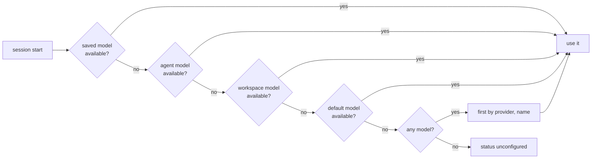

# Model and thinking selection

Models come from Pi's `ModelRuntime`: built-in providers the person connected, plus gateways registered from `settings.json`. A model is "available" when the runtime's availability snapshot contains it (`findAvailable` in `apps/desktop/src/agent/providers.ts`); only available models can be chosen. `list_models` (`availableModels`) also returns the models of gateways that need a key and have none, marked `needsKey: true`; `set_model` and `update_settings` reject them with a "needs an API key" error (`gatewayNeedingKey`), and saved agent, workspace and conversation models pointing at them fall back as for any unavailable model. A gateway with `requiresApiKey: false` is registered with the literal placeholder `apiKey` `not-needed`, which makes Pi treat it as configured (auth source `fallback`, shown as "No key needed"); a key stored in the vault takes precedence (Pi checks the stored credential before the configured key).

## Which model a conversation uses

When a session starts (`startSession` → `chooseModel`), the first available of:

1. **The conversation's own model** — the model Pi saved in the session file (new conversations have none).
2. **The agent's model** — `AgentProfile.model` of the conversation's agent.
3. **The workspace's model** — `WorkspaceProfile.model` of the conversation's workspace.
4. **The default model** — `settings.json` `defaultModel` (Settings › Models).
5. **The first available model**, sorted by provider name, then model name.

If none is available the conversation has no model and the status is `unconfigured`; `prompt` then fails with "Choose a model in Settings › Models before starting a chat."

Changes after the session started:

| Trigger                                              | Effect on the open conversation                                                                                                                                             |
| ---------------------------------------------------- | --------------------------------------------------------------------------------------------------------------------------------------------------------------------------- |
| `set_model` (model picker)                           | `session.setModel`; Pi saves it with the conversation. Refreshes availability once if the model is not found yet; fails if still unavailable.                               |
| Provider or gateway change (`model` flag)            | `ensureModel`: keeps the current model if still available (re-applies it when a re-registered gateway produced a new model object), else falls back to `chooseModel(null)`. |
| Agent switch or agent model edit (`agentModel` flag) | `useAgentModel`: switches to the agent's model when it is available; otherwise an `error` event says the current model is kept.                                             |
| `update_settings { defaultModel }`                   | Only an empty conversation whose agent and workspace have no usable model of their own switches immediately. The new default must be available, or the command fails.       |

The renderer disables the model picker while a run is active (`apps/web/src/components/chat/model-picker.tsx`).

## Thinking level

Levels are `THINKING_LEVELS`: `off`, `minimal`, `low`, `medium`, `high`, `xhigh`, `max`.

- **New conversation:** starts with the workspace's thinking level when it sets one, else `settings.json` `thinkingLevel`, the level picked last.
- **Saved conversation:** Pi restores the level saved in the session file (the app passes no level when the session already has messages).
- **Clamping:** Pi clamps the level to what the model offers. The snapshot carries `thinking: { level, available }`; `available` is empty when the model cannot think, and the renderer then hides the picker.
- **`set_thinking_level`:** sets the level on the open conversation and stores it as the level for new conversations (emits `settings_changed ["settings"]` when that changed), then sends a snapshot. The picker is disabled while running.
- **Gateways:** a gateway model can think only when its `reasoning` flag is set in the gateway settings (`GatewayModel.reasoning`, default false).
