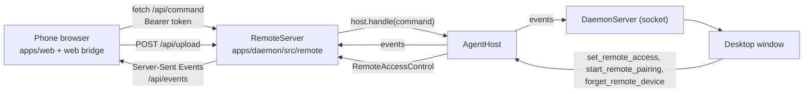

# Phone access (web app on the local network)

Settings › Phone access lets a phone, or another computer on the same network, use PP Agent in its web browser. The daemon serves the same React app the window shows (`apps/web/dist`) over HTTP, and a small API replaces the preload bridge. It is off by default.

## Pieces

| Piece                   | Where                                                        | Role                                                                                                                                                                                                                                        |
| ----------------------- | ------------------------------------------------------------ | ------------------------------------------------------------------------------------------------------------------------------------------------------------------------------------------------------------------------------------------- |
| `RemoteServer`          | `apps/daemon/src/remote/server.ts`                           | The HTTP listener (`0.0.0.0:<port>`, default 47830), static files, the API, pairing (`PairingGuard` from agent-core), event streams, uploads. Implements `RemoteAccessControl`, which `AgentHost` calls for the four phone access commands. |
| `RemoteStore`           | `apps/daemon/src/remote/store.ts`                            | `<home>/remote.json` (mode 0600): on/off, port, and paired devices. A device's secret is stored only as a SHA-256 hash.                                                                                                                     |
| `findWebDir`            | `apps/daemon/src/remote/web-dir.ts`                          | Finds the built web app: `PP_AGENT_WEB_DIR`, else `<PP_AGENT_RESOURCES>/renderer` (packaged), else `apps/web/dist` beside the daemon's bundle or source. Looked up each time the server starts listening.                                   |
| Web bridge              | `apps/web/src/lib/web-bridge.ts`                             | A `DesktopBridge` with `kind: "web"`: commands over `fetch`, events over a streamed SSE response, attachments through `files.upload`. Desktop-only methods (side panel, Finder, updates, computer use) reject or do nothing.                |
| `RemoteGate`            | `apps/web/src/components/remote/remote-gate.tsx`             | Checks `/api/session`; shows the pairing screen (reads `#pair=CODE` from the QR code), an "unreachable" screen, and a reconnect banner.                                                                                                     |
| Settings › Phone access | `apps/web/src/components/settings/remote-access-section.tsx` | On the computer: switch, port, warning, QR code and addresses, pairing code, paired devices. In the web app: "This device" with Unpair.                                                                                                     |

`apps/web/src/lib/bridge.ts` uses the preload bridge when it exists, else the web bridge when the page is served over http(s); `isWebApp` gates the UI.

## API

All JSON. Requests from outside the local network (`isLocalNetworkAddress`, see the security rules) and requests with an `Origin` whose host differs from `Host` get 403, except the [phone app](mobile-app.md)'s origins (`capacitor://localhost`, `http://localhost`), which get CORS headers instead. A `Host` that does not name this computer gets 421 (see the security rules). A request (headers and body) must arrive within 10 minutes; responses, such as the event stream, are not limited.

| Route               | Auth  | Does                                                                                                                                                                                                                                                                                                                          |
| ------------------- | ----- | ----------------------------------------------------------------------------------------------------------------------------------------------------------------------------------------------------------------------------------------------------------------------------------------------------------------------------- |
| `GET /api/session`  | none  | `{ paired, deviceName, appVersion }`; `paired` is true only with a valid token.                                                                                                                                                                                                                                               |
| `POST /api/pair`    | none  | `{ code, name }` → `{ token, deviceName }`. 400 for a wrong or closed code, 429 while locked (for everyone, or for the sending address).                                                                                                                                                                                      |
| `GET /api/events`   | token | `text/event-stream`: one `data:` line per `AgentEvent`, a `: ping` every 20 s. Three streams per device at most; a fourth closes the oldest. A stream that leaves 4 MB unread is dropped (the app refetches a snapshot when it reconnects).                                                                                   |
| `POST /api/command` | token | An `AgentCommand` → `{ ok: true, data }` or `{ ok: false, error }`. 403 for commands `remoteMayRun` refuses and for unblocking an app.                                                                                                                                                                                        |
| `POST /api/upload`  | token | Raw body, `Content-Type`, `X-File-Name` (URI-encoded) → an `Attachment` whose path is under `<home>/remote-uploads/<device id>/<uuid>/`. Up to 100 MB, written to disk as it arrives; three uploads per device at a time (429 beyond). Leftovers are swept after a day, and a device's folder is removed when it is unpaired. |
| `POST /api/logout`  | token | Forgets this device.                                                                                                                                                                                                                                                                                                          |
| anything else (GET) | none  | Static files from the web app; paths without an extension get `index.html`. `assets/` is cached as immutable.                                                                                                                                                                                                                 |

"token" means `Authorization: Bearer <deviceId>.<secret>`; 401 otherwise, and the web app returns to the pairing screen.

## Security rules

- **Off by default**, switched on only from the computer (the phone access commands are in `REMOTE_LOCAL_ONLY_COMMANDS`).
- **Local network only** (`isLocalNetworkAddress`): private IPv4, link-local, IPv6 unique-local and link-local source addresses. Carrier-grade NAT (`100.64.0.0/10`, Tailscale) counts only while one of the computer's own interfaces has such an address, since some ISPs and hotspots give those addresses to other customers. Loopback is answered only when `Host` is a loopback name (`localhost`, `127.x`, `[::1]`: a browser or `vp dev` proxy on the computer). A tunnel or reverse proxy on the computer (`tailscale funnel` or `serve`, `cloudflared`, `ngrok`) arrives on loopback with its public name and gets 403; such setups are not supported.
- **`Host` allowlist** (`isOwnHost`): the computer's own addresses, its host name (with or without `.local`), `localhost`, and `*.ts.net` while the computer is on a tailnet. Anything else gets 421, so a website that rebinds its own name to the computer's address (DNS rebinding) cannot reach the pairing endpoint.
- **Pairing**: an 8-character one-time code, valid ten minutes, one use; five wrong codes from anyone lock pairing for fifteen minutes, and three wrong codes from one source address lock that address for fifteen minutes (`AddressLockout`), so one client cannot lock everyone out. Starting a new pairing on the computer lifts both (same `PairingGuard` as Telegram and Zalo). The QR code carries the code in the URL fragment, which never reaches the server or its logs; the page removes it from the address bar.
- **Device token in a header, not a cookie**: kept in the page's `localStorage` (scoped to scheme, host and port, unlike cookies) and sent as `Authorization`. Nothing is ambient, so a page on another site cannot use it (no CSRF), and the event stream is read with `fetch` so the token never appears in a URL. A device unused for 30 days (`DEVICE_IDLE_MS`, from `lastSeenAt`) is signed out: its token stops working at once and the hourly sweep removes it.
- **Refused from a device** (`remoteMayRun` and `REMOTE_LOCAL_ONLY_COMMANDS` in `packages/shared`, 403):
  - phone access itself: `get_remote_access`, `set_remote_access`, `start_remote_pairing`, `forget_remote_device`;
  - what lets the computer run programs without someone approving each one: `save_mcp_server`, `save_mcp_json`, `set_tool_policy`, `get_mcp_json` (plain-text keys), `import_skill` (a path only the computer's file picker supplies), always allowing an app for computer use (`set_computer_app_access` with `allowed`, or `respond_approval` with `remember: "always"`; answering with `conversation` or no `remember` works), taking an app off the blocked list (`set_computer_app_access` with `null` for a blocked app; checked by `RemoteServer` against `list_computer_apps`), turning on yolo mode (`set_conversation_yolo` with `active: true`, `update_settings` with `yoloMode: true`) and the shell (`shellEnabled: true`);
  - Telegram and Zalo set-up: `save_telegram`, `start_telegram_pairing`, `forget_telegram`, `save_zalo`, `start_zalo_pairing`, `forget_zalo`. Whoever pairs a bot talks to the agent from anywhere and keeps doing so after the device is forgotten. `get_telegram_status` and `get_zalo_status` work, with `pairingCode` and `pairingExpiresAt` blanked;
  - creating a workspace (`save_workspace` without `id`): it creates a folder anywhere, and an `AGENTS.md` written there is read by every agent working below it. Editing an existing workspace (its folder never changes) and its `AGENTS.md` works, since every workspace folder was chosen on the computer. Trusting a workspace's own skills (`set_workspace_skills_trust` with `trusted: true`) is refused too; withdrawing trust works;
  - bulk deletions and the login service: `delete_workspace`, `clear_sessions`, `clear_memory`, `set_service_installed`.

  Turning the shell, yolo mode or an always-allowed app off, and blocking an app, are allowed. Everything else works as in the window, including answering approvals: a device that holds a token can approve the agent's own write and exec calls, so the token is as powerful as the window for those.

- **Attachments**: `prompt` and `edit_message` attachments with a `path` must be inside the sending device's own `remote-uploads/<device id>/`, so a device cannot have the agent read an arbitrary file on the computer without the read tools and their approvals.
- **Headers**: `X-Frame-Options: DENY`, `frame-ancestors 'none'`, `nosniff`, `Referrer-Policy: no-referrer`; the page keeps its build-time CSP (`connect-src 'self'`).
- **The phone app's origins**: `capacitor://localhost` is a scheme no website can have. `http://localhost` (Android) is also the origin of any page served on port 80 of `localhost` in the browser that makes the request, so such a page may read answers; it still gets only what any unpaired client gets: `GET /api/session` and pairing with a valid code (the web app's static files need no token either). The other API routes need a device token, which lives in the app's own storage.
- **Not encrypted**: plain HTTP. Anyone who can watch the network's traffic can read conversations and copy a device token. Settings shows a standing warning to use it only on trusted networks. HTTPS with a self-signed certificate was left out: phones show a full-page warning and some refuse to remember the exception.
- **Stored keys stay with their address**: from a device, `save_gateway` that changes a stored gateway's base URL, or `fetch_gateway_models` against another URL with a gateway's stored key, needs the key typed again (403 otherwise), so a copied device token cannot send a saved key to another server. The window may still fix an address without retyping. Web search enforces the same rule for every caller: `WebSearchService.save` deletes a provider's stored key when its endpoint changes, unless a new key comes in the same save.
- **MCP secrets**: `list_mcp_servers` answers devices with the values of `env` and `headers` hidden; `get_mcp_json` is refused.
- **Signed out mid-request**: a device unpaired while its command or upload was arriving gets 401; unpairing (or a pairing that pushes out the oldest of 20 devices) closes its event streams and removes its uploads.
- **IPv4 only**: the listener binds `0.0.0.0` and the addresses offered are IPv4; IPv6-only networks are not supported.
- `open_url` frames (OAuth sign-in) are not sent to devices; sign-in pages open on the computer.

## Behaviour

- A device that is signed out while in use reloads into the pairing screen, so no dialog or cached data stays. Send waits while attachments are still uploading.
- Devices and the window share the daemon's state: every event reaches every client, so opening a conversation on the phone opens it in the window too, as with two windows.
- The web app reconnects the event stream with backoff (1 s to 10 s), at once when the page becomes visible again or the network returns, and after 45 s without data. Every time the stream opens (the first time too) it requests a fresh `get_snapshot` and refetches every settings query, since events from before the stream opened are not replayed. Like the window, it does not order that snapshot against events arriving meanwhile; the next event for a message replaces it.
- Pages served over plain HTTP are not a secure context: `navigator.clipboard`, `crypto.randomUUID` and the microphone are missing. Copy buttons fall back to `document.execCommand("copy")` (`packages/ui/src/lib/clipboard.ts`), ids use `getRandomValues` (`apps/web/src/lib/id.ts`), and the microphone button is hidden.
- Hidden in the web app: the side panel, open-folder and reveal buttons, Settings › Browser and Computer use, the desktop group, updates and diagnostics in General, skill import. MCP servers and tool policies are shown read-only with a notice. Other actions the server refuses (creating a workspace, Telegram and Zalo set-up, clearing conversations or memory, deleting a workspace, the login service, "always allow" on an app approval) show the "only on the computer" error when tried.

## Development

`vp dev` in `apps/web` proxies `/api` to `127.0.0.1:47830`. Turn on phone access (default port) in a running app, then open `http://localhost:47821` in a browser, or `vp dev --host` and the computer's address on a phone.
