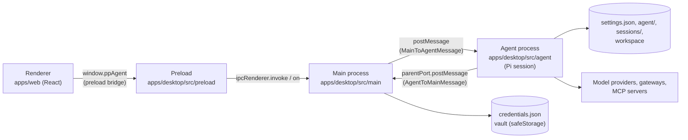
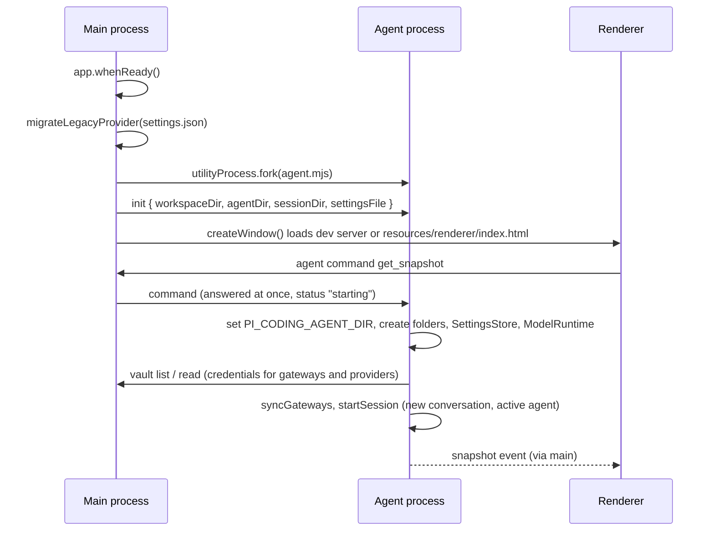

# Process model

PP Agent runs as four cooperating pieces inside one Electron app. Everything that crosses a process boundary is typed in `packages/shared/src/index.ts`, so the three sides (main, agent process, renderer) cannot drift.

## Responsibilities

| Piece          | Entry                               | Owns                                                                                                                                                                                                                                                                                                                                         |
| -------------- | ----------------------------------- | -------------------------------------------------------------------------------------------------------------------------------------------------------------------------------------------------------------------------------------------------------------------------------------------------------------------------------------------- |
| Main process   | `apps/desktop/src/main/index.ts`    | The window, native dialogs (`apps/desktop/src/main/files.ts`), opening folders and http(s) links, the vault (`apps/desktop/src/main/vault.ts`), the one-time legacy `provider.json` migration (`apps/desktop/src/main/legacy.ts`), forking and restarting the agent process, and correlating agent command ids with renderer `invoke` calls. |
| Agent process  | `apps/desktop/src/agent/index.ts`   | The Pi SDK: `ModelRuntime`, the `AgentSession`, extensions (approval gate, agent extension, codemode, tool search, MCP), tools, skills, MCP servers, `settings.json`, sessions, attachments. It handles every agent command and emits every agent event.                                                                                     |
| Preload bridge | `apps/desktop/src/preload/index.ts` | Exposes `window.ppAgent` (`DesktopBridge`) through `contextBridge`. Strips Electron's "Error invoking remote method" prefix so the renderer can show main's message as is, and resolves dropped files' paths with `webUtils.getPathForFile` (a sandboxed renderer cannot read `File.path`).                                                  |
| Renderer       | `apps/web/src/main.tsx`             | UI only. Mirrors the agent process into a Zustand store (`apps/web/src/stores/chat-store.ts`) and reads settings through TanStack Query (`apps/web/src/lib/queries.ts`). It has no Node access and no network access; all I/O goes through the bridge.                                                                                       |

The agent process never touches Electron windows or `safeStorage`; the main process never touches the Pi SDK.

## Why the agent runs in a utility process

The agent process is started with `utilityProcess.fork(dist/agent.mjs)` (service name "PP Agent"). The reasons, as stated in the code:

- **The window never freezes.** A Pi session runs model streaming, tool execution, document parsing and MCP connections; running it off the main process keeps the event loop that drives the window free (`apps/desktop/src/agent/index.ts` header comment).
- **A crash is recoverable.** When the agent process exits unexpectedly, main rejects every pending command with "The agent stopped unexpectedly.", sends an `error` event and a `status: "starting"` event to the renderer, and forks a new agent process after 1 s (`RESTART_DELAY_MS`). On quit (`before-quit`) it kills the agent process without restarting it.
- **Secrets stay narrow.** `safeStorage` is only available in the main process, so credentials are decrypted there and handed to the agent process one provider at a time through vault requests (see [Data storage](data-storage.md)).

## Startup sequence

`get_snapshot` is the only command answered before `init` finishes; every other command waits on the agent process's `ready` promise. The renderer subscribes to agent events first and then requests a snapshot, so it never misses an update (`apps/web/src/hooks/use-agent-connection.ts`).

`startAgent()` and `createWindow()` run concurrently: the fork waits for the legacy migration, the window does not. A command sent before the agent process exists is rejected by main with "The agent is not running." and the renderer shows it as a toast.

## Agent status

`AgentStatus` is derived in the agent process (`refreshStatus`):

| Status         | Meaning                                                                                 |
| -------------- | --------------------------------------------------------------------------------------- |
| `starting`     | Before `init` finished, or after an agent process crash while the restart is pending.   |
| `unconfigured` | No usable model on the open conversation (no provider connected or no model available). |
| `idle`         | A model is available and no run is active.                                              |
| `running`      | Between Pi's `agent_start` and `agent_settled` session events.                          |

## Window hardening

- `BrowserWindow` uses `contextIsolation: true`, `sandbox: true`, `nodeIntegration: false`; the preload is built as CommonJS because sandboxed preloads must be.
- `will-navigate` is prevented; `window.open` is denied and http(s) URLs go to the default browser instead.
- The packaged renderer carries a Content-Security-Policy meta tag injected at build time (`apps/web/vite.config.ts`): `default-src 'self'`, `connect-src 'self'`, no remote scripts. Dev builds skip it because the dev server injects inline HMR scripts.
- Web permissions (`apps/desktop/src/main/permissions.ts`): the default session grants the app window only the audio `media` permission (voice input; never video) and `clipboard-sanitized-write` (copy buttons); every other permission and every other page is denied. `getUserMedia` and `MediaRecorder` are not governed by the CSP, so it needs no media entry.
- Main validates every argument it receives over IPC: `files:open-workspace` accepts only absolute folder paths, `files:reveal` only paths inside userData or the default workspace, `shell:open-external` only `http:`/`https:` URLs. The agent process accepts session paths only inside `sessions/` and ending in `.jsonl` (`requireSessionPath`).
