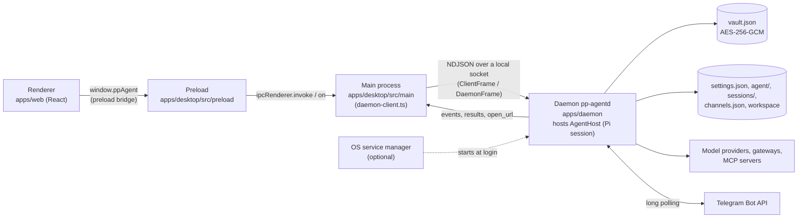
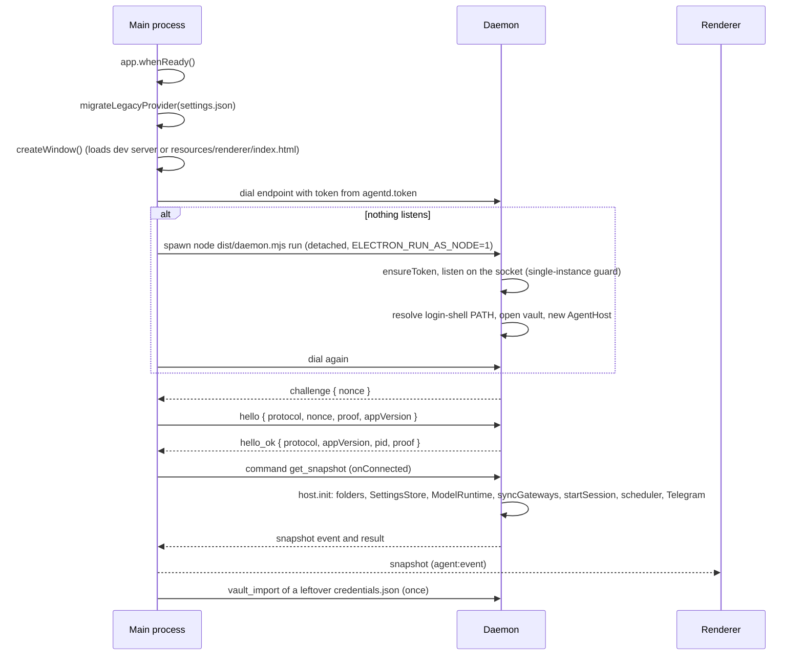

# Process model

PP Agent is an Electron app (main, preload, renderer) plus a headless Node daemon, `pp-agentd`, that hosts the agent. The window is a client of the daemon, so the agent keeps working (scheduled tasks, the Telegram bot) when the window is closed. Everything that crosses a process boundary is typed in `packages/shared/src/index.ts`, so the sides cannot drift.

## Responsibilities

| Piece          | Entry                                                                       | Owns                                                                                                                                                                                                                                                                                                                                                                                                                                   |
| -------------- | --------------------------------------------------------------------------- | -------------------------------------------------------------------------------------------------------------------------------------------------------------------------------------------------------------------------------------------------------------------------------------------------------------------------------------------------------------------------------------------------------------------------------------- |
| Main process   | `apps/desktop/src/main/index.ts`, `daemon-client.ts`                        | The window, tray icon and global shortcut, native dialogs (`files.ts`), opening folders and http(s) links, the one-time legacy migrations (`legacy.ts`, `legacy-vault.ts`), and the daemon connection (`DaemonClient`): finding, starting, replacing and reconnecting to the daemon, and correlating command ids with renderer `invoke` calls. It holds no secrets and never touches the Pi SDK.                                       |
| Daemon         | `apps/daemon/src/index.ts` (bundled as `dist/daemon.mjs` by `apps/desktop`) | The local socket server (`server.ts`), the token file, the vault (`vault/`), the OS service installers (`service/`), the CLI (`cli.ts`), and one `AgentHost`. It exists once per data folder: whoever listens on the socket first is the daemon, a second one exits.                                                                                                                                                                   |
| Agent core     | `packages/agent-core/src/index.ts`                                          | `AgentHost`: the Pi SDK (`ModelRuntime`, the `AgentSession`, extensions: approval gate, agent extension, codemode, tool search, MCP), tools, skills, MCP servers, `settings.json`, sessions, attachments, the scheduler, and the chat channels (Telegram). It handles every agent command and emits every agent event. It depends only on a small environment (`HostEnvironment`: output, vault, service control) the daemon provides. |
| Preload bridge | `apps/desktop/src/preload/index.ts`                                         | Exposes `window.ppAgent` (`DesktopBridge`) through `contextBridge`. Strips Electron's "Error invoking remote method" prefix so the renderer can show main's message as is, and resolves dropped files' paths with `webUtils.getPathForFile` (a sandboxed renderer cannot read `File.path`).                                                                                                                                            |
| Renderer       | `apps/web/src/main.tsx`                                                     | UI only. Mirrors the daemon into a Zustand store (`apps/web/src/stores/chat-store.ts`) and reads settings through TanStack Query (`apps/web/src/lib/queries.ts`). It has no Node access and no network access; all I/O goes through the bridge.                                                                                                                                                                                        |

The daemon never touches Electron windows (it is plain Node, no Electron API); main never touches the Pi SDK or the vault.

## Why the agent runs in a daemon

The agent used to run in an Electron utility process that died with the app. A separate daemon, also run by Node (`ELECTRON_RUN_AS_NODE`) when the app starts it, gives:

- **The window never freezes.** A Pi session runs model streaming, tool execution, document parsing and MCP connections in another process, so the event loop that drives the window stays free.
- **The agent outlives the window.** With the optional login service installed (launchd, systemd user unit or Windows scheduled task, see [Data storage](data-storage.md) and the [background use case](../project-pdr/use-case-background-and-telegram.md)) the daemon runs without the app, so scheduled tasks and the Telegram bot keep working.
- **One owner of secrets and state.** The daemon alone reads and writes `vault.json`, `settings.json` and the sessions; the window, whenever it connects, sees the same state through events.
- **A crash is recoverable.** Main reconnects (and respawns the daemon if needed); see below.

Several clients may be connected at once. The daemon broadcasts every event to every authenticated client, and every client may send commands.

## Startup sequence

Details:

- `startDaemon()` and `createWindow()` run concurrently. The legacy `provider.json` migration (`legacy.ts`) finishes before the daemon is started so the daemon reads the `settings.json` it writes.
- The daemon listens before it opens anything else. Commands that arrive while `AgentHost.init` still runs wait for it; `get_snapshot` is the exception and is answered at once with status `starting`. The renderer subscribes to agent events first and then requests a snapshot, so it never misses an update (`apps/web/src/hooks/use-agent-connection.ts`).
- Spawn: main waits up to 20 s (`START_TIMEOUT_MS`), dialling every 150 ms. The daemon's output goes to `<home>/logs/daemon.log` (appended).
- Version check: `hello_ok` carries the daemon's `DAEMON_PROTOCOL` and app version (`PP_AGENT_VERSION`, else the daemon's `package.json`). If either differs from the app's, main sends `shutdown`, waits up to 5 s for the connection to close and starts over, at most twice; a daemon that still differs is accepted with a warning. A service manager restarts the stopped daemon from the new files; otherwise main spawns it.
- A command sent while no connection exists waits up to 20 s; after that it is rejected with "The agent is not running." and the renderer shows a toast.
- Ownership: main remembers whether the daemon answering has the pid it spawned (`hello_ok.pid`). Only then does it count as "started by this app".

## Crash, restart and quit

| Situation                                                | What happens                                                                                                                                                                                                                                                 |
| -------------------------------------------------------- | ------------------------------------------------------------------------------------------------------------------------------------------------------------------------------------------------------------------------------------------------------------ |
| The connection drops (daemon crashed or was stopped)     | Main rejects every pending command with "The agent stopped unexpectedly.", sends an `error` and a `status: "starting"` event to the renderer, waits 1 s (`RETRY_DELAY_MS`) and runs the startup sequence again; when nothing listens it spawns a new daemon. |
| The daemon cannot be started or reached                  | Main reports "The agent could not start: …" once, shows `starting`, and keeps retrying every second.                                                                                                                                                         |
| The daemon runs as a login service and crashes           | The service manager restarts it (launchd `KeepAlive` with a throttle, systemd `Restart=always` after 10 s; the Windows task starts only at logon). Whichever daemon listens first wins; the other exits quietly ("already running").                         |
| The person quits the app and this app started the daemon | Main sends `shutdown` and closes the socket (`before-quit`). The daemon stops the Telegram bot, the scheduler and running chats (5 s limit), removes the socket and exits.                                                                                   |
| The person quits and the daemon was already running      | Main only closes its connection; the daemon, the scheduled tasks and the bot keep running. This is the case with the login service, with a daemon started from a terminal, and with one left behind by an earlier crashed app.                               |
| The window is closed                                     | With the tray icon on, the window hides and the app keeps running; otherwise the app quits (macOS keeps it running without windows). Either way the quit rule above decides the daemon's fate.                                                               |

`SIGTERM` and `SIGINT` stop the daemon the same way as `shutdown`.

## The daemon socket

- Unix startup holds an exclusive per-endpoint lock recording the PID, generation and OS boot identifier until shutdown. Locks from a previous boot are reclaimed even if their PID has been reused; locks from this boot are reclaimed only when the recorded process is dead. Legacy locks without a boot identifier retain the PID liveness check. Main validates the socket and its parent before connecting. Windows pipe instances inherit a restricted process default DACL granting access only to the current user and SYSTEM; failure to set it aborts startup.
- Endpoint: `<home>/run/agentd.sock` (a Unix socket, mode 0600, in a directory owned by the current user and tightened to mode 0700 without changing home permissions); when that path is longer than 100 characters, `/tmp/pp-agent-<uid>/agentd-<12 hex of sha1(home)>.sock`. On Windows a named pipe `\\.\pipe\pp-agentd-<12 hex of sha1(home)>`. Restart existing Unix daemons after upgrading from the former `<home>/agentd.sock` or `/tmp/pp-agent-<uid>/agentd.sock` endpoints.
- Authentication (protocol 2): the daemon sends a fresh challenge, and the client replies with `hello` containing a fresh nonce and an HMAC proof over both nonces and its version fields. The daemon replies with its own HMAC over both nonces, version fields and pid; main verifies it before adopting the connection. The shared secret in `<home>/agentd.token` (64 hex characters, mode 0600) is never sent. Invalid proofs or no `hello` within 5 s close the connection. The frame protocol is in [IPC and message flow](ipc-and-messages.md).
- A client that stops reading (more than twice the 64 MiB frame limit queued) is dropped rather than waited for.
- The daemon listens only on this local endpoint. There is no network listener and no remote UI.

## Agent status

`AgentStatus` is derived in the daemon (`refreshStatus`):

| Status         | Meaning                                                                                                       |
| -------------- | ------------------------------------------------------------------------------------------------------------- |
| `starting`     | Before `AgentHost.init` finished, or in the renderer while main reconnects after the daemon connection broke. |
| `unconfigured` | No usable model on the open conversation (no provider connected or no model available).                       |
| `idle`         | A model is available and no run is active.                                                                    |
| `running`      | Between Pi's `agent_start` and `agent_settled` session events.                                                |

## Window hardening

- `BrowserWindow` uses `contextIsolation: true`, `sandbox: true`, `nodeIntegration: false`; the preload is built as CommonJS because sandboxed preloads must be.
- `will-navigate` is prevented; `window.open` is denied and http(s) URLs go to the default browser instead.
- The packaged renderer carries a Content-Security-Policy meta tag injected at build time (`apps/web/vite.config.ts`): `default-src 'self'`, `connect-src 'self'`, no remote scripts. Dev builds skip it because the dev server injects inline HMR scripts.
- Web permissions (`apps/desktop/src/main/permissions.ts`): the default session grants the app window only the audio `media` permission (voice input; never video) and `clipboard-sanitized-write` (copy buttons); every other permission and every other page is denied. `getUserMedia` and `MediaRecorder` are not governed by the CSP, so it needs no media entry.
- Main validates every argument it receives over IPC: `files:open-workspace` accepts only absolute folder paths, `files:reveal` only paths inside userData or the default workspace, `shell:open-external` only `http:`/`https:` URLs. The daemon accepts session paths only inside `sessions/` and ending in `.jsonl` (`requireSessionPath`).
