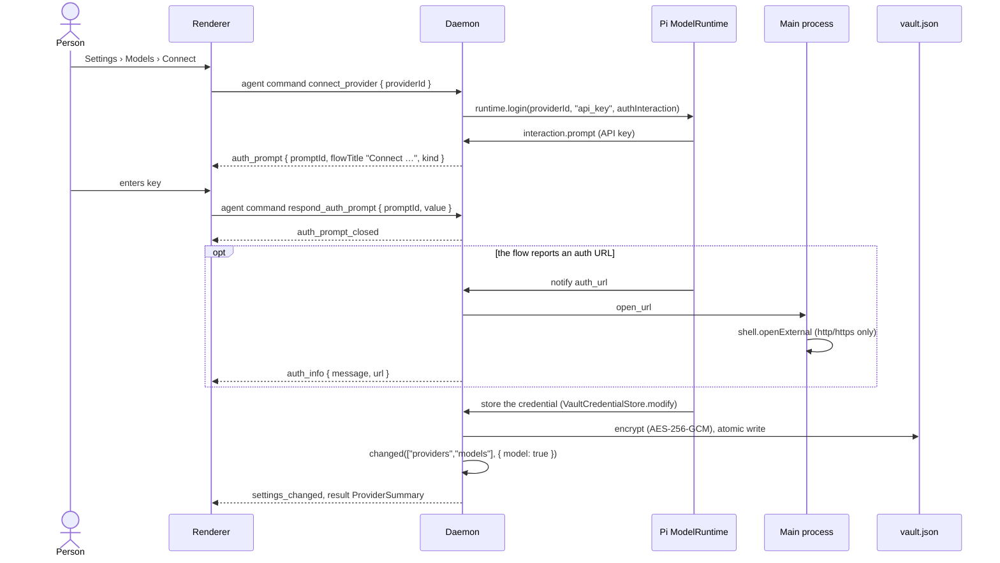
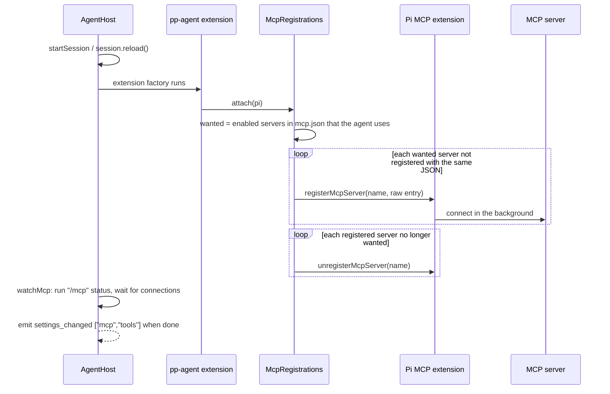

# Providers, gateways and MCP servers

Both model access and business systems run entirely in the daemon; the renderer has no network access. Sign-in flows that need input from the person are routed through the same auth prompt mechanism. Code: `packages/agent-core/src/providers.ts`, `packages/agent-core/src/auth-prompts.ts`, `packages/agent-core/src/mcp.ts`.

In the diagrams below, renderer ↔ daemon arrows are relayed by the preload bridge and the main process (see [IPC and message flow](ipc-and-messages.md)).

## Auth prompts

`AuthPrompts.ask` turns a question from a sign-in flow into an `auth_prompt` event (`kind`: `text`, `secret`, `select`, `manual_code`) and waits. The renderer's auth prompt modal answers with the `respond_auth_prompt` command (`value: null` = cancel). The prompt also settles when the flow aborts it (for example when a browser callback finished first); either way an `auth_prompt_closed` event removes it from the modal. Progress and instructions arrive as `auth_info` events, shown as toasts with an "Open" link.

## Connecting a provider

Providers are Pi's built-in catalog. The app signs in with an API key: `connect_provider` runs `runtime.login(providerId, "api_key", authInteraction(...))`, and Pi stores the result through `VaultCredentialStore`, i.e. in the daemon's vault (`vault.json`).

- A `CredentialSynchronizationError` after login is ignored: the key was saved and only the local refresh failed.
- `disconnect_provider` runs `runtime.logout`; Pi removes the credential through the same store.
- `ProviderSummary.authSource` tells where a credential comes from (a saved key, or an environment variable such as `OPENAI_API_KEY`).
- The `model` pending flag makes the open conversation keep a usable model once the provider list changed.

## Gateways

A gateway is a custom endpoint speaking one of `GATEWAY_APIS` (OpenAI- or Anthropic-compatible). It is stored in `settings.json` (`GatewayConfig`, id `gw-<slug>`) and its API key in the vault under the same id.

- `syncGateways` registers every gateway with `runtime.registerProvider` (unregistering first, because re-registration merges with the old config), drops deleted ones, then refreshes availability without network access. It runs at `init` and after each `save_gateway` / `delete_gateway`.
- Gateway model defaults: name = the name set on the model, else the name in Pi's catalog, else the id; `reasoning` false, image input on, zero cost. Context window and max tokens come from the model's own setting, else from Pi's built-in catalog (matched by id, also without a `vendor/` prefix, preferring the provider that matches the gateway's API), else 128,000 and 16,384.
- `normalizeBaseUrl` drops a trailing `/v1` for Anthropic gateways (the client appends `/v1/messages`) and keeps it for OpenAI-compatible ones.
- `fetch_gateway_models` lists the gateway's models (`GET {base}/models` with a Bearer key, or `GET {base}/v1/models?limit=1000` with `x-api-key` for Anthropic) in the daemon, with a 15 s timeout, and returns each model's display name (`display_name` from Anthropic, `name` from OpenRouter; an id-like name such as `models/x` is ignored) and limits. The response is read for `max_input_tokens`, `context_length`, `context_window`, `max_model_len`, `max_context_length` or `inputTokenLimit` (context) and `max_tokens`, `max_output_tokens`, `max_completion_tokens` or `top_provider.max_completion_tokens` (reply); what the gateway omits is filled from Pi's catalog. It uses the key typed in the form or, if omitted, the stored key.
- Deleting a gateway also clears `defaultModel` when it pointed at that gateway.

## MCP servers

`agent/mcp.json` lists every MCP server; agents decide which of them a conversation connects (`AgentProfile.mcpServers`, `null` = every enabled server).

### Registration per agent

Pi's own `mcp.json` loading is switched off (`createMcpExtension({ loadConfig: () => ({ servers: [], errors: [] }) })`). Instead, the `pp-agent` extension attaches `McpRegistrations` on every extension load (new session or `session.reload()`), which registers the servers the conversation's agent uses with `pi.registerMcpServer`:

- `sync()` compares each entry's JSON with what is registered, so an `mcp.json` edit or an agent switch only touches servers that changed.
- If Pi refuses a config, the reason is kept (`failure(name)`) and shown in the MCP overview as `failed`.
- MCP tools are named `mcp__<server>__<tool>`. Their exposure (`codemode` default, `deferred`, `direct`, `hidden`) is handled by Pi's MCP, codemode and tool search extensions; `hidden` tools are not listed in Settings › Tools.
- OAuth sign-in URLs from Pi's MCP extension go to the window as `open_url` frames (`createMcpExtension({ openUrl })`), and main opens them in the browser. Tokens are kept in the vault (`VaultMcpAuthStore`, entry `mcp-auth:state`), falling back to Pi's `agent/mcp-auth.json` only when the vault cannot be read.

### Status via `/mcp`

Pi's MCP extension exposes status, reconnect and sign-in only through its `/mcp` slash command, which reports via `ctx.ui.notify` and asks via `ctx.ui.input`. `McpCommands` runs that command programmatically:

- Each session is bound with a UI context (`session.bindExtensions({ uiContext: mcp.uiContext(...), mode: "rpc" })`) whose `notify` captures notices into the current run and whose `input` becomes an auth prompt.
- Each run gets its own capture through `AsyncLocalStorage`, so a status check during a sign-in does not mix their messages.
- `status` runs `/mcp` with no arguments; `parseMcpStatus` parses lines like `name: <state>[, N tools] (<exposure>)`, `name: needs sign-in, …` and `config error: …` into `McpServerState` (`starting`, `connecting`, `connected`, `failed`, `needs-auth`, `disconnected`).
- `reconnect`, `signIn`, `signOut` run `/mcp reconnect|login|logout <name>`; sign-in notices are forwarded as `auth_info` (with the URL split out). An `error` notice fails the command.

`list_mcp_servers` builds `McpOverview` from `mcp.json`, the parsed status and the registrations: a disabled server is `disabled`; a server the agent does not use is `disabled` with "Not used by `<agent>`"; a server missing from the status is `failed` (refused config) or `starting`. HTTP servers without an `Authorization` header or `auth` key are marked `usesOAuth`. `reconnect_mcp_server`, `mcp_sign_in` and `mcp_sign_out` refuse servers the conversation's agent does not use.

> Note: `parseMcpStatus` parses the plain-text output of Pi's `formatStatus` (`dist/extensions/mcp/index.js`), which is not a public API; re-check it when upgrading Pi.

### Editing mcp.json

- `save_mcp_server` writes only the fields Settings manages over the existing entry, keeps unknown keys, and keeps a renamed server's position in the file. Names must match `[A-Za-z0-9_-]+`.
- `save_mcp_json` accepts a full `{ "mcpServers": { … } }` config or a bare server map (as other MCP clients show it).
- A broken `mcp.json` connects nothing; the overview reports the error.
- Every edit emits `settings_changed ["mcp"]` and sets the `mcp` pending flag (see [Agents and live settings](agents-and-live-settings.md)).
