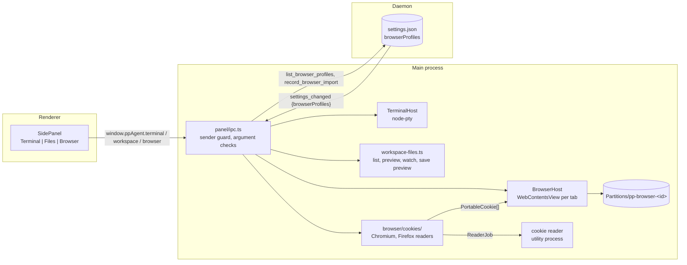

# Side panel: terminal, files, browser

The panel on the right of the chat (`apps/web/src/components/panel/`) has three tools. It opens with the panel button in the chat's top bar or Cmd+J (macOS) / Ctrl+J; its state (open, tool, width, expanded) is a per-window convenience in `localStorage` (`stores/panel-store.ts`). Expanded, it takes the chat's place: the chat stays mounted, only hidden. Each tool shows its tabs with the shared `PanelTabs` / `PanelTab` (`panel-tabs.tsx`). The tools' code loads lazily, the first time the panel shows them.



## Who owns what

| Piece                                           | Owner                                                  | Why                                                                                                                               |
| ----------------------------------------------- | ------------------------------------------------------ | --------------------------------------------------------------------------------------------------------------------------------- |
| Shells, file listing, browser views, partitions | Main (`apps/desktop/src/main/panel/`, `browser/`)      | They need Electron or native modules, belong to the person (never the agent) and end with the window.                             |
| Browser profile list                            | Daemon (`packages/agent-core/src/browser-profiles.ts`) | The daemon is the only writer of `settings.json`; a future agent browser tool (or a headless browser) must see the same profiles. |
| Panel layout                                    | Renderer (`localStorage`)                              | Display preference only.                                                                                                          |

When the window is destroyed, main closes every tab, ends every shell and stops the file watch.

Every panel channel is registered through `TrustedIpc` (`main/trusted-ipc.ts`), as are main's own: a message is answered only when it comes from the main frame of the app window showing the app's page (the renderer dev server's origin, or the bundled `index.html`).

## Terminal

`TerminalHost` (`panel/terminals.ts`) spawns the person's login shell (`$SHELL -l`, so a GUI app gets their PATH; PowerShell on Windows) with node-pty in a workspace folder. Output is coalesced per terminal (8 ms), numbered (`seq`) and kept as a backlog of whole chunks (a ring of about 256 KiB, never re-copied on output), so a panel that remounts (another workspace, another tool) asks for `terminal.backlog(id)` after subscribing to `terminal:data` and skips chunks whose `seq` the backlog already holds. Flow control: from `terminal.backlog(id)` until `terminal.detach(id)` (the view unmounts) the view acks each chunk once xterm has drawn it (`terminal.ack(id, chars)`, from the `write` callback); main pauses the pty while more than 512 Ki characters wait unacked and resumes it below 64 Ki, so a command such as `yes` cannot flood main or the renderer. A terminal nobody shows is never paused. The panel shows the terminals whose `cwd` is the open conversation's `workspaceDir` and opens a first one by itself. At most 12 terminals.

node-pty 1.1 publishes its macOS `spawn-helper` without the execute bit ("posix_spawnp failed"): main sets it in development, `scripts/after-pack.cjs` (electron-builder `afterPack`) in packaged builds, and `node_modules/node-pty/**` is unpacked from the asar archive.

## Files

The Files tool's first tab is the folder tree; every file opened from it becomes a tab (at most 20, the oldest close first). Tabs and expanded folders live per workspace folder in `stores/file-tabs-store.ts`, for the life of the window. `workspace-files.ts` lists one folder at a time (folders first, at most 2000 entries, `.git` and OS clutter hidden), previews a file (text up to 256 KiB, images up to 10 MiB as a data URL, anything else "no preview"), reveals it, or returns it as an `Attachment` for the message box. One recursive `fs.watch` per window follows the open workspace and sends `workspace:changed` (debounced 300 ms, and at least once a second while changes keep coming); changes under `.git`, `node_modules`, `.venv`, `__pycache__`, `.next`, `.turbo`, `.cache`, `dist` and `build` are ignored. The renderer invalidates `["workspace-files", root]`. The allowed workspace folders come from `DesktopSettings` (`main/settings.ts`), which parses `settings.json` once and again only on `settings_changed` (`settings` or `workspaces`) and on each daemon connection, never per IPC call.

Markdown files show rendered (mermaid blocks drawn) and HTML files show a **Run** button that runs the page in the sandboxed preview frame (`components/visual-preview.tsx`, see [Electron security](../code-standard/electron-security.md)); a file cut at 256 KiB shows only its text, and a change to the file resets the preview to **Run**. An HTML block in the chat can be saved and opened here: `workspace:save-artifact` (`saveArtifact`) writes it as a new `artifacts/preview-<date>-<time>.html` (at most 256 KiB, never over an existing file, the `artifacts` folder created inside the workspace and resolved with `realpath`) and the renderer opens it as a tab.

## Browser

`BrowserHost` (`browser/host.ts`) keeps one `WebContentsView` per tab in the window's `contentView`. The renderer measures the page area and sends `browser.setBounds(rect)`; it sends `null` (the page is hidden) while the panel is closed or resized, another tool shows, or an app popup is open (`[role=dialog|alertdialog|menu|listbox]`, which a native view would cover). Tab ids (`tab-<n>`) stay the same for a tab's life.

Each profile is the persistent partition `persist:pp-browser-<profile id>`. Every page:

- runs sandboxed with context isolation, no Node, no preload;
- may only go to `http(s):` or `about:blank` (`will-navigate`, `will-redirect`); links opening a tab stay in the same profile; `window.open` with features (sign-in popups) gets a sandboxed popup window that keeps its opener;
- gets fullscreen, pointer lock and clipboard writes, nothing else (camera, location, notifications… are refused per session);
- reports a plain Chrome user agent: `app.userAgentFallback` is set at start, the only way it reaches `navigator.userAgent`;
- is throttled while hidden, as in any browser, except while an agent step acts on it (`BrowserHost.drive` / `release`).

Pages the agent opened or acted on (and the tabs and popups they open) are the agent's: their main-frame and subframe loads go through `webRequest.onBeforeRequest`, which resolves the host and cancels any that leads to this computer or the local network (loopback, private, link-local, carrier-grade NAT, metadata, `*.localhost`; the same ranges `web_fetch` refuses, `isPrivateTarget` in `browser/address.ts`). That covers a link the agent clicks and a redirect, not only `open` / `navigate`, which also refuse such an address up front with a message for the model. A tab stops being the agent's when the person types an address into it; the person can always open local addresses themselves. Chromium resolves the host again when it connects, so a name that changes its address in between is not caught.

When a profile disappears from the daemon's list (deleted, or found after a reconnection), main closes its tabs, clears its storage and cache and removes `Partitions/pp-browser-<id>`. On disk, the partitions' cookies are encrypted with the OS key (the `enableCookieEncryption` fuse, see [Build and packaging](../code-standard/build-and-packaging.md)).

### Cookie import

The import has two steps. First main lists the sites with cookies in the chosen source profile (`browser.cookieSites`: host names and counts only, no value is read or decrypted), grouped by `cookieSite` (`google.com` for `.mail.google.com`, `example.co.uk` for `www.example.co.uk`; a heuristic without the public suffix list, so a hosting domain such as `github.io` is one site). The person picks sites (none are picked to start with); `browser.importCookies` then reads only the cookies of those sites into `PortableCookie` (domain, host-only, name, value, path, secure, httpOnly, SameSite, expiry in epoch seconds), which `BrowserHost.setCookies` writes with `session.cookies.set` (expired cookies and those the engine refuses are counted as skipped). Main refuses an import that names no site. The same list fits CDP `Network.setCookies`, so profiles can move to a headless browser later. Databases are always read from a temporary copy (with their `-wal` / `-journal`), never in place, in a short-lived utility process (`cookies/reader.ts`, bundled as `cookieReader.mjs`), so opening the database and decrypting thousands of cookies does not hold up main and the window.

| Source                          | How                                                                                                                                                                                                                                                                                                                                                                                                                                                                                                                                                                                                                                                                                      |
| ------------------------------- | ---------------------------------------------------------------------------------------------------------------------------------------------------------------------------------------------------------------------------------------------------------------------------------------------------------------------------------------------------------------------------------------------------------------------------------------------------------------------------------------------------------------------------------------------------------------------------------------------------------------------------------------------------------------------------------------- |
| Chromium family, macOS          | Password from the Keychain, read in main with `@napi-rs/keyring` (`findCredentialsAsync("<Browser> Safe Storage")`): macOS asks the person and names PP Agent, so "Always Allow" trusts only PP Agent's signature (through `/usr/bin/security` it would trust that tool, which any program can run). PBKDF2-SHA1 (`saltysalt`, 1003 rounds) → AES-128-CBC of `v10` values. Database version ≥ 24 prefixes values with a 32-byte host hash, dropped.                                                                                                                                                                                                                                      |
| Chromium family, Windows        | AES-256-GCM key from `Local State` (`os_crypt.encrypted_key`), unwrapped with DPAPI through `%SystemRoot%\System32\WindowsPowerShell\v1.0\powershell.exe` (by full path, never PATH). `v20` values (app-bound encryption, Chrome 127+) are readable only by the browser itself: the profile's cookie database is copied into a throwaway user data folder, the browser is started headless on it with `--remote-debugging-pipe` (CDP over file descriptors 3 and 4, so no other program can connect, unlike a debugging port), and `Storage.getCookies` is asked over CDP; only the chosen sites are kept. A browser that is running locks its database: the person is asked to quit it. |
| Firefox (macOS, Windows, Linux) | `cookies.sqlite` is plain; container and private-window cookies (non-empty `originAttributes`) are skipped; `expiry` is seconds or (newer versions) milliseconds.                                                                                                                                                                                                                                                                                                                                                                                                                                                                                                                        |

Chromium stores `expires_utc` in microseconds since 1601, beyond what a JavaScript number holds exactly (`node:sqlite` refuses it), so the query divides it in SQL. Source profiles are looked up again at import time by id; a path from the renderer is never used. After an import, main records `lastImport` (browser, source profile name, time, count) with `record_browser_import`.

### Browser use (the agent's `browser` tool)

```mermaid
sequenceDiagram
  participant P as Pi session (daemon)
  participant T as browser tool (agent-core)
  participant S as DaemonServer
  participant M as Main (DaemonClient)
  participant A as BrowserAutomation
  participant V as Page (WebContentsView)
  M->>S: browser_available { available: true } (window created, every reconnection)
  P->>T: browser { action, tab?, ref?, … }
  T->>S: BrowserBridge.request
  S->>M: browser_request { id, request } (newest client that offered its browser)
  M->>A: run(request)
  A->>V: isolated-world script / sendInputEvent / insertText
  A-->>M: { text, image? }
  M->>S: browser_response { id, ok, result | error }
  S-->>T: result (90 s timeout; aborts with the tool call)
  T-->>P: fenced <browser_page> text (+ JPEG screenshot)
```

- **One tool, `browser`** (`packages/agent-core/src/browser-tool.ts`), with a tier per action: reading actions run without asking by default, while `open`, `navigate`, `click`, `type`, `press`, `select_option` and `eval` ask under the default tool policy. Settings › Tools can switch it to ask or off, and agents can be limited without it. It is in every session; without a window it answers that PP Agent must be open (a headless browser can later answer `BrowserBridge` instead).
- **Actions** (`BROWSER_TOOL_ACTIONS` in `packages/shared`): `tabs`, `open` (url, profile by name or id, else the default), `select`, `close`, `navigate`, `back`, `forward`, `reload`, `snapshot`, `text` (with `offset`), `screenshot`, `click`, `type` (`clear`, `submit`), `press`, `select_option`, `scroll`, `wait` (ms or text), `eval`. `tab` omitted means the active tab; the agent may use the person's tabs too.
- **Snapshots** (`main/browser/page-script.ts`) list headings, images with text, dialogs and interactive elements in document order with refs (`e1`…), values, states and link targets, including same-origin frames and open shadow roots (at most 600 entries, 25k characters). They run in an isolated world (`AGENT_WORLD`), so the page cannot read or forge the refs, which last until the next snapshot. Steps that change the page wait for loading to settle and return a fresh snapshot.
- **Input is real**: clicks are mouse events at the element's centre (`sendInputEvent`, after scrolling it into view; frame offsets added), typing focuses the field and uses `insertText`, keys go through `parseKey` (`Enter`, `ArrowDown`, `Control+A`…). `select_option` sets the options from script and fires `input`/`change`.
- **The person sees it**: a tab the agent acts on becomes the active tab, and main sends `browser:reveal` so the panel shows the browser. Pages are created at the last page size (1024×768 before the panel ever showed one); while a step acts on a tab its background throttling is off, so it works while hidden. Screenshots are at most 1280 px on the long edge, as JPEG (`main/screenshot.ts`). Each call shows in the chat as a plain step ("Opened example.com", "Typed on the page").
- `DAEMON_PROTOCOL` became 3 for these frames (4 with the `computer_*` frames of [computer use](computer-use.md)), so an app replaces an older daemon (also in development, where versions match).

`browser/driver.ts` still declares `BrowserDriver`, the tab and cookie surface a second, headless browser needs.
