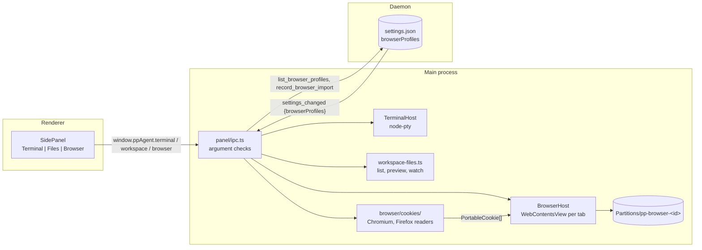

# Side panel: terminal, files, browser

The panel on the right of the chat (`apps/web/src/components/panel/`) has three tools. It opens with the panel button in the chat's top bar or Cmd+J (macOS) / Ctrl+J; its state (open, tool, width, expanded) is a per-window convenience in `localStorage` (`stores/panel-store.ts`). Expanded, it takes the chat's place: the chat stays mounted, only hidden. Each tool shows its tabs with the shared `PanelTabs` / `PanelTab` (`panel-tabs.tsx`). The tools' code loads lazily, the first time the panel shows them.

## Who owns what

| Piece                                           | Owner                                                  | Why                                                                                                                               |
| ----------------------------------------------- | ------------------------------------------------------ | --------------------------------------------------------------------------------------------------------------------------------- |
| Shells, file listing, browser views, partitions | Main (`apps/desktop/src/main/panel/`, `browser/`)      | They need Electron or native modules, belong to the person (never the agent) and end with the window.                             |
| Browser profile list                            | Daemon (`packages/agent-core/src/browser-profiles.ts`) | The daemon is the only writer of `settings.json`; a future agent browser tool (or a headless browser) must see the same profiles. |
| Panel layout                                    | Renderer (`localStorage`)                              | Display preference only.                                                                                                          |

When the window is destroyed, main closes every tab, ends every shell and stops the file watch.

## Terminal

`TerminalHost` (`panel/terminals.ts`) spawns the person's login shell (`$SHELL -l`, so a GUI app gets their PATH; PowerShell on Windows) with node-pty in a workspace folder. Output is coalesced per terminal (8 ms), numbered (`seq`) and kept as a 256 KiB backlog, so a panel that remounts (another workspace, another tool) asks for `terminal.backlog(id)` after subscribing to `terminal:data` and skips chunks whose `seq` the backlog already holds. The panel shows the terminals whose `cwd` is the open conversation's `workspaceDir` and opens a first one by itself. At most 12 terminals.

node-pty 1.1 publishes its macOS `spawn-helper` without the execute bit ("posix_spawnp failed"): main sets it in development, `scripts/after-pack.cjs` (electron-builder `afterPack`) in packaged builds, and `node_modules/node-pty/**` is unpacked from the asar archive.

## Files

The Files tool's first tab is the folder tree; every file opened from it becomes a tab (at most 20, the oldest close first). Tabs and expanded folders live per workspace folder in `stores/file-tabs-store.ts`, for the life of the window. `workspace-files.ts` lists one folder at a time (folders first, at most 2000 entries, `.git` and OS clutter hidden), previews a file (text up to 256 KiB, images up to 10 MiB as a data URL, anything else "no preview"), reveals it, or returns it as an `Attachment` for the message box. One recursive `fs.watch` per window follows the open workspace and sends `workspace:changed` (debounced 300 ms); the renderer invalidates `["workspace-files", root]`.

## Browser

`BrowserHost` (`browser/host.ts`) keeps one `WebContentsView` per tab in the window's `contentView`. The renderer measures the page area and sends `browser.setBounds(rect)`; it sends `null` (the page is hidden) while the panel is closed or resized, another tool shows, or an app popup is open (`[role=dialog|alertdialog|menu|listbox]`, which a native view would cover). Tab ids (`tab-<n>`) stay the same for a tab's life.

Each profile is the persistent partition `persist:pp-browser-<profile id>`. Every page:

- runs sandboxed with context isolation, no Node, no preload;
- may only go to `http(s):` or `about:blank` (`will-navigate`, `will-redirect`); links opening a tab stay in the same profile; `window.open` with features (sign-in popups) gets a sandboxed popup window that keeps its opener;
- gets fullscreen, pointer lock and clipboard writes, nothing else (camera, location, notifications… are refused per session);
- reports a plain Chrome user agent: `app.userAgentFallback` is set at start, the only way it reaches `navigator.userAgent`.

When a profile disappears from the daemon's list (deleted, or found after a reconnection), main closes its tabs, clears its storage and cache and removes `Partitions/pp-browser-<id>`.

### Cookie import

`browser/cookies/` reads every cookie of a profile of an installed browser into `PortableCookie` (domain, host-only, name, value, path, secure, httpOnly, SameSite, expiry in epoch seconds), which `BrowserHost.setCookies` writes with `session.cookies.set` (expired cookies and those the engine refuses are counted as skipped). The same list fits CDP `Network.setCookies`, so profiles can move to a headless browser later. Databases are always read from a temporary copy (with their `-wal` / `-journal`), never in place.

| Source                          | How                                                                                                                                                                                                                                                                                                                                                                                                                                                                 |
| ------------------------------- | ------------------------------------------------------------------------------------------------------------------------------------------------------------------------------------------------------------------------------------------------------------------------------------------------------------------------------------------------------------------------------------------------------------------------------------------------------------------- |
| Chromium family, macOS          | Password from the Keychain (`security find-generic-password -w -s "<Browser> Safe Storage"`, macOS asks the person), PBKDF2-SHA1 (`saltysalt`, 1003 rounds) → AES-128-CBC of `v10` values. Database version ≥ 24 prefixes values with a 32-byte host hash, dropped.                                                                                                                                                                                                 |
| Chromium family, Windows        | AES-256-GCM key from `Local State` (`os_crypt.encrypted_key`), unwrapped with DPAPI through PowerShell. `v20` values (app-bound encryption, Chrome 127+) are readable only by the browser itself: the profile's cookie database is copied into a throwaway user data folder, the browser is started headless on it with remote debugging, and `Storage.getCookies` is asked over CDP. A browser that is running locks its database: the person is asked to quit it. |
| Firefox (macOS, Windows, Linux) | `cookies.sqlite` is plain; container and private-window cookies (non-empty `originAttributes`) are skipped; `expiry` is seconds or (newer versions) milliseconds.                                                                                                                                                                                                                                                                                                   |

Chromium stores `expires_utc` in microseconds since 1601, beyond what a JavaScript number holds exactly (`node:sqlite` refuses it), so the query divides it in SQL. Source profiles are looked up again at import time by id; a path from the renderer is never used. After an import, main records `lastImport` (browser, source profile name, time, count) with `record_browser_import`.

### Towards browser use

`browser/driver.ts` declares `BrowserDriver` (tabs by stable id, `open`, `navigate`, `go`, `evaluate`, `screenshot`, `setCookies`), which `BrowserHost` implements. A future agent tool runs in the daemon, so it needs a daemon → client request frame that main answers with the driver, and a second driver (a headless Chromium the daemon starts, fed the profile's cookies) for when no window is open.
