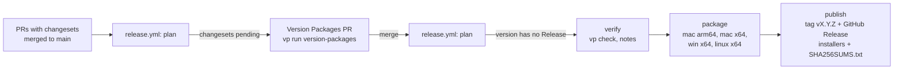

# Release process

`main` is the only long-lived branch. Releases follow [Semantic Versioning](https://semver.org) and are driven by [Changesets](https://github.com/changesets/changesets) and `.github/workflows/release.yml`.

## Versioned packages

- `@workspace/desktop` and `@workspace/web` are versioned in lockstep (`fixed` in `.changeset/config.json`). The desktop version is the app version electron-builder stamps on the installers.
- `scripts/version-packages.ts` copies that version to the private root `package.json` and adds a `## [x.y.z] — date` section to the root `CHANGELOG.md`. That section becomes the GitHub Release notes.
- `packages/shared` and `packages/ui` are internal and not released.

## Day to day

1. Make the change on a branch and open a PR to `main` (CI: `vp check`, `vp run -r build`, Linux installers, a Windows installer build, and an advisory changeset check).
2. If people using the app will notice the change, add a changeset: `vp run changeset`, pick `@workspace/desktop`, choose the bump, and write one or two sentences for the release notes. Docs, CI, and internal refactors need none.

Bumps before 1.0: `patch` for fixes, `minor` for features and for changes that need users to act. After 1.0, `major` for breaking changes to saved data or behaviour.

## Cutting a release



1. Every push to `main` runs `plan`. With pending changesets it opens or updates the **chore(release): version packages** PR: versions bumped, changesets consumed, CHANGELOGs written. Edit the root `CHANGELOG.md` section in that PR if the notes need polish.
2. Merging that PR is the release. `plan` sees a version whose CHANGELOG section exists and that has no GitHub Release, then:
   - `verify` checks lockstep versions, runs `vp check`, and extracts the notes;
   - `package` builds installers on GitHub-hosted runners: `.dmg` + `.zip` for macOS arm64 and x64, NSIS `.exe` for Windows x64, `.AppImage` + `.deb` for Linux x64 (names: `pp-agent-<version>-<os>-<arch>.<ext>`);
   - `publish` (environment `release`) creates tag `vX.Y.Z` and the GitHub Release with every installer and `SHA256SUMS.txt`. Versions with a pre-release suffix (`0.2.0-rc.1`) are marked as pre-releases.
3. A failed run is retried by re-running the failed jobs; an existing tag or Release is left alone.

Preview the version step locally (it rewrites files; discard them afterwards):

```bash
vp run version-packages
git restore . && git clean -fd .changeset
```

## Updates inside the app

The installed app checks GitHub Releases ten seconds after start, every six hours, and when someone presses **Check for updates** (Settings → General). Implementation: `apps/desktop/src/main/updates.ts`.

| Platform                | Behaviour                                                                                                                                                                                                                                       |
| ----------------------- | ----------------------------------------------------------------------------------------------------------------------------------------------------------------------------------------------------------------------------------------------- |
| Windows, Linux AppImage | `electron-updater` downloads the installer and restarts into it. It reads `latest.yml` / `latest-linux.yml`, which electron-builder writes next to the installers and `publish` uploads with the release.                                       |
| macOS                   | `electron-updater` downloads the `.zip` and restarts into it. It reads `latest-mac.yml`, which `publish` builds by merging the arm64 and x64 feeds. Only Developer ID signed builds can replace themselves; update the app signed, or it fails. |
| Linux `.deb`            | The app only compares versions (GitHub Releases API) and opens the release page, because `.deb` belongs to the system package manager.                                                                                                          |

The `publish` job fails when `latest.yml`, `latest-linux.yml`, or `latest-mac.yml` is missing. Each macOS `package` job renames its feed to `latest-mac-<arch>.yml`; `publish` merges them with `yq` into one `latest-mac.yml` listing both architectures.

Development runs (`app.isPackaged` false) never check.

## Repository settings the workflow needs

- **Actions → General → Workflow permissions:** "Allow GitHub Actions to create and approve pull requests" (for the Version Packages PR).
- **Environments → `release`:** add required reviewers here for a manual gate before publishing.
- Because the Version Packages PR is opened with `GITHUB_TOKEN`, CI does not run on it; `verify` re-checks the merged commit.

## Code signing

Signing is optional and driven by repository secrets (Settings → Secrets and variables → Actions). The `package` job forwards them to electron-builder; empty secrets are unset first. Without any secret the release still builds: macOS apps are ad-hoc signed (no hardened runtime, not notarized) and Windows installers are unsigned, so users see Gatekeeper and SmartScreen warnings (the README explains how to open the app). Forks and local builds need nothing.

| Secret / env                  | What it is                                                                                | Effect                                             |
| ----------------------------- | ----------------------------------------------------------------------------------------- | -------------------------------------------------- |
| `CSC_LINK`                    | Developer ID Application certificate with private key, a `.p12` file as base64 (or a URL) | Signs macOS builds with the hardened runtime       |
| `CSC_KEY_PASSWORD`            | Password chosen when exporting the `.p12`                                                 | Unlocks `CSC_LINK`                                 |
| `APPLE_ID`                    | Apple ID email of an Apple Developer Program member                                       | Notarizes signed macOS builds (all three required) |
| `APPLE_APP_SPECIFIC_PASSWORD` | App-specific password for that Apple ID                                                   | Notarizes signed macOS builds (all three required) |
| `APPLE_TEAM_ID`               | 10-character Team ID (developer.apple.com → Membership details)                           | Notarizes signed macOS builds (all three required) |
| `WIN_CSC_LINK`                | Windows code-signing certificate (`.pfx`/`.p12`) as base64 (or a URL)                     | Signs the Windows installer                        |
| `WIN_CSC_KEY_PASSWORD`        | Password of that certificate                                                              | Unlocks `WIN_CSC_LINK`                             |

### macOS

- Signing and notarization both require an [Apple Developer Program](https://developer.apple.com/programs/) membership.
- Create a **Developer ID Application** certificate (developer.apple.com → Certificates, or Xcode → Settings → Accounts → Manage Certificates). In Keychain Access, export the certificate together with its private key as a `.p12` and set a password (`CSC_KEY_PASSWORD`). Encode it for `CSC_LINK`: `base64 -i developer-id.p12 | pbcopy`.
- Create the app-specific password at [account.apple.com](https://account.apple.com) → Sign-In and Security → App-Specific Passwords. Your normal Apple ID password does not work.
- `apps/desktop/electron-builder.yml` sets `hardenedRuntime`, `gatekeeperAssess: false`, `notarize: true`, and points `entitlements`/`entitlementsInherit` at `apps/desktop/build/entitlements.mac.plist`. The plist grants only `com.apple.security.cs.allow-jit` and `com.apple.security.cs.allow-unsigned-executable-memory`, which Electron's V8 needs under the hardened runtime. Add further entitlements only when a feature breaks in a signed build.
- The workflow decides per macOS build:
  - no `CSC_LINK`: ad-hoc signature, `-c.mac.hardenedRuntime=false -c.mac.notarize=false`, plus a warning;
  - `CSC_LINK` and all three `APPLE_*` secrets: Developer ID signature, hardened runtime, notarization;
  - `CSC_LINK` but a missing `APPLE_*` secret: signed, `-c.mac.notarize=false`, plus a warning. (electron-builder itself throws when only some of `APPLE_ID`, `APPLE_APP_SPECIFIC_PASSWORD`, `APPLE_TEAM_ID` are set, and silently skips when none is.)
- Notarization uploads the app to Apple and waits for the result, which can add several minutes to the macOS jobs.

### Windows

`WIN_CSC_LINK` + `WIN_CSC_KEY_PASSWORD` sign the NSIS installer. Without `WIN_CSC_LINK` the workflow unsets the macOS `CSC_*` variables for the Windows job and disables identity discovery, so the installer stays unsigned. A new certificate without SmartScreen reputation (standard, non-EV) can still show a warning until it builds reputation.

### CI

`ci.yml` has a **Build (Windows installer)** job: `vp run -r build`, then `electron-builder --win --x64 --publish never` with `CSC_IDENTITY_AUTO_DISCOVERY=false`, and it checks that `release/latest.yml` exists. It builds the installer only; nothing is run or signed. There is no macOS packaging job in CI, so the signing configuration is first exercised by a release.

### Not verified

No real certificate or Apple account was available when this was set up. The configuration keys and the notarization logic were checked against the installed electron-builder 26.15.3 source, but Developer ID signing, notarization, entitlements under the hardened runtime, and Windows signing have not been run end to end. Expect to debug the first signed release (for example with a pre-release tag) before relying on it.

## Updating workflow dependencies

Actions are pinned by commit SHA with the version in a comment; Dependabot (`.github/dependabot.yml`) proposes updates weekly for GitHub Actions and npm packages.
