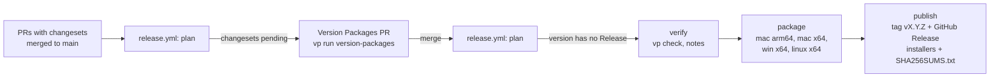

# Release process

`main` is the only long-lived branch. Releases follow [Semantic Versioning](https://semver.org) and are driven by [Changesets](https://github.com/changesets/changesets) and `.github/workflows/release.yml`.

## Versioned packages

- `@workspace/desktop` and `@workspace/web` are versioned in lockstep (`fixed` in `.changeset/config.json`). The desktop version is the app version electron-builder stamps on the installers.
- `scripts/version-packages.ts` copies that version to the private root `package.json` and adds a `## [x.y.z] — date` section to the root `CHANGELOG.md`. That section becomes the GitHub Release notes.
- `packages/shared` and `packages/ui` are internal and not released.

## Day to day

1. Make the change on a branch and open a PR to `main` (CI: `vp check`, `vp run -r build`, an unpacked Linux package, and an advisory changeset check).
2. If people using the app will notice the change, add a changeset: `vp run changeset`, pick `@workspace/desktop`, choose the bump, and write one or two sentences for the release notes. Docs, CI, and internal refactors need none.

Bumps before 1.0: `patch` for fixes, `minor` for features and for changes that need users to act. After 1.0, `major` for breaking changes to saved data or behaviour.

## Cutting a release



1. Every push to `main` runs `plan`. With pending changesets it opens or updates the **chore(release): version packages** PR: versions bumped, changesets consumed, CHANGELOGs written. Edit the root `CHANGELOG.md` section in that PR if the notes need polish.
2. Merging that PR is the release. `plan` sees a version whose CHANGELOG section exists and that has no GitHub Release, then:
   - `verify` checks lockstep versions, runs `vp check`, and extracts the notes;
   - `package` builds installers on GitHub-hosted runners: `.dmg` + `.zip` for macOS arm64 and x64, NSIS `.exe` for Windows x64, `.AppImage` + `.deb` for Linux x64 (names: `pp-agent-<version>-<os>-<arch>.<ext>`);
   - `publish` (environment `release`) creates tag `vX.Y.Z` and the GitHub Release with every installer and `SHA256SUMS.txt`. Versions with a pre-release suffix (`0.2.0-rc.1`) are marked as pre-releases.
3. A failed run is retried by re-running the failed jobs; an existing tag or Release is left alone.

Preview the version step locally (it rewrites files; discard them afterwards):

```bash
vp run version-packages
git restore . && git clean -fd .changeset
```

## Repository settings the workflow needs

- **Actions → General → Workflow permissions:** "Allow GitHub Actions to create and approve pull requests" (for the Version Packages PR).
- **Environments → `release`:** add required reviewers here for a manual gate before publishing.
- Because the Version Packages PR is opened with `GITHUB_TOKEN`, CI does not run on it; `verify` re-checks the merged commit.

## Code signing

Without secrets, macOS builds are ad-hoc signed (no hardened runtime) and Windows builds are unsigned, so users see Gatekeeper and SmartScreen warnings (the README explains how to open the app). To sign, add repository secrets; the `package` job passes them to electron-builder:

| Secret                                                     | Effect                                     |
| ---------------------------------------------------------- | ------------------------------------------ |
| `CSC_LINK`, `CSC_KEY_PASSWORD`                             | Sign macOS builds with a Developer ID .p12 |
| `APPLE_ID`, `APPLE_APP_SPECIFIC_PASSWORD`, `APPLE_TEAM_ID` | Notarize signed macOS builds               |
| `WIN_CSC_LINK`, `WIN_CSC_KEY_PASSWORD`                     | Sign Windows builds                        |

## Updating workflow dependencies

Actions are pinned by commit SHA with the version in a comment; Dependabot (`.github/dependabot.yml`) proposes updates weekly for GitHub Actions and npm packages.
