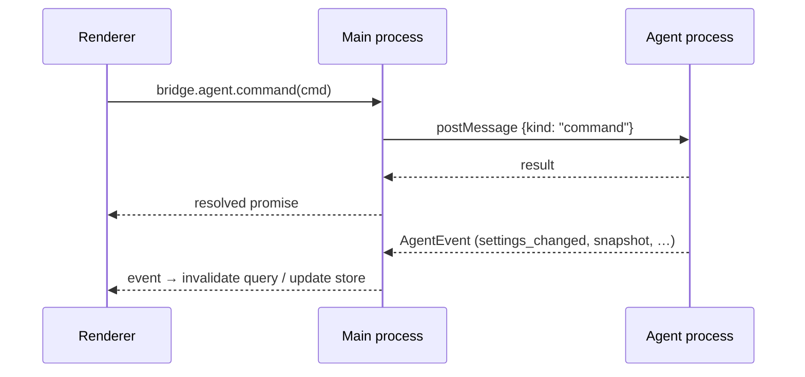

# Cross-process and renderer patterns

## Contract first

Every new capability starts in `packages/shared/src/index.ts`, the contract for main process, agent process, and renderer:

1. Add the agent command to `AgentCommandMap` (request shape and result type) and/or a variant to `AgentEvent`.
2. Add IPC channel names to `IPC` and methods to `DesktopBridge` only when the main process itself must act (file pickers, reveal, external links).
3. Implement the handler in `apps/desktop/src/agent/index.ts` (or main), then the renderer call.

`vp check` type-checks all three sides against the contract.

## Commands and events

- The renderer calls `bridge.agent.command({ type: … })` through the preload bridge (`window.ppAgent`). Commands return a result or throw; long-running effects (streaming, settings applied, tool approvals) arrive as agent events.
- Commands such as `prompt` are fire-and-forget: do not wait on them for UI state. State flows back through `snapshot`, streaming, and `settings_changed` events.
- When settings change, the agent process emits `settings_changed` with the affected `SettingsScope`s; the renderer invalidates those query keys.

## Server state: TanStack Query

- Reads: `queryOptions` factories taking the `bridge` (`settingsQuery`, `modelsQuery`, …) in `apps/web/src/lib/queries.ts`.
- Writes: `useMutation` hooks there; on success either `setQueryData` with the returned value (`useUpdateSettings`) or invalidate the related keys (`useInvalidateProviders`).
- Errors: show them with sonner — `toast.error(error.message)` in the mutation's `onError` or the `catch` of an awaited call.

## Live state: Zustand

Chat stream and composer state live in `apps/web/src/stores/chat-store.ts` and `composer-store.ts` (`create<State>()((set) => …)`). Use stores for data that changes per event; do not put it in Query.

## Dialogs: better-modal

Define with `createModal<Props, Result>("id", ({ modal, … }) => <Dialog open={modal.visible} …>)` and open imperatively: `const ok = await ConfirmModal.show({ … })`. Resolve with `modal.resolve(value)`; closing resolves the "no" value. See `apps/web/src/components/modals/confirm-modal.tsx`.

## Settings sections

- Start a pane with `SectionHeading` (`section-heading.tsx`).
- Group options with `OptionGroup`, toggles with `SwitchRow`, dependent options with `SubOptions` (`option-group.tsx`).
- Editors (agent, skill, MCP server, MCP JSON) open inside the pane, not in a new dialog; call `useSettingsSubPage(label)` (`settings-subpage.tsx`) so the breadcrumb shows the sub-page.

## UI components (shadcn)

- Use components from `@workspace/ui/components/*` (`packages/ui`, style `base-rhea`, Base UI primitives, lucide icons). Add new ones with the shadcn CLI into `packages/ui`, not ad hoc in `apps/web`.
- Compose existing primitives before writing custom markup; style via Tailwind classes and theme tokens.

## UI copy

Users are non-developers. Write plain English: "Choose the workspace folder", "Wait for the answer to finish." Avoid jargon (JSON, IPC, token, stack trace) in labels and errors; explain what the person can do next. Every text goes through i18next (see [i18n.md](i18n.md)): add the key to the English and Vietnamese files, never hard-code a string.
