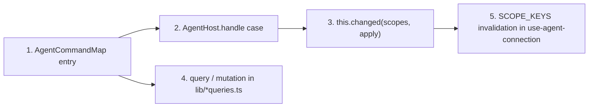

# Renderer structure and the shared contract

## Renderer — `apps/web/src/`

| Path                       | Contents                                                                                                                                                                                                                                                                                                                                                                                                                                                    |
| -------------------------- | ----------------------------------------------------------------------------------------------------------------------------------------------------------------------------------------------------------------------------------------------------------------------------------------------------------------------------------------------------------------------------------------------------------------------------------------------------------- |
| `components/chat/`         | Chat UI: `chat-sidebar` (conversations), `chat-thread`, `chat-message` (copy, regenerate, edit & resend via `message-editor`, branch), `chat-header-actions` (context, usage and cost, export), `tool-step` (tool calls, approval gate), `empty-chat`, `prompt-composer`, `composer-menu` (+ menu), `slash-suggestions`, `agent-picker`, `model-picker`, `thinking-picker`, `voice-controls` (microphone button: idle, recording with timer, transcribing). |
| `components/settings/`     | Settings sections: `general`, `models`, `tools`, `skills` (+ `skill-editor`), `mcp` (+ `mcp-server-form`, `mcp-json-editor`), `agents` (+ `agent-editor`), `memory`, `scheduled-tasks` (+ `scheduled-task-editor`, `scheduled-task-format`); `general` also holds the Voice input group (`voice-input-group`); shared `option-group`, `section-heading`, `settings-subpage`.                                                                                |
| `components/modals/`       | better-modal dialogs: `settings-modal` (`SettingsModal.show({ bridge, section })`), `auth-prompt-modal` (with `useAuthPromptStore`), `confirm-modal`, `prompt-modal`.                                                                                                                                                                                                                                                                                       |
| `components/`              | `markdown.tsx` (Streamdown), `theme-provider.tsx`.                                                                                                                                                                                                                                                                                                                                                                                                          |
| `hooks/`                   | `use-agent-connection` (agent events → chat store, toasts, query invalidation), `use-send-message`, `use-debounced-value`, `use-highlighted-code`, `use-voice-recorder` (MediaRecorder → `transcribe_audio`).                                                                                                                                                                                                                                               |
| `lib/bridge.ts`            | `bridge = window.ppAgent ?? null`.                                                                                                                                                                                                                                                                                                                                                                                                                          |
| `lib/queries.ts`           | `queryKeys`, query options (settings, providers, gateways, models, sessions, agents) and mutations (`useUpdateSettings`, `useProviderCommands`, `useRespondAuthPrompt`, `useAgentCommands`).                                                                                                                                                                                                                                                                |
| `lib/extension-queries.ts` | Tools, skills, MCP servers, agent editor queries and mutations (`useSetToolPolicy`, `useSaveSkill`, `useSaveMcpServer`, `useSaveAgent`, …), memory, scheduled tasks (`scheduledTasksQuery`, `useScheduledTaskCommands`) and voice input (`voiceQuery`, `useSaveVoice`).                                                                                                                                                                                     |
| `lib/slash-commands.ts`    | `SlashItem` list (commands, skills, …), `/` query parsing and filtering, `focusComposer`.                                                                                                                                                                                                                                                                                                                                                                   |
| `lib/models.ts`            | `modelKey`, `groupByProvider`.                                                                                                                                                                                                                                                                                                                                                                                                                              |
| `lib/highlighter.tsx`      | Shiki highlighter used by `use-highlighted-code`.                                                                                                                                                                                                                                                                                                                                                                                                           |
| `stores/chat-store.ts`     | Zustand mirror of the agent stream (snapshot, messages, status).                                                                                                                                                                                                                                                                                                                                                                                            |
| `stores/composer-store.ts` | Draft text and attachments; `toAttachments` resolves dropped files through `bridge.files.pathFor`.                                                                                                                                                                                                                                                                                                                                                          |

Server-like state (settings, lists) lives in TanStack Query; the live stream lives in Zustand.

## Shared contract — `packages/shared/src/index.ts`

Key exports:

- `AgentCommandMap` — every agent command: `{ params; result }`. `AgentCommand` and `AgentCommandResult<K>` are derived from it, so `bridge.agent.command({ type, ...params })` is fully typed.
- `AgentEvent` — events from the agent process (`status`, `message`, `snapshot`, `sessions_changed`, `settings_changed { scopes }`, `auth_prompt`, `error`, …).
- `SettingsScope` — `settings | providers | models | tools | skills | mcp | agents | workspaces | sessions | memory | scheduledTasks | voice`.
- `DesktopBridge` and `IPC` channel names; `MainToAgentMessage` / `AgentToMainMessage`; `VaultRequest`, `StoredCredential`, `AgentPaths`.
- Domain types: `AppSettings`, `SettingsFile`, `AgentProfile`, `ProviderSummary`, `GatewayConfig`, `ModelSummary`, `ToolSummary`, `SkillSummary`, `McpServerView`, `ChatMessage`, `ApprovalRequest`.

## Adding an agent command end-to-end



1. **Contract** — add `my_command: { params: {...}; result: T }` to `AgentCommandMap` in `packages/shared/src/index.ts`. No IPC change is needed: all agent commands travel over `IPC.agentCommand`.
2. **Agent handler** — add `case "my_command":` to the switch in `AgentHost.handle` (`apps/desktop/src/agent/index.ts`); put the logic in the matching module (`skills.ts`, `mcp.ts`, `providers.ts`, …). The returned value becomes the result; thrown errors reach the renderer as the rejection message.
3. **Notify** — if it changes state, call `this.changed([...scopes], apply)`; `apply` (`model`, `tools`, `mcp`, `reload`, …) says what to re-apply to the conversation, deferred until a running prompt settles. If a new kind of state is introduced, add a `SettingsScope` member.
4. **Renderer** — add a `queryOptions` (reads) or `useMutation` hook (writes) in `apps/web/src/lib/queries.ts` or `lib/extension-queries.ts`, calling `bridge.agent.command({ type: "my_command", ... })`; add a key to `queryKeys` for new queries.
5. **Invalidation** — map any new scope to its query keys in `SCOPE_KEYS` (`apps/web/src/hooks/use-agent-connection.ts`); `settings_changed` then refetches every affected query, including in other open views. Mutations may also `setQueryData` with their result for immediate updates.

Native capabilities (dialogs, shell) are not agent commands: they need a new `IPC` name, a `DesktopBridge.files` member, an `ipcMain.handle` in `apps/desktop/src/main/index.ts`, and a preload entry.

## UI components — `packages/ui`

`packages/ui/src/components/` holds shadcn components (style `base-rhea`, Base UI primitives, lucide icons) plus chat pieces such as `bubble`, `message`, `message-scroller`, `trace`, `code-block`. Helpers: `src/lib/utils.ts`, `src/hooks/use-mobile.ts`; styles: `src/styles/globals.css`.

Add a component from `apps/web`:

```sh
cd apps/web
pnpm dlx shadcn@latest add <name>
```

`apps/web/components.json` aliases `ui` to `@workspace/ui/components`, so files land in `packages/ui/src/components/`. The CLI may overwrite existing components that were customized (and their dependencies); review the diff and revert unintended overwrites before committing.
