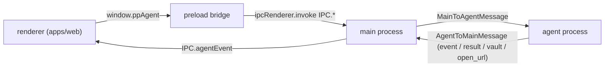

# Repository layout

PP Agent is a Vite+ (`vp`) monorepo managed by pnpm 12 with a dependency catalog (`pnpm-workspace.yaml`, `catalogMode: prefer`). Workspaces are `apps/*` and `packages/*`. Node `>=24` is required (root `package.json`).

```
apps/
  desktop/   @workspace/desktop — Electron 45 app: main process, preload bridge, agent process
  web/       @workspace/web     — React 19 renderer (Vite dev server on port 47821)
packages/
  shared/    @workspace/shared  — cross-process contract (types, commands, events, IPC names)
  ui/        @workspace/ui      — shadcn components (base-rhea style), Tailwind globals
vite.config.ts                  — root Vite+ config: fmt (oxfmt), lint (oxlint, type-aware), staged hook, task cache
```

| Package           | Purpose                                                                                                                                                                                                                               |
| ----------------- | ------------------------------------------------------------------------------------------------------------------------------------------------------------------------------------------------------------------------------------- |
| `apps/desktop`    | Bundled with `vp pack` (`apps/desktop/vite.config.ts`) into `dist/main.mjs`, `dist/agent.mjs` (ESM) and `dist/preload.cjs` (CJS, required for sandboxed preload). Packaged by electron-builder (`apps/desktop/electron-builder.yml`). |
| `apps/web`        | Renderer UI. Talks only to the preload bridge `window.ppAgent`. Its build output `apps/web/dist` is copied into the packaged app as `resources/renderer`.                                                                             |
| `packages/shared` | Single file `packages/shared/src/index.ts`, imported by all three processes. Type-only plus a few constants (`IPC`, `TOOL_POLICIES`, `THINKING_LEVELS`, `GATEWAY_APIS`, `MCP_EXPOSURES`, `DEFAULT_AGENT_ID`, `ATTACHMENTS_DIR`).      |
| `packages/ui`     | Source-only component package; consumers import `@workspace/ui/components/<name>`, `@workspace/ui/lib/utils`, `@workspace/ui/hooks/<name>`, `@workspace/ui/globals.css`.                                                              |

`electron` is never bundled; the Pi SDK stays in `node_modules` because it loads assets and wasm at runtime.

## Entry points

| Process        | Entry                               | Role                                                                                                                                                                            |
| -------------- | ----------------------------------- | ------------------------------------------------------------------------------------------------------------------------------------------------------------------------------- |
| main process   | `apps/desktop/src/main/index.ts`    | Creates the window, forks the agent process (`utilityProcess.fork(dist/agent.mjs)`), relays agent commands/events, answers vault requests, restarts the agent process on crash. |
| preload bridge | `apps/desktop/src/preload/index.ts` | Exposes `window.ppAgent` (`DesktopBridge`) via `contextBridge`; strips Electron's "Error invoking remote method" prefix from errors.                                            |
| agent process  | `apps/desktop/src/agent/index.ts`   | `AgentHost`: owns the Pi session, settings, providers, tools, skills, MCP servers, agents; handles every agent command; emits agent events.                                     |
| renderer       | `apps/web/src/main.tsx`             | Mounts providers: `QueryClientProvider`, `ThemeProvider`, `TooltipProvider`, better-modal `ModalContainer`, sonner `Toaster`, React Query devtools in dev.                      |
| renderer       | `apps/web/src/App.tsx`              | Chat screen: sidebar, header with agent picker, thread or empty chat, prompt composer, file drop, `AuthPromptModal`; calls `useAgentConnection`.                                |

Unpackaged runs load the renderer from `ELECTRON_RENDERER_URL` or `http://localhost:47821`; packaged builds load `resources/renderer/index.html`.



## Scripts and tasks

Run with `vp run <name>` from the repo root (`vp <name>` alone runs a Vite+ built-in, not the script).

| Command                              | Defined in                    | Effect                                                                                                                          |
| ------------------------------------ | ----------------------------- | ------------------------------------------------------------------------------------------------------------------------------- |
| `vp run dev`                         | root `package.json`           | Runs `dev` in `@workspace/web` (`vp dev`) and `@workspace/desktop` in parallel.                                                 |
| desktop `dev` task                   | `apps/desktop/vite.config.ts` | `vp pack && electron .`; uncached because cache tracking crashes Electron's sandboxed renderer.                                 |
| `vp run build`                       | root                          | `vp run -r build`: `vp build` (web), `vp pack` (desktop).                                                                       |
| `vp run dist`                        | root                          | Builds web, then desktop `dist`: `vp pack` + electron-builder installers into `apps/desktop/release` (dmg/zip, nsis, AppImage). |
| `vp run @workspace/desktop#dist:dir` | `apps/desktop/package.json`   | Same as `dist` but an unpacked directory (`--dir`); build web first so `apps/web/dist` exists.                                  |
| `vp run ready`                       | root                          | `vp check` (format, lint, type check) then `vp run -r build`.                                                                   |

`dist:dir` is only defined in `apps/desktop`; there is no root alias.
