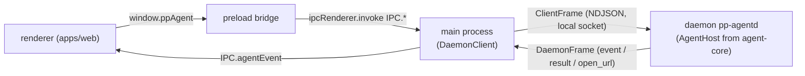

# Repository layout

PP Agent is a Vite+ (`vp`) monorepo managed by pnpm 12 with a dependency catalog (`pnpm-workspace.yaml`, `catalogMode: prefer`). Workspaces are `apps/*` and `packages/*`. Node `>=24` is required (root `package.json`).

```
apps/
  desktop/   @workspace/desktop — Electron 45 app: main process (daemon client), preload bridge; bundles the daemon
  daemon/    @workspace/daemon  — pp-agentd: headless Node daemon (local socket server, vault, OS service installers, CLI)
  web/       @workspace/web     — React 19 renderer (Vite dev server on port 47821)
packages/
  agent-core/ @workspace/agent-core — AgentHost and everything it uses: Pi session, tools, skills, MCP, scheduler, Telegram channel
  shared/    @workspace/shared  — cross-process contract (types, commands, events, IPC names, daemon frames)
  ui/        @workspace/ui      — shadcn components (base-rhea style), Tailwind globals
vite.config.ts                  — root Vite+ config: fmt (oxfmt), lint (oxlint, type-aware), staged hook, task cache
```

| Package               | Purpose                                                                                                                                                                                                                                                                                                                                                                               |
| --------------------- | ------------------------------------------------------------------------------------------------------------------------------------------------------------------------------------------------------------------------------------------------------------------------------------------------------------------------------------------------------------------------------------- |
| `apps/desktop`        | Bundled with `vp pack` (`apps/desktop/vite.config.ts`) into `dist/main.mjs`, `dist/daemon.mjs` (ESM; the daemon entry is `apps/daemon/src/index.ts`) and `dist/preload.cjs` (CJS, required for sandboxed preload). Packaged by electron-builder (`apps/desktop/electron-builder.yml`); `@napi-rs/keyring` is unpacked from the asar because native addons cannot load from inside it. |
| `apps/daemon`         | `pp-agentd`. Its own `vp pack` also writes `apps/daemon/dist/daemon.mjs`, but the app ships the copy bundled by `apps/desktop`. Exports `./paths` and `./framing` to the desktop main process, so both sides compute the same endpoint and frame the same way.                                                                                                                        |
| `packages/agent-core` | Source-only package (`exports: ./src/index.ts`) with `AgentHost` and all agent modules, formerly `apps/desktop/src/agent`. It has no Electron imports; the daemon injects the vault, the service control and the output channel through `HostEnvironment`. Unit tests (`*.test.ts`) sit next to the code.                                                                             |
| `apps/web`            | Renderer UI. Talks only to the preload bridge `window.ppAgent`. Its build output `apps/web/dist` is copied into the packaged app as `resources/renderer`.                                                                                                                                                                                                                             |
| `packages/shared`     | Single file `packages/shared/src/index.ts`, imported by main, the daemon, agent-core and the renderer. Type-only plus a few constants (`IPC`, `DAEMON_PROTOCOL`, `TOOL_POLICIES`, `THINKING_LEVELS`, `GATEWAY_APIS`, `MCP_EXPOSURES`, `DEFAULT_AGENT_ID`, `ATTACHMENTS_DIR`).                                                                                                         |
| `packages/ui`         | Source-only component package; consumers import `@workspace/ui/components/<name>`, `@workspace/ui/lib/utils`, `@workspace/ui/hooks/<name>`, `@workspace/ui/globals.css`.                                                                                                                                                                                                              |

`electron` and `@napi-rs/keyring` are never bundled; the Pi SDK stays in `node_modules` because it loads assets and wasm at runtime.

## Entry points

| Process        | Entry                                                     | Role                                                                                                                                                                                                                                                     |
| -------------- | --------------------------------------------------------- | -------------------------------------------------------------------------------------------------------------------------------------------------------------------------------------------------------------------------------------------------------- |
| main process   | `apps/desktop/src/main/index.ts`, `main/daemon-client.ts` | Creates the window, connects to the daemon (spawns `dist/daemon.mjs` with `ELECTRON_RUN_AS_NODE` when none listens, replaces an outdated one), relays agent commands/events, reconnects on crash, migrates the legacy vault, owns the tray and shortcut. |
| preload bridge | `apps/desktop/src/preload/index.ts`                       | Exposes `window.ppAgent` (`DesktopBridge`) via `contextBridge`; strips Electron's "Error invoking remote method" prefix from errors.                                                                                                                     |
| daemon         | `apps/daemon/src/index.ts`                                | `pp-agentd run` (default): listens on the local socket, opens the vault, hosts one `AgentHost`. `install`, `uninstall`, `status` manage the login service.                                                                                               |
| agent core     | `packages/agent-core/src/index.ts`                        | `AgentHost`: owns the Pi session, settings, providers, tools, skills, MCP servers, agents, scheduled tasks and chat channels; handles every agent command; emits agent events.                                                                           |
| renderer       | `apps/web/src/main.tsx`                                   | Mounts providers: `QueryClientProvider`, `ThemeProvider`, `TooltipProvider`, better-modal `ModalContainer`, sonner `Toaster`, React Query devtools in dev.                                                                                               |
| renderer       | `apps/web/src/App.tsx`                                    | Chat screen: sidebar, header with agent picker, thread or empty chat, prompt composer, file drop, `AuthPromptModal`; calls `useAgentConnection`.                                                                                                         |

Unpackaged runs load the renderer from `ELECTRON_RENDERER_URL` or `http://localhost:47821`; packaged builds load `resources/renderer/index.html`.



## Scripts and tasks

Run with `vp run <name>` from the repo root (`vp <name>` alone runs a Vite+ built-in, not the script).

| Command                              | Defined in                           | Effect                                                                                                                       |
| ------------------------------------ | ------------------------------------ | ---------------------------------------------------------------------------------------------------------------------------- |
| `vp run dev`                         | root `package.json`                  | Runs `dev` in `@workspace/web` (`vp dev`) and `@workspace/desktop` in parallel.                                              |
| desktop `dev` task                   | `apps/desktop/vite.config.ts`        | `vp pack && electron .`; uncached because cache tracking crashes Electron's sandboxed renderer.                              |
| `vp run build`                       | root                                 | `vp run -r build`: `vp build` (web), `vp pack` (desktop).                                                                    |
| `vp run dist`                        | root                                 | Builds web, then desktop `dist`: `vp pack` + electron-builder installers for the current system into `apps/desktop/release`. |
| `vp run @workspace/desktop#dist:dir` | `apps/desktop/package.json`          | Same as `dist` but an unpacked directory (`--dir`); build web first so `apps/web/dist` exists.                               |
| `vp run ready`                       | root                                 | `vp check` (format, lint, type check) then `vp run -r build`.                                                                |
| `vp run changeset`                   | root                                 | Records a change for the next release in `.changeset/`.                                                                      |
| `vp run version-packages`            | root (`scripts/version-packages.ts`) | Release workflow's version step: bumps desktop + web, root version, CHANGELOGs.                                              |

`dist:dir` is only defined in `apps/desktop`; there is no root alias. CI and release workflows live in `.github/workflows/` (see [Release process](../code-standard/release-process.md)).
