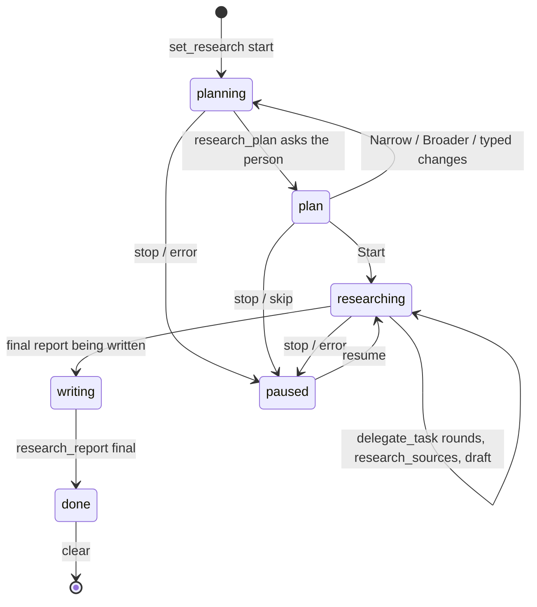

# Design brief: deep research as a conversation mode

Status: implemented. Paths are under `packages/agent-core/src/` unless noted. Replaces the built-in `deep-research` skill (see `visual-output-and-research.md` for where its content came from).

As built, the surfaces differ slightly from the plan: the report opens in the **Files** panel (which renders both Markdown and the HTML preview) rather than a dedicated Research tab, and the sources and the phone's report text are shown in the banner's expanded panel (`research-banner.tsx`, a disclosure under the run) instead of a side-panel tab and a separate sheet. The host side, tools, channels and report files follow the plan.

## Problem

Claude Research and Gemini Deep Research are modes you switch on in the message box, with a plan you confirm, live progress and sources, and a report that opens beside the chat. PP Agent's `deep-research` skill needs `/skill:` or luck to trigger, asks approval for every file it writes, shows the plan as a plain question, can stop between turns, and has no sources view.

## Decisions (confirmed)

1. A real mode, built like `/goal`: per-conversation state, a prompt section, its own tools, and the host continuing turns by itself (not a thin button over the skill).
2. The skill is removed; its content moves into agent-core (prompt section + `research_guide` tool). The unmodified seeded copy is removed from users' skills folders by `seedBuiltInSkills` (a skill the app no longer ships).
3. The report is saved by the host without approval, only as new files in `<workspace>/research/`, never over a file the run did not create.
4. Surfaces: desktop window, phone web app and app, Telegram and Zalo (owner's private chat only).
5. Zalo cannot send files (its bot API has text and photos only): it gets the summary and the report's path. Telegram gets the files as documents.
6. At **deep** depth a research round may run **8** helpers in parallel (5 elsewhere, and for the ordinary `delegate_task`).
7. Not in scheduled runs (nobody can confirm a plan).

## State and lifecycle

Contract: `packages/shared/src/index.ts` (`ResearchSummary`, `ResearchSource`, `ResearchPhase`, `ResearchReport`, `ResearchDepth`, `RESEARCH_DEPTHS`, `MAX_RESEARCH_QUESTION_LENGTH`, `AgentSnapshot.research`, event `research`, commands `set_research` and `get_research_report`, `QuestionRequest.plan`) and `channels/types.ts` (`ChannelGateway.runResearch`, `ResearchResult`).

- State lives on the conversation like `goal` (`ResearchState` in a new `research.ts`), saved as a `pp-agent-research` custom entry on the branch when the conversation is idle (same rule as `persistGoal`: never between a tool call and its result). A reopened conversation shows an active run **paused**; a `done` run stays `done` with its sources and report paths so the Research panel can show them.
- The host starts every turn after the first with a hidden custom message (like `GOAL_CONTINUE_TYPE`) until `research_report` is called with `final: true`. A turn with no tool call, or an `ask_user`/plan question left unanswered, makes the run wait (`waiting: true`); error or stop pauses. A hard cap on turns (suggested 60, `quick` 15) pauses with an error so a model that never finishes cannot loop forever.
- A research run and a goal exclude each other (a conversation has at most one).
- Window conversations and the owner's private chat only; `chatScope` gets it for `chatAccess === "owner"`. Scheduled and helper scopes never do.

## Tools (active only while a run is active; none asks approval)

| Tool               | Purpose                                                                                                                                                                                                                                                                                                                                                                                                                                                                                                                                                                                                                                                                   |
| ------------------ | ------------------------------------------------------------------------------------------------------------------------------------------------------------------------------------------------------------------------------------------------------------------------------------------------------------------------------------------------------------------------------------------------------------------------------------------------------------------------------------------------------------------------------------------------------------------------------------------------------------------------------------------------------------------------- |
| `research_plan`    | `{ plan: markdown ≤ 6000 chars, questions?: ≤ 2 clarifying questions }`. Blocks like `ask_user` (reuse its pending-question plumbing in the host, the snapshot's `questions`, the `question_requested` event and `respond_question`) with `QuestionRequest.plan` set. The host appends two questions: depth (quick / standard / deep, current one recommended) and "Start with this plan?" (Start recommended / Narrow the scope / Go broader); "Other" is the person's own change. Returns the answers formatted for the model. `Start` moves the phase to `researching`; anything else keeps `planning`. Skipping pauses the run.                                       |
| `research_sources` | `{ sources: ResearchSource-like (title, url, publisher?, date?, type?)[] }`. The host assigns `n` in order of first call and dedupes by URL; returns the numbers. The report must cite these numbers.                                                                                                                                                                                                                                                                                                                                                                                                                                                                     |
| `research_report`  | `{ markdown: string, html?: string, final: boolean }`. The host writes `research/<slug>-<YYYY-MM-DD>.md` (and `.html`) inside the workspace folder, `slug` from the question. The first call creates the files; later calls of the same run overwrite **those** files only; a name taken by a file the run did not create gets `-2`, `-3`… Never outside `research/`, resolved with `realpath` and refused through links that lead out (`office/files.ts` `resolveInWorkspace` pattern). Size caps: markdown 300 KB, html 256 KB (what the Files panel previews whole). `final: false` saves a draft (for red-team helpers to read); `final: true` ends the run (`done`). |
| `research_guide`   | `{ topic: "report" \| "helper-brief" \| "matrix" \| "red-team" \| "html-report" }`. Returns the matching guide text. The five guides are the content of `references/*.md` of the old skill, kept in agent-core as TS string constants (bundled into the daemon; no packaging change).                                                                                                                                                                                                                                                                                                                                                                                     |

Tiers: all four `read` with a locked `allow` policy (like `complete_goal`); `CHAT_ONLY_TOOLS` is unaffected because the tools only exist in the owner's scope. Document them in `business-rules.md`.

Sources the host counts itself: `visited` = distinct URLs opened by the lead's own `web_fetch` (from `tool_execution_end`, parsing the `<web_page url="…">` fence or, better, `details`) plus those the helpers opened (add `details.pages` to the `delegate_task` update/result payload from `runHelper`'s `tool_execution_end` for `web_fetch`, keeping the existing `HelperProgress`). The `research` event is emitted on every change (throttled).

## Prompt

A `## Research` section while a run is active (like `goalSection`): the lead's playbook, adapted from the skill's `SKILL.md` — frame, plan (call `research_plan`), rounds of `delegate_task` with the helper brief from `research_guide`, triangulate, draft with `research_report(final:false)`, critique (standard: self; deep: four red-team helpers reading the draft), fix, final with `final:true`, then a 5–10 line summary reply. The depth table (quick / standard / deep) comes from the run's depth. The section is rebuilt each turn from the run's state, so the phase and depth are always right. `research_guide` returns the long texts so the section stays short.

Helper limits: a per-session getter on `SessionScope` raises `MAX_PARALLEL_TASKS` to 8 while a **deep** run is active (parameterise `createDelegateTool` options, schema `maxItems`, tool description and `context`'s size stay as they are).

## Surfaces

**Window and phone (renderer, `apps/web/src`)**

- `/research [quick|standard|deep] <question>` in the message box (a slash command like `/goal`, with a chip and the `/` suggestions), running `set_research { action: "start", question, depth }`; no depth means `standard`. No separate switch: research is a command like the others.
- `ResearchBanner` above the composer next to `GoalBanner`: phase text, pages visited, sources cited, Pause / Resume / Stop (clear) buttons, and when done: **Open report** (desktop: opens the Research panel on the report; phone: opens a report sheet). Tapping it on the phone opens a **sources sheet** (list of cited sources, visited count).
- The plan card: `QuestionCard` shows `request.plan` (rendered Markdown, scrollable, max-height) above the questions. Same card on the phone. Start is the recommended option.
- Desktop **Research** tab in the side panel (`PANEL_TOOLS` gets `"research"`; `panel.tools.research`), inner tabs **Sources** (live, from `research.sources` and `visited`, each with number, title, publisher, date, type badge, link opening outside) and **Report** (Markdown rendered like the Files panel does, with `Show source` toggle and an `.html` preview via `HtmlPreview` + Run, using the saved files through `workspace.preview`; buttons Open in Files, Reveal in folder). Opens by itself on `Open report`.
- Phone: the report sheet loads `get_research_report` (the phone bridge cannot read the workspace) and shows the Markdown; HTML shows its code like other previews. Copy button.
- State: `research` in `chat-store` from the snapshot and the `research` event; `useSetResearch` mutation like `useSetGoal`; `get_research_report` as a query keyed on the report path/phase.
- `tool-step.tsx`: icons and titles for the four tools (`toolStep.titles.research_*`, en and vi).
- i18n: `research.*` keys in `chat.json` (en and vi) for banner, toggle, depths, panel, sheet; backend errors in `backend.json`.

**Telegram and Zalo (`channels/`)**

- `/research <question>` (also `/research deep <question>`, `/research quick …`): only in the owner's private chat; others get the usual "not available" reply. Added to the command lists/menus (`setMyCommands`, `/help`).
- Calls `gateway.runResearch`. The plan card is `hooks.askQuestion` (existing buttons on Telegram, numbered text on Zalo); the question's `plan` text is shown first as its own message(s), split like any long text. Status uses the existing live message/`onTool`.
- On `done`: Telegram sends the summary text, then the `.md` and `.html` as documents (`sendDocument`, multipart upload: new `TelegramApi.sendDocument(chatId, path, caption?)`; files must be inside the workspace's `research/` folder and ≤ 50 MB; `request()` is JSON-only today, add a multipart path). Zalo sends the summary and "The full report is saved on your computer: `research/<file>.md`" (no upload).
- `/stop` stops the run like any turn.

## Risks

- A model that never calls `research_report`: turn cap and the stall rule (pause and tell the person).
- Writing files without approval: only through `research_report`, inside `research/`, new files or the run's own, size-capped, symlink-safe.
- Prompt injection through fetched pages steering the plan or the report: the same data-not-instructions rule; the tools write nothing but the report.
- Phone and channel latency: runs are long; progress comes through `research` events (phone) and the live status message (Telegram).

## Verification

- Session tests with the scripted model server (pattern of `goal.session.test.ts`): full lifecycle (start → plan card → start → rounds → sources → draft → final), the plan question carrying `plan`, "Narrow" keeping `planning`, pause on stop and resume, a reopened conversation showing the run paused and a done run intact, report written inside `research/` without approval and not over a foreign file, refusal through a link out of the workspace, tools absent when no run is active and in scheduled/chat-shared scopes, turn cap, `visited` counted from helper pages, deep run allowing 8 helpers and others 5.
- Unit: report path/slug/collision logic, source dedupe and numbering, state entry round trip, guides present.
- Telegram: `sendDocument` multipart body and the `/research` flow with a fake gateway; Zalo: path-only completion text.
- Smoke in the app (built renderer with CSP, scripted model): toggle, plan card, banner and Research panel updating live, report rendering, phone web app via the remote server.
