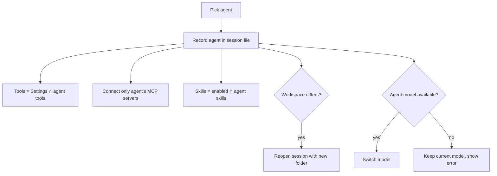

# Use case: creating and using agents

**Actors:** tech team (builds agents in **Settings › Agents**), business user (picks one in the top bar).

## Agent fields

Name, emoji icon, description, instructions (rules), tools subset, MCP servers subset, skills subset, own model, starter prompts, own workspace folder. Agents export and import as `.json` files (`ppAgentExport: 1`). See limits in `business-rules.md`.

## Build

- New, Edit, Duplicate (saved as "<name> copy"), Export, Delete (hidden for the default agent), Import.
- Each subset is either "All" (`null`) or a checklist. Tools that Settings › Tools turns off are flagged "Off in Settings › Tools".
- Import sanitizes the file, assigns a new id, makes the name unique with " (2)", " (3)" …, and clears the workspace folder. Tool, server, and skill names that do not exist yet are kept.

## Use

1. The user picks an agent in the top bar (disabled while a run is active). The empty chat screen shows the agent's icon, name, description, and starter prompt buttons.
2. The agent's instructions are added to the system prompt as `## Active agent: <icon> <name>` from the next prompt.
3. If the agent has a model and it is available, the conversation switches to it; otherwise the current model is kept and an error explains why.
4. If the agent's workspace differs, the session is reopened on the same file with the new working folder; the transcript is kept.
5. The conversation records the agent; reopening it restores that agent (unknown or deleted → default agent).

