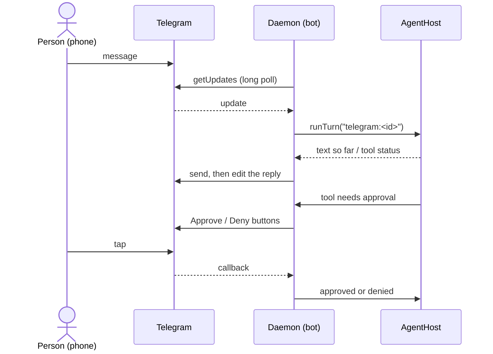

# Use case: background service and Telegram

**Goal.** The agent keeps working when the window is closed, and the person can talk to it from the Telegram app on their phone. Two independent pages: **Settings › Background** (**Run in background**, a login service for the daemon) and **Settings › Channels › Telegram** (a bot for the paired owner and explicitly allowed chat members). Nothing is exposed to the network: the daemon is reachable only through its local socket, and the bot reaches Telegram by polling outward.

Paths are under `packages/agent-core/src/` (channels in `channels/telegram/` and `channels/zalo/`, shared code in `channels/shared/`) unless noted; the daemon is `apps/daemon/src/`.

## Run in background

The daemon (`pp-agentd`, see [Process model](../architecture/process-model.md)) exists with or without this switch. Without it, the app starts the daemon and stops it when the app quits. With it, the OS starts the daemon at sign-in and restarts it where the service manager supports that, so scheduled tasks run and the bot answers with the app closed. Opening the app later just attaches to the running daemon, and quitting the app leaves it running.

| System  | What **Run in background** registers                                                                                                                                        | Restart on crash                                |
| ------- | --------------------------------------------------------------------------------------------------------------------------------------------------------------------------- | ----------------------------------------------- |
| macOS   | A LaunchAgent `~/Library/LaunchAgents/com.pptechs.agentd.plist` (`RunAtLoad`, `KeepAlive`, `Background` process type), loaded and started right away.                       | After a crash, throttled to one start per 10 s. |
| Linux   | A systemd user unit `~/.config/systemd/user/pp-agentd.service` (`WantedBy=default.target`), enabled and started right away.                                                 | After a crash, `Restart=on-failure` after 10 s. |
| Windows | A scheduled task "PP Agent Daemon" (`ONLOGON`, limited rights) that runs a hidden PowerShell launcher `pp-agentd-launch.ps1` in the data folder, and is started right away. | No.                                             |

- The service runs the same runtime and script the app uses (`<this runtime> <daemon script> run`) with `PP_AGENT_HOME`, `PP_AGENT_RESOURCES`, `PP_AGENT_WORKSPACE` and `PP_AGENT_VERSION` passed along, so it uses the same data folder. Its output goes to `<data folder>/logs/daemon.log`.
- After an app update the running daemon may still be the old version: the app notices (protocol or version differs from its own), asks it to shut down and starts the new one itself; that daemon updates the installed service's file to the new version and restart rule, and starts the service again when the app quits.
- **Linux limits.** The unit is a _user_ unit, so it needs a user session bus. Without `loginctl enable-linger <user>` it stops at logout and starts again only after the next login; Settings shows that hint when linger is off. In a container or an SSH session without a login, systemd's user manager is not reachable and Settings reports the service as unavailable. Other platforms and init systems show "This computer can't start the agent in the background."
- The switch shows `Managed by launchd / systemd / Windows Task Scheduler` and whether it is on. Turning it off stops and removes the launchd job and the systemd unit, and deletes the Windows task and its launcher (a Windows daemon that is already running keeps running until it is stopped).

Commands: `get_service_status`, `set_service_installed { installed }` (both scope `background`).

### Without the app

The same daemon can run in a terminal with no Electron at all: `node dist/daemon.mjs run`, and `install`, `uninstall`, `status` manage the service from the command line (`status` exits with 1 when the service is not installed). A headless machine usually has no OS keyring, so set `PP_AGENT_MASTER_KEY` (32 bytes as hex or base64) or accept the `vault.key` file. Settings are changed in the desktop app, which attaches to the running daemon of the same data folder. See the README for the commands.

## Telegram

### Set up

1. In Telegram, create a bot with @BotFather (`/newbot`) and copy its token.
2. In **Settings › Channels › Telegram**, paste the token, choose the **agent** and **workspace** the bot uses, switch **Answer messages on Telegram** on and **Save**. The daemon asks Telegram who the token belongs to; a refused token is reported and nothing is saved. The token goes to the vault (`channel:telegram`), never to `settings.json`.
3. Press **Pair** (available once the bot is online). The window shows an 8-character code (alphabet without 0/O/1/I/L) valid for 10 minutes; send `/pair CODE` to the bot in a private chat. The sender becomes the **owner**; their id and name are saved in `settings.json › channels.telegram`.
4. **Forget Telegram** removes the token, owner and saved poll offset, turns the bot off and stops its polling.

The state shown is `Off`, `Connecting…`, `Online` or `Problem` (with the reason: token refused, another process polling the same bot, Telegram unreachable). Unreachable Telegram is retried with back-off up to 30 s; a refused token is not retried until the token is saved again.

### Several accounts

Telegram and Zalo can each have as many accounts (bots) as the person wants, for example a personal and a work bot. **Settings › Channels › Telegram** opens a list of accounts; **Add an account** takes an optional name and a bot token, and saving opens the new account so it can be paired and configured like the first one. Every account has its **own token, owner, agent, workspace, per-chat settings, pairing code, poll offset and conversations**, and runs as its own bot, so one can be off or in error while the others answer. **Forget** removes one account (token, owner, settings, saved poll offset) and leaves the rest.

- A token that another account already uses is refused, because two pollers on one bot would fight over its updates.
- The first account is `default`; its chat keys (`telegram:<chat>`), vault id (`channel:telegram`) and offset file (`telegram-offset.json`) are the ones used before accounts existed, so nothing saved had to move. Another account has the id from its name (`work`) and uses `telegram:work:<chat>`, `channel:telegram:work` and `telegram-offset-work.json`. Zalo is the same with `zalo`. The same person's chat id on two bots is two separate conversations.
- An account with a name shows as "Telegram (Work)" in the app and to the agent. `deliver: "home"` still means the first paired owner (first account first); another account's owner is reached with `peer:telegram:work:<owner id>`, and its configured chats with `peer:telegram:work:<chat id>`. An account can deliver only to its own chats.
- Old settings (`channels.telegram` as one object) are read as the account `default`; they are written back as a list the next time settings are saved.

### Who is answered

- **Private chats** answer the paired owner by default. A private chat explicitly configured with **members** access also answers its allowed users; an absent or empty allowlist permits any user in that chat, while a nonempty list permits only those user IDs. The owner always retains access.
- **Groups and supergroups** are answered only when their exact chat ID is configured in Settings › Channels › Telegram, even when the sender is the owner. The same owner/members access and allowlist rules apply. Telegram must deliver the update to the bot; its group privacy mode may limit which messages it receives.
- Pairing works **only in private chats**. `/pair` can claim an open pairing code, replacing the previous owner; a group message never consumes the code. Before pairing, private `/start` explains how to begin.
- The code is single-use. Three wrong guesses lock out that sender alone for 15 minutes, so one stranger cannot use up the tries and lock the owner out; five wrong guesses from anyone lock pairing for 15 minutes. Pressing **Pair** in the window opens a new code and lifts both locks.
- Unconfigured groups, channel posts and other bots are ignored, except that the paired owner's `/id` still works there (see below) so they can discover the chat id to configure. Malformed restrictive allowlists normalize to owner-only access before saved settings become active, rather than becoming unrestricted members access.

### What the bot does

- **Messages.** Text, photos, documents and voice or audio. Photos reach the agent as images; documents (up to 20 MiB) are copied into the workspace's `attachments/` for the turn; voice is transcribed with the voice input provider from Settings and used as the message text. Anything else without text gets a short "not supported" reply.
- **One conversation per chat**, saved like any other (`💬 Telegram – <date>`) and listed in the window's history. Up to 5 messages queue behind a running turn; more get a "busy" reply. A chat's busy mode can instead steer an active text turn (queueing if steering is not accepted) or interrupt it; only the owner's messages steer or interrupt, everyone else's queue.
- **Replies** appear as one message that is edited while the agent writes, with a status line for tool use, and are split when they exceed Telegram's length limit.
- **Command menu.** When the bot connects it publishes `/new`, `/agent`, `/workspace`, `/model`, `/thinking`, `/stop`, `/sessions`, `/resume`, `/id` and `/help` with Telegram (`setMyCommands`), so they appear when the person types `/`. The descriptions use the app's language at that moment and are refreshed on the next connect (save, restart); a failure is only logged.
- **Commands.** Allowed chat participants can use `/new` to start a fresh conversation, `/stop` to stop the running turn and clear the queue, `/sessions` to list the chat's history, `/resume N` to switch to a listed session, `/help` and `/start`. These controls affect the shared chat conversation. Only the paired owner can use `/agent`, `/workspace`, `/model`, `/thinking` or `/effort`, with or without arguments, or tap their binding-choice buttons; member attempts are ignored. `/id` replies with the chat's id and type; only the paired owner can use it, and it works even in a group that is not yet configured in Settings, so the owner can discover the id to add there.
- **Workspace and agent per chat.** In Settings › Channels › Telegram, step 3 picks the workspace and, optionally, pins an agent; left on **The workspace's agent** it uses the agent set in that workspace, else the built-in agent. In the chat, `/workspace` and `/agent` show buttons (the current one is ticked) or take a name, a number, or a unique part of a name (`/agent finance`). An agent picked in the chat beats the pinned one, which beats the workspace's. A new agent continues the conversation and moves it to the agent's own model, as in the window; a new workspace starts a new conversation, because a conversation belongs to its workspace. The pick is kept across `/new` and restarts; a pick whose agent or workspace was deleted is ignored.
- **Model and thinking level per conversation.** `/model` lists the models that can run now (buttons, at most 30 shown; type part of a name to find another), `/thinking` (alias `/effort`) lists the levels the conversation's current model offers. Both change only this conversation, not the app's default model or the last-picked level in the window, and are refused while the chat is answering, as the window's pickers are. A new conversation (`/new`) starts again from the agent's model and the default level.
- **Questions.** When the agent needs a decision it asks with buttons, one question per message: tap an option (several, then **Done**, for multi-choice), **Other** and then type your answer in the next message, or **Skip**. Only the owner's taps and text count; no answer within 10 minutes skips the question, and `/stop` or `/new` skips it too.
- **Approvals.** Whatever would ask in the window is asked in the chat with **Approve** / **Deny** buttons; only the owner's tap counts, and no answer within 10 minutes means deny. Tools set to `off` stay off. The agent and tool policies are those of the chosen agent; the bot does not see the conversation open in the window. The card shows the start and the end of a long detail around "… N characters hidden …" (1500 characters in all), so the end of a long command stays visible.
- **Chats other people talk in.** Every chat other than the owner's own private chat (any group, and a private chat with members access) is treated as shared, even when the owner writes in it: yolo mode does not apply, and every tool asks the owner first, except planning (`todo_write`), questions and the current time, which touch nothing outside the chat. While nobody is paired, those tools are off. The agent sees only the workspace's own memory notes, never the global ones, and only this chat's session in `sessions`. Each message reaches the agent prefixed with the sender's name and user id, so it knows who is talking.

### Scheduled result delivery

There is no standalone `telegram_notify` tool. The agent uses **Scheduled tasks** (`schedule_manage`) with a one-shot or recurring schedule and `deliver: "home"` for the paired owner's private chat, or `deliver: "peer:telegram:<chat-id>"` for an explicitly configured chat. The host sends the completed result, splitting long text like a reply; a different chat key is never silently redirected to the owner. The channel must be paired and online. Failed delivery stays pending for the next startup, and each confirmed send updates the latest ledger without overwriting concurrent deliveries.

### Commands and data

- Commands: `list_telegram_accounts`, `save_telegram { config }` (`config.accountId` omitted adds an account), `start_telegram_pairing { accountId }`, `forget_telegram { accountId }` (scope `background`; the last two return the status of one account and the list left).
- `settings.json › channels.telegram` is a list of accounts, each with `id`, `label`, `enabled`, `agentId`, `workspaceId`, `ownerId`, `ownerName`, and per-ID `chats` (label, agent/workspace override, access, allowlist, busy mode). Settings › Channels › Telegram lets a person add a private/group ID even before any chat is configured; the owner's `/id` in that group gives the ID to paste in. These controls survive restart; clearing a label or allowlist replaces the old value. The token is vault entry `channel:telegram` (`channel:telegram:<account>` for other accounts). Chat → current/previous session map is `channels.json`; `/new` and workspace changes keep previous sessions available to `/sessions` and `/resume`. Missing historical files are omitted without exposing local paths. A chat session unused for 30 minutes is released from memory and reopened on the next message.
- Poll progress is saved in `telegram-offset.json` (`telegram-offset-<account>.json` for other accounts; in the app's data folder; never committed) with the bot's numeric token-prefix identity, never its token secret. Restarting or rotating the secret for the same bot preserves the offset; a different bot, a legacy offset without an identity, or an invalid offset starts from 0.
- Each downloaded document gets its own fresh folder under the OS temp folder (`pp-agent-telegram-…`, made with `mkdtemp`), removed with its contents after the turn.

## Zalo

Zalo works as a second chat channel next to Telegram, set up in **Settings › Channels › Zalo** with a bot made by the official account "Zalo Bot Manager" ([Zalo Bot docs](https://docs.zaloplatforms.com/docs/BOT)). It follows the same rules: one paired owner (a one-time `/pair <code>`, ten minutes, three tries per sender and five in all), members access per chat, the same shared-chat rules (owner approves every tool, no yolo, workspace notes only, sender prefix, only the owner steers), and the same commands (`/new`, `/stop`, `/agent`, `/workspace`, `/model`, `/thinking`, `/sessions`, `/resume`, `/id`, `/help`). Zalo has no `setMyCommands`-style menu, so these only work as typed text.

What differs, because the Zalo Bot API is smaller:

- **Polling.** The daemon long polls `getUpdates` (the bot calls `deleteWebhook` first, since Zalo refuses `getUpdates` while a webhook is set). A webhook would need a public HTTPS address, which a desktop app does not have. Zalo keeps no offset, so nothing is saved between runs, and a message id seen twice is answered once.
- **Private chats, and groups by mention or reply.** Group chats are beta on Zalo: Zalo only forwards a group message to the bot when someone @-mentions it or replies to one of its messages, so unlike Telegram a group never needs to be configured in advance. A private chat, or a group, answers the paired owner by default; one explicitly configured with **members** access in Settings › Channels › Zalo also answers its allowed users, following the same rules as Telegram (absent or empty allowlist permits any user in that chat, a nonempty list permits only those user IDs, the owner always retains access). `chat.id` (the group id for a group) is used both as the session key `zalo:<chatId>` and as the reply target.
- Pairing works **only in private chats**, exactly like Telegram: `/pair` in a group is ignored even when the group is configured with members access.
- **`/id` discovers a chat's id.** Only the paired owner can use it. Zalo gives no chat-id lookup of its own, so this is the way to find the id of a group to add in Settings › Channels › Zalo: tag or reply to the bot in the group with `/id`, and it replies with the group's `chat.id` and type.
- **One message per answer.** Zalo cannot edit a message, so the answer is sent once the agent has finished (split at 2000 characters, as plain text), with the typing indicator on while it works. There is no tool status line.
- **Replies instead of buttons.** An approval says "Reply 1 to approve or 2 to deny" and shows a long detail as its start and end around "… N characters hidden …" (1200 characters in all); a question lists numbered options and takes a number (or several, separated by commas, for multi-select), your own words as the answer, or `0` to skip. `/agent`, `/workspace`, `/model` and `/thinking` list numbered choices and take `/agent 2` or part of a name; only the owner may use them, even in a members-access chat. While a question is open the next message answers it instead of starting a turn. Unanswered questions are denied or skipped after ten minutes.
- **Incoming media.** Photos (`photo_url`) go to the agent as images and voice notes (`voice_url`) are transcribed with the voice provider chosen in Settings. Stickers and other types get a "cannot read this" reply. Files are not supported by the Zalo Bot API.
- **Data.** Commands `list_zalo_accounts`, `save_zalo { config }`, `start_zalo_pairing { accountId }`, `forget_zalo { accountId }` (scope `background`). `settings.json › channels.zalo` is a list of accounts (see Several accounts), each holding `id`, `label`, `enabled`, `agentId`, `workspaceId`, `ownerId` (a string), `ownerName`, and per-ID `chats` (label, agent/workspace override, access, allowlist, busy mode); the token is vault entry `channel:zalo` (`channel:zalo:<account>` for other accounts); chats are keyed `zalo:<id>` (`zalo:<account>:<id>` for other accounts) in `channels.json`. Scheduled results can go to `deliver: "home"` (Telegram if paired, else Zalo) or `peer:zalo:<owner id>` or `peer:zalo:<configured chat id>`.

## Privacy

- The bot token and the owner's Telegram id stay on the computer; messages travel through Telegram's servers, and what the agent sends to model providers is the same as with the window.
- Voice messages go to the transcription provider chosen in Settings, like recordings made in the window.
- `logs/daemon.log` holds lifecycle messages and errors; secrets must never be written to it.
