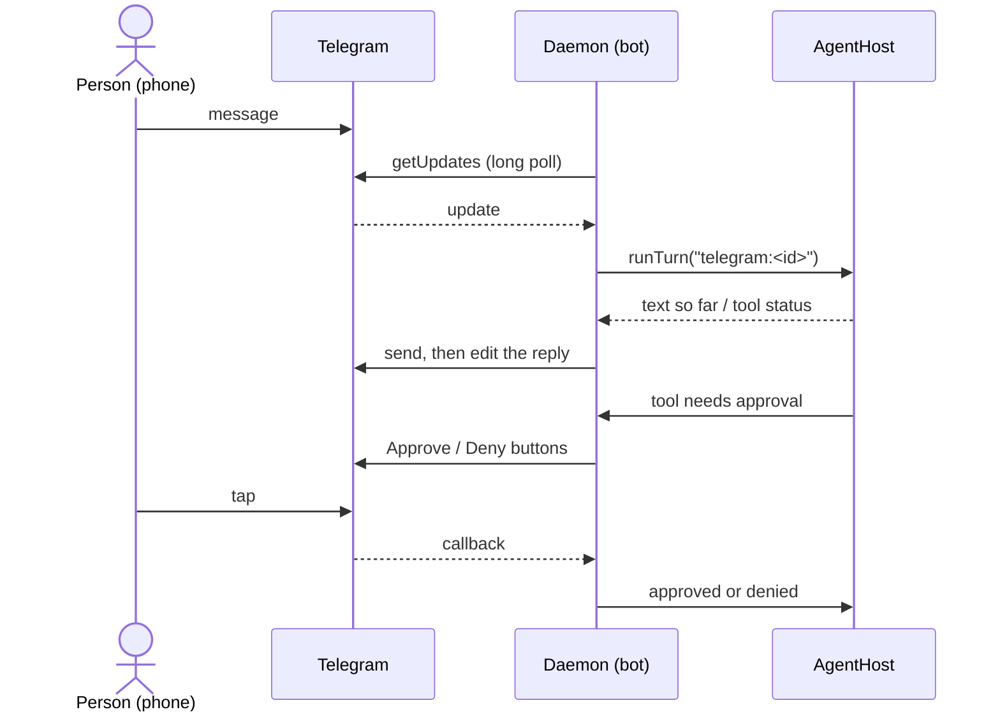

# Use case: background service and Telegram

**Goal.** The agent keeps working when the window is closed, and the person can talk to it from the Telegram app on their phone. Two independent pages: **Settings › Background** (**Run in background**, a login service for the daemon) and **Settings › Channels › Telegram** (a bot that answers one paired person). Nothing is exposed to the network: the daemon is reachable only through its local socket, and the bot reaches Telegram by polling outward.

Paths are under `packages/agent-core/src/` (channels in `channels/telegram/`) unless noted; the daemon is `apps/daemon/src/`.

## Run in background

The daemon (`pp-agentd`, see [Process model](../architecture/process-model.md)) exists with or without this switch. Without it, the app starts the daemon and stops it when the app quits. With it, the OS starts the daemon at sign-in and restarts it where the service manager supports that, so scheduled tasks run and the bot answers with the app closed. Opening the app later just attaches to the running daemon, and quitting the app leaves it running.

| System  | What **Run in background** registers                                                                                                                                        | Restart on crash                      |
| ------- | --------------------------------------------------------------------------------------------------------------------------------------------------------------------------- | ------------------------------------- |
| macOS   | A LaunchAgent `~/Library/LaunchAgents/com.pptechs.agentd.plist` (`RunAtLoad`, `KeepAlive`, `Background` process type), loaded and started right away.                       | Yes, throttled to one start per 10 s. |
| Linux   | A systemd user unit `~/.config/systemd/user/pp-agentd.service` (`WantedBy=default.target`), enabled and started right away.                                                 | Yes, `Restart=always` after 10 s.     |
| Windows | A scheduled task "PP Agent Daemon" (`ONLOGON`, limited rights) that runs a hidden PowerShell launcher `pp-agentd-launch.ps1` in the data folder, and is started right away. | No.                                   |

- The service runs the same runtime and script the app uses (`<this runtime> <daemon script> run`) with `PP_AGENT_HOME`, `PP_AGENT_RESOURCES`, `PP_AGENT_WORKSPACE` and `PP_AGENT_VERSION` passed along, so it uses the same data folder. Its output goes to `<data folder>/logs/daemon.log`.
- After an app update the running daemon may still be the old version: the app notices (protocol or version differs from its own), asks it to shut down, and the service manager or the app starts the new one.
- **Linux limits.** The unit is a _user_ unit, so it needs a user session bus. Without `loginctl enable-linger <user>` it stops at logout and starts again only after the next login; Settings shows that hint when linger is off. In a container or an SSH session without a login, systemd's user manager is not reachable and Settings reports the service as unavailable. Other platforms and init systems show "This computer can't start the agent in the background."
- The switch shows `Managed by launchd / systemd / Windows Task Scheduler` and whether it is on. Turning it off stops and removes the launchd job and the systemd unit, and deletes the Windows task and its launcher (a Windows daemon that is already running keeps running until it is stopped).

Commands: `get_service_status`, `set_service_installed { installed }` (both scope `background`).

### Without the app

The same daemon can run in a terminal with no Electron at all: `node dist/daemon.mjs run`, and `install`, `uninstall`, `status` manage the service from the command line (`status` exits with 1 when the service is not installed). A headless machine usually has no OS keyring, so set `PP_AGENT_MASTER_KEY` (32 bytes as hex or base64) or accept the `vault.key` file. Settings are changed in the desktop app, which attaches to the running daemon of the same data folder. See the README for the commands.

## Telegram

### Set up

1. In Telegram, create a bot with @BotFather (`/newbot`) and copy its token.
2. In **Settings › Channels › Telegram**, paste the token, choose the **agent** and **workspace** the bot uses, switch **Answer messages on Telegram** on and **Save**. The daemon asks Telegram who the token belongs to; a refused token is reported and nothing is saved. The token goes to the vault (`channel:telegram`), never to `settings.json`.
3. Press **Pair** (available once the bot is online). The window shows an 8-character code (alphabet without 0/O/1/I/L) valid for 10 minutes; send `/pair CODE` to the bot in a private chat. The sender becomes the **owner**; their id and name are saved in `settings.json › channels.telegram`.
4. **Forget Telegram** removes the token and the owner, turns the bot off and stops its polling.

The state shown is `Off`, `Connecting…`, `Online` or `Problem` (with the reason: token refused, another process polling the same bot, Telegram unreachable). Unreachable Telegram is retried with back-off up to 30 s; a refused token is not retried until the token is saved again.

### Who is answered

- Only **private chats** with the paired owner. Everyone else gets no answer; the one exception is `/pair`, which counts only while a pairing window is open and ends with a successful pairing. Pairing again from another account replaces the owner.
- The code is single-use. Five wrong guesses from anyone lock pairing for 15 minutes; pressing **Pair** in the window opens a new code and lifts the lock.
- Group chats, channels and other bots are ignored.

### What the bot does

- **Messages.** Text, photos, documents and voice or audio. Photos reach the agent as images; documents (up to 20 MiB) are copied into the workspace's `attachments/` for the turn; voice is transcribed with the voice input provider from Settings and used as the message text. Anything else without text gets a short "not supported" reply.
- **One conversation per chat**, saved like any other (`💬 Telegram – <date>`) and listed in the window's history. Up to 5 messages queue behind a running turn; more get a "busy" reply.
- **Replies** appear as one message that is edited while the agent writes, with a status line for tool use, and are split when they exceed Telegram's length limit.
- **Command menu.** When the bot connects it publishes `/new`, `/agent`, `/workspace`, `/model`, `/thinking`, `/stop` and `/help` with Telegram (`setMyCommands`), so they appear when the person types `/`. The descriptions use the app's language at that moment and are refreshed on the next connect (save, restart); a failure is only logged.
- **Commands.** `/new` starts a fresh conversation, `/stop` stops the running turn and clears the queue, `/help`, `/start`.
- **Workspace and agent per chat.** In Settings › Channels › Telegram, step 3 picks the workspace and, optionally, pins an agent; left on **The workspace's agent** it uses the agent set in that workspace, else the built-in agent. In the chat, `/workspace` and `/agent` show buttons (the current one is ticked) or take a name, a number, or a unique part of a name (`/agent finance`). An agent picked in the chat beats the pinned one, which beats the workspace's. A new agent continues the conversation and moves it to the agent's own model, as in the window; a new workspace starts a new conversation, because a conversation belongs to its workspace. The pick is kept across `/new` and restarts; a pick whose agent or workspace was deleted is ignored.
- **Model and thinking level per conversation.** `/model` lists the models that can run now (buttons, at most 30 shown; type part of a name to find another), `/thinking` (alias `/effort`) lists the levels the conversation's current model offers. Both change only this conversation, not the app's default model or the last-picked level in the window, and are refused while the chat is answering, as the window's pickers are. A new conversation (`/new`) starts again from the agent's model and the default level.
- **Questions.** When the agent needs a decision it asks with buttons, one question per message: tap an option (several, then **Done**, for multi-choice), **Other** and then type your answer in the next message, or **Skip**. Only the owner's taps and text count; no answer within 10 minutes skips the question, and `/stop` or `/new` skips it too.
- **Approvals.** Whatever would ask in the window is asked in the chat with **Approve** / **Deny** buttons; only the owner's tap counts, and no answer within 10 minutes means deny. Tools set to `off` stay off. The agent and tool policies are those of the chosen agent; the bot does not see the conversation open in the window.

### Scheduled result delivery

There is no standalone `telegram_notify` tool. The agent uses **Scheduled tasks** (`schedule_manage`) with a one-shot or recurring schedule and `deliver: "home"` for the paired owner's private chat, or `deliver: "peer:telegram:<chat-id>"` for an explicitly configured chat. The host sends the completed result, splitting long text like a reply; a different chat key is never silently redirected to the owner. The channel must be paired and online. Failed delivery stays pending for the next startup, and each confirmed send updates the latest ledger without overwriting concurrent deliveries.

### Commands and data

- Commands: `get_telegram_status`, `save_telegram { config }`, `start_telegram_pairing`, `forget_telegram` (scope `background`).
- `settings.json › channels.telegram`: `enabled`, `agentId`, `workspaceId`, `ownerId`, `ownerName`, and per-ID `chats` (label, agent/workspace override, access, allowlist, busy mode). Settings › Channels › Telegram lets a person add a private/group ID even before any chat is configured. These controls survive restart; clearing a label or allowlist replaces the old value. The token is vault entry `channel:telegram`. Chat → current/previous session map is `channels.json`; `/new` and workspace changes keep previous sessions available to `/sessions` and `/resume`. Missing historical files are omitted without exposing local paths. A chat session unused for 30 minutes is released from memory and reopened on the next message.
- Downloads from Telegram are temporary files under the OS temp folder (`pp-agent-telegram/`) and are deleted after the turn.

## Privacy

- The bot token and the owner's Telegram id stay on the computer; messages travel through Telegram's servers, and what the agent sends to model providers is the same as with the window.
- Voice messages go to the transcription provider chosen in Settings, like recordings made in the window.
- `logs/daemon.log` holds lifecycle messages and errors; secrets must never be written to it.
