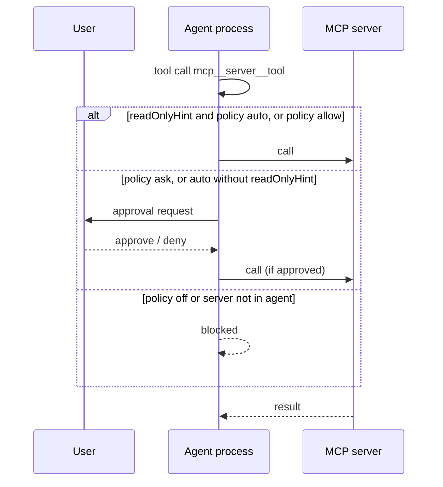

# Use case: using business systems via MCP with approvals

**Actors:** tech team (configures), business user (uses and approves).

## Configure

- **Settings › MCP servers** adds, edits, removes, enables/disables servers, shows status, reconnects, and signs in/out of OAuth servers.
- A raw JSON editor accepts configurations pasted from Claude Desktop or Cursor; the file is `<user-data>/agent/mcp.json` (`mcpServers` format). Keys the app does not edit (`oauth`, `toolExposure`, …) are preserved on save (`apps/desktop/src/agent/mcp.ts`).
- `exposure: "direct"` declares tools to the model; the default `codemode` lets the model call them from a sandboxed script, suited to large servers.
- HTTP servers without an `Authorization` header can sign in with OAuth from Settings.

## Use

1. A conversation connects only the MCP servers its agent uses; they connect when the chat starts and reconnect when their settings change.
2. When the agent calls an MCP tool, the approval gate decides: tools the server marks `readOnlyHint` have tier `read` and run freely under `auto`; all others have tier `write` and ask.
3. The user approves or denies in the chat. Stopping a run denies pending approvals first.

Discovery tools (`codemode`, `tool_search`, MCP resource tools) are always allowed; each tool call they make passes the gate on its own (`apps/desktop/src/agent/tools.ts`).
