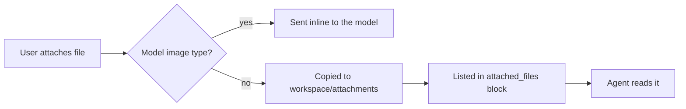

# Use case: chat with documents and attachments

**Actor:** business user. **Goal:** ask questions about files without opening them in other tools.

## Flow

1. The user attaches files from the **+** menu, by dropping them on the chat, or by pasting images.
2. Images of type PNG, JPEG, GIF, or WebP are resized and sent to the model inline (`packages/agent-core/src/attachments.ts`).
3. Any other file is copied into `<workspace>/attachments/` as `<timestamp>-<original name>`, so two uploads of the same name never collide, and listed in an `<attached_files>` block appended to the message.
4. The agent opens the copy with `read` (plain text) or `read_document`.

## read_document

`packages/agent-core/src/documents.ts` converts PDF, DOCX, XLSX, PPTX, ODF, RTF, EPUB, HTML, and CSV to Markdown with officeparser. Relative paths resolve against the workspace. Long output is truncated; for PDFs the agent can request later pages with `pages` (for example `5-10`). Unsupported extensions return an error telling the agent to use `read`.

`read_document` has tool tier `read`, so it runs without asking under the `auto` policy.

## Workspace instructions

An `AGENTS.md` in the conversation's workspace folder, and in the folders above it, is added to the system prompt (`README.md`). It is the workspace's rules: edit it in Settings › Workspaces or with any editor. See `business-rules.md`.
