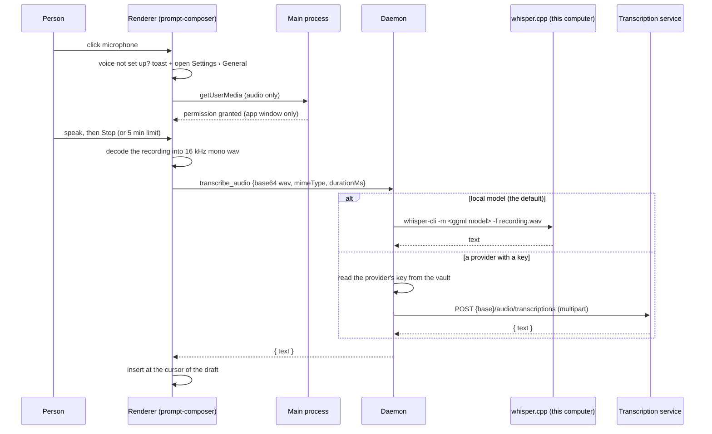

# Use case: voice input

**Goal.** A person speaks instead of typing. The microphone button in the message box records, turns the recording into text, and puts the text in the draft. Nothing is sent until the person presses Send.

Paths are under `apps/desktop/src/` unless noted; the renderer is `apps/web/src/`.

## Flow

1. **Set up.** The default needs no account: Settings › General › Voice input offers **This computer (whisper.cpp)** with a whisper model to download (tiny 74 MB, base 141 MB, small 465 MB, medium 1.4 GB) into the app's `models/` folder. whisper.cpp's `whisper-cli` must be installed — bundled with the app when the build ships one, else on the PATH (`brew install whisper-cpp`). A provider or gateway from Models with a key can be chosen instead; for it the transcription model (default `whisper-1`) and the spoken language (the app's language, automatic detection, or a code such as `vi`) apply. The setting is `ready` while the chosen way to transcribe can work right now: the local model needs its executable and its model file, a provider needs its key.
2. **Not set up.** Clicking the microphone shows a short explanation and opens Settings › General instead of failing. What the local setup is missing (whisper.cpp not installed, model not downloaded) is shown there.
3. **Record.** The button turns into a timer (`m:ss / 5:00`) with Cancel (discard) and Stop. Recording uses `MediaRecorder` at 64 kbps (webm/opus, falling back to ogg or mp4). It stops by itself after **5 minutes** and is then transcribed. Recordings shorter than 0.4 s are dropped.
4. **Convert.** The renderer decodes the recording and writes it as 16 kHz mono wav (`toWavBlob` in `apps/web/src/lib/voice-input.ts`). whisper.cpp reads wav directly and services accept it, so nothing downstream has to understand the recorder's own format.
5. **Transcribe.** While the text is being written out the button shows a spinner and a Cancel button (the answer is then ignored). The local model runs `whisper-cli` on a temporary file that is deleted afterwards; a provider is called as before. Send is disabled while recording or transcribing, so the text cannot land in the wrong message.
6. **Insert.** The text replaces the selection or goes at the cursor of the draft, with a space where it would touch a word; the cursor ends after it. Text that is empty or "no speech recognized" shows an error instead.

## Limits

| Limit      | Value                                                                                       | Where                                                               |
| ---------- | ------------------------------------------------------------------------------------------- | ------------------------------------------------------------------- |
| Duration   | 5 minutes (a few seconds of slack on the agent side)                                        | `VOICE_LIMITS.maxDurationMs`; recorder timer and `transcription.ts` |
| Size       | 20 MB of audio (services refuse about 25 MB)                                                | `VOICE_LIMITS.maxBytes`; checked in the renderer and the agent      |
| Formats    | wav, mp3 and flac reach whisper directly; webm, ogg and mp4/m4a go through ffmpeg first     | `voice-local.ts`                                                    |
| Model name | a service's model (at most 100 characters), or locally a preset or ggml path (at most 1024) | `VOICE_LIMITS`; `transcription.ts`                                  |

## Local model (whisper.cpp)

- The recording never leaves the computer. `whisper-cli` runs with a scrubbed environment (no credentials, proxies or API keys) and a two-minute limit; the transcript is all that is kept.
- Models download from whisper.cpp's own repository into `models/ggml-<preset>.bin` next to `settings.json`. Settings shows the size before downloading, and a partial download is removed. `VoiceSettings.model` holds a preset name (`tiny`, `base`, `small`, `medium`), or — by editing `settings.json` — the path of any ggml file.
- whisper.cpp is expected on the PATH, or bundled under `resources/whisper/<platform>-<arch>/` like OfficeCLI. Recordings whisper cannot read by itself (the formats `MediaRecorder` produces, Telegram voice notes) are converted to wav with ffmpeg when it is installed; without ffmpeg those recordings name what is missing instead of failing quietly.

## Provider and key handling

- `settings.json` holds only `voice: { providerId, model, language }` (default: the local model `base`, language `app`). `providerId: "local"` selects whisper.cpp; any other id is a provider or gateway from Models.
- The key stays in the vault. The renderer sends the audio to the daemon over the existing `transcribe_audio` command; with a provider the daemon reads the key from its vault, calls the service and returns only the text. The key never reaches the renderer, and the audio is not written to disk (the local run's temporary file is deleted afterwards). Voice messages sent to the Telegram bot use the same setting (see [Background and Telegram](use-case-background-and-telegram.md)).
- The service address is the provider's own base address plus `/audio/transcriptions`. Failures are translated: key rejected, service without speech-to-text (404), usage limit (429), unreachable, too large, nothing heard. Local failures name what is missing (whisper.cpp, the model, ffmpeg) or what the run itself said.
- With a provider the recording leaves the computer for the service the person chose; the Settings text says so. With the local model nothing is sent anywhere.

## Microphone permission

- Main (`main/permissions.ts`) sets a permission handler on the default session: the app window may use the **audio** `media` permission (never video) and write plain text to the clipboard; every other permission and every other page is refused.
- macOS: `NSMicrophoneUsageDescription` (`mac.extendInfo` in `electron-builder.yml`) and the `com.apple.security.device.audio-input` entitlement (`build/entitlements.mac.plist`) are needed in signed (hardened runtime) builds. The system asks the first time; if the person said no, the button shows how to allow it in system settings.
- The renderer's Content-Security-Policy needs no change: `getUserMedia` and `MediaRecorder` are not governed by CSP, recordings never become `<audio>` elements, and the audio travels over the preload bridge, not the network (`connect-src 'self'` stays).
