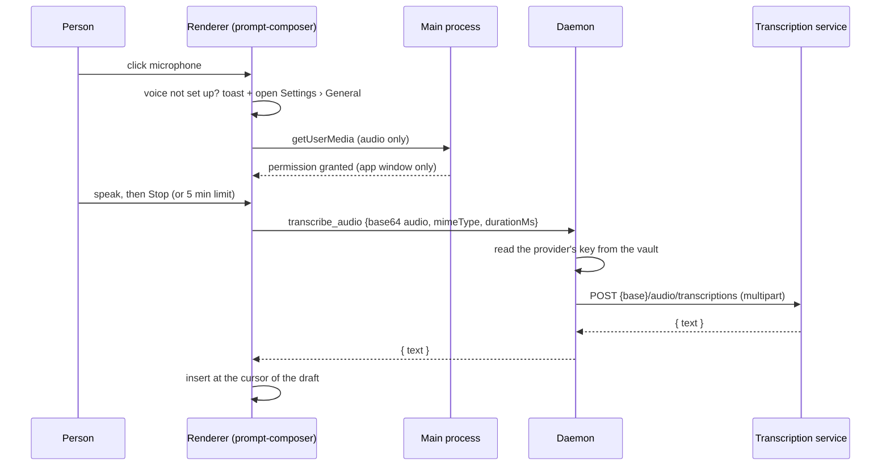

# Use case: voice input

**Goal.** A person speaks instead of typing. The microphone button in the message box records, turns the recording into text, and puts the text in the draft. Nothing is sent until the person presses Send.

Paths are under `apps/desktop/src/` unless noted; the renderer is `apps/web/src/`.

## Flow

1. **Set up** in Settings › General › Voice input: pick a provider or gateway that already has a key in Models, the transcription model (default `whisper-1`) and the spoken language (the app's language, automatic detection, or a code such as `vi`). Only providers with a key and an OpenAI-style address are offered; the setting is `ready` while the chosen provider still has its key.
2. **Not set up.** Clicking the microphone shows a short explanation and opens Settings › General instead of failing.
3. **Record.** The button turns into a timer (`m:ss / 5:00`) with Cancel (discard) and Stop. Recording uses `MediaRecorder` at 64 kbps (webm/opus, falling back to ogg or mp4). It stops by itself after **5 minutes** and is then transcribed. Recordings shorter than 0.4 s are dropped.
4. **Transcribe.** While the text is being written out the button shows a spinner and a Cancel button (the answer is then ignored). Send is disabled while recording or transcribing, so the text cannot land in the wrong message.
5. **Insert.** The text replaces the selection or goes at the cursor of the draft, with a space where it would touch a word; the cursor ends after it. Text that is empty or "no speech recognized" shows an error instead.

## Limits

| Limit      | Value                                                | Where                                                               |
| ---------- | ---------------------------------------------------- | ------------------------------------------------------------------- |
| Duration   | 5 minutes (a few seconds of slack on the agent side) | `VOICE_LIMITS.maxDurationMs`; recorder timer and `transcription.ts` |
| Size       | 20 MB of audio (services refuse about 25 MB)         | `VOICE_LIMITS.maxBytes`; checked in the renderer and the agent      |
| Formats    | webm, ogg, mp4/m4a, mp3, wav                         | `transcription.ts`                                                  |
| Model name | at most 100 characters                               | `VOICE_LIMITS.maxModelLength`                                       |

## Provider and key handling

- `settings.json` holds only `voice: { providerId, model, language }` (default: no provider, `whisper-1`, language `app`).
- The key stays in the vault. The renderer sends the audio to the daemon over the existing `transcribe_audio` command; the daemon reads the key from its vault, calls the service and returns only the text. The key never reaches the renderer, and the audio is not written to disk. Voice messages sent to the Telegram bot use the same provider and settings (see [Background and Telegram](use-case-background-and-telegram.md)).
- The service address is the provider's own base address plus `/audio/transcriptions`. Failures are translated: key rejected, service without speech-to-text (404), usage limit (429), unreachable, too large, nothing heard.
- The recording leaves the computer for the service the person chose; the Settings text says so.

## Microphone permission

- Main (`main/permissions.ts`) sets a permission handler on the default session: the app window may use the **audio** `media` permission (never video) and write plain text to the clipboard; every other permission and every other page is refused.
- macOS: `NSMicrophoneUsageDescription` (`mac.extendInfo` in `electron-builder.yml`) and the `com.apple.security.device.audio-input` entitlement (`build/entitlements.mac.plist`) are needed in signed (hardened runtime) builds. The system asks the first time; if the person said no, the button shows how to allow it in system settings.
- The renderer's Content-Security-Policy needs no change: `getUserMedia` and `MediaRecorder` are not governed by CSP, recordings never become `<audio>` elements, and the audio travels over the preload bridge, not the network (`connect-src 'self'` stays).
